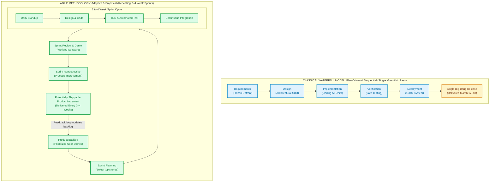

# Agile vs Waterfall: Visual Comparison & Architectural Contrast

This document contains publication-grade Mermaid diagrams contrasting the **Classical Waterfall Model** (Predictive / Plan-Driven) with **Agile Methodologies** (Adaptive / Empirical).

---

## 1. Process Lifecycle Comparison: Linear vs Cyclic Sprints

---

## 2. Working Software Availability Timeline

```mermaid
gantt
    title Working Software Delivery: Waterfall vs Agile
    dateFormat  X
    axisFormat Month %m

    section Waterfall (Monolithic)
    Requirements Analysis & Frozen Spec :w1, 0, 3
    System & Detailed Architecture      :w2, 3, 6
    Full System Coding & Construction   :w3, 6, 10
    Integrated System Testing & UAT     :w4, 10, 12
    First Working Software to Customer  :milestone, m_wf, 12, 12

    section Agile (Incremental Sprints)
    Sprint 1 (Basic MVP Features)       :done, s1, 0, 1
    Increment 1 in Customer Hands       :milestone, ms1, 1, 1
    Sprint 2 (Secondary Enhancements)   :done, s2, 1, 2
    Increment 2 in Customer Hands       :milestone, ms2, 2, 2
    Sprint 3 (Integrations & Reporting) :active, s3, 2, 3
    Increment 3 in Customer Hands       :milestone, ms3, 3, 3
    Sprint 4 (Advanced Features)        :crit, s4, 3, 4
    Increment 4 in Customer Hands       :milestone, ms4, 4, 4
```

### Explanation of Diagram:
- In **Waterfall**, customer visibility is zero for 10–12 months. Any mismatch between original requirements and real business needs is discovered only at the very end.
- In **Agile**, the customer receives a working, tested slice of software at the end of **Month 1**, continuing to receive validated software increments every month.
