# Incremental Process Model: Visual Architecture & Staged Delivery Flow

This document contains standardized, publication-grade Mermaid diagrams representing the **Incremental Process Model**, showing the progression from the Core Product through successive operational increments to the final software system.

---

## 1. Complete Incremental Model Architecture

The Incremental Model applies linear sequential phases (Communication, Planning, Modeling, Construction, and Deployment) in a staggered, staged progression.

```mermaid
flowchart TD
    classDef core fill:#e0f2fe,stroke:#0284c7,stroke-width:2px,color:#0369a1;
    classDef inc2 fill:#fef3c7,stroke:#d97706,stroke-width:2px,color:#78350f;
    classDef inc3 fill:#dcfce7,stroke:#16a34a,stroke-width:2px,color:#15803d;
    classDef deliverable fill:#ede9fe,stroke:#7c3aed,stroke-width:2px,color:#5b21b6;
    classDef feedback fill:#fee2e2,stroke:#dc2626,stroke-width:1.5px,stroke-dasharray: 4 4,color:#7f1d1d;

    Start([Project Initiation]) --> GlobalReq["Global Requirements Analysis & Architectural Baseline"]

    %% Increment 1
    subgraph Inc1["INCREMENT 1: Core Product (Basic Functional Capabilities)"]
        C1["Communication & Planning"] --> M1["Modeling (Analysis & Design)"]
        M1 --> B1["Construction (Coding & Testing)"]
        B1 --> D1["Deployment of Increment 1"]
    end

    %% Increment 2
    subgraph Inc2["INCREMENT 2: Supplemental Features & Enhancements"]
        C2["Communication & Planning"] --> M2["Modeling (Analysis & Design)"]
        M2 --> B2["Construction (Coding & Testing)"]
        B2 --> D2["Deployment of Increment 2"]
    end

    %% Increment 3
    subgraph Inc3["INCREMENT 3: Advanced Capabilities & Final Polish"]
        C3["Communication & Planning"] --> M3["Modeling (Analysis & Design)"]
        M3 --> B3["Construction (Coding & Testing)"]
        B3 --> D3["Deployment of Final System"]
    end

    GlobalReq --> Inc1
    D1 --> P1["CORE PRODUCT RELEASE<br/>• Operational software in user hands<br/>• Primary business workflows functional"]
    
    P1 --> F1["Customer Usage & Feedback Evaluation"]
    F1 -.->|"Customer feedback informs scope"| C2
    P1 --> Inc2

    D2 --> P2["SECOND OPERATIONAL RELEASE<br/>• Core Product + Supplemental Features<br/>• Verified backward compatibility"]

    P2 --> F2["Customer Usage & Feedback Evaluation"]
    F2 -.->|"Customer feedback informs scope"| C3
    P2 --> Inc3

    D3 --> FinalRelease["FINAL OPERATIONAL PRODUCT<br/>• Complete software package delivered<br/>• Fully integrated & tested system"]

    class C1,M1,B1,D1 core;
    class C2,M2,B2,D2 inc2;
    class C3,M3,B3,D3 inc3;
    class P1,P2,FinalRelease deliverable;
    class F1,F2 feedback;
```

### Explanation of Diagram Components:
1. **Global Requirements & Architecture:** The team establishes high-level functional scope and design architecture to ensure that future increments will integrate smoothly.
2. **Increment 1 (Core Product):** Focuses exclusively on fundamental, high-priority capabilities. It delivers the essential system backbone that solves the customer's immediate operational need.
3. **Customer Usage & Feedback Loop:** As soon as Increment 1 is deployed, real users operate it in production. Their practical experience uncovers usability improvements, bugs, and clarified priorities, which directly inform the planning of Increment 2.
4. **Increment 2 & Subsequent Increments:** Each subsequent release adds new functional layers (reporting, integrations, advanced analytics) while performing regression testing on previously delivered code.
5. **Final Operational Product:** The culmination of all increments into a cohesive, fully verified software system.

---

## 2. Staged Delivery Timeline vs Waterfall Monolithic Delivery

```mermaid
gantt
    title Incremental Staged Delivery vs Classical Waterfall Delivery
    dateFormat  X
    axisFormat Day %d

    section Classical Waterfall
    Requirements & Design   :active, w1, 0, 30
    Coding & Unit Testing    :active, w2, 30, 60
    System Integration & Testing :active, w3, 60, 90
    Single Monolithic Delivery  :crit, w4, 90, 95

    section Incremental Model
    Increment 1 (Core Product)    :done, inc1, 0, 30
    Deliverable 1 in Production   :milestone, m1, 30, 30
    Increment 2 (Enhancements)    :active, inc2, 30, 60
    Deliverable 2 in Production   :milestone, m2, 60, 60
    Increment 3 (Final System)    :crit, inc3, 60, 90
    Final System in Production    :milestone, m3, 90, 90
```

### Explanation of Timeline:
- Under **Classical Waterfall**, the customer receives $0\%$ operational software for the first 90 days. Value is realized only at the very end.
- Under the **Incremental Model**, the customer receives the **Core Product on Day 30**, gaining business utility, user training, and competitive market advantage while subsequent features are developed.
