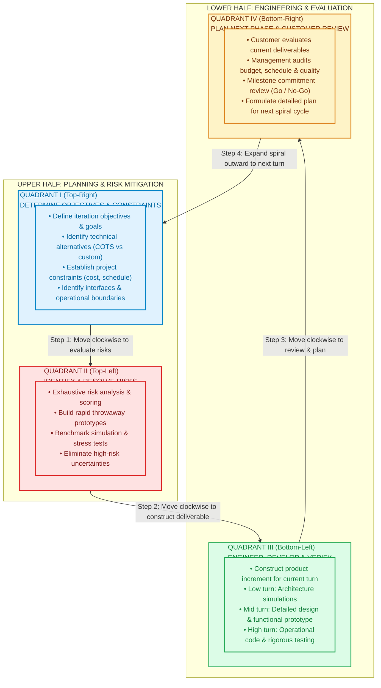
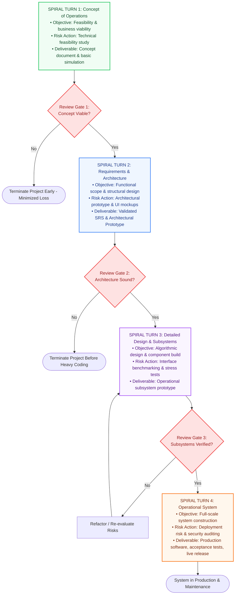

# Spiral Model: Visual Architecture & Barry Boehm's 4 Quadrants

This document contains publication-grade Mermaid diagrams representing **Barry Boehm's Spiral Model (1988)**, showing the four quadrants, the radial and angular dimensions, and the progressive spiral turns.

---

## 1. Boehm's Four-Quadrant Spiral Architecture

The Spiral Model divides software engineering activities into four distinct quadrants traversed in a clockwise direction. Each loop of the spiral represents an evolutionary phase:

---

## 2. Progressive Spiral Turns: From Concept to Operational Software

Each cycle around the four quadrants expands radially outward, representing increasing cumulative cost and progress toward a complete system:

### Explanation of Spiral Dimensions:
- **Radial Dimension ($r$):** The distance from the center origin represents **cumulative project cost and effort**. As the spiral moves outward, more capital and engineering resources are expended.
- **Angular Dimension ($\theta$):** The angular position represents **progress completed within the current iteration cycle**. Each $360^\circ$ rotation represents the completion of one entire development turn across all four quadrants.
- **Why It Is "Risk-Driven":** If an unresolvable technical or financial risk is uncovered in Quadrant II of Turn 1 or 2, the project is terminated immediately at a fraction of the total budget, preventing catastrophic multi-million dollar failures.
