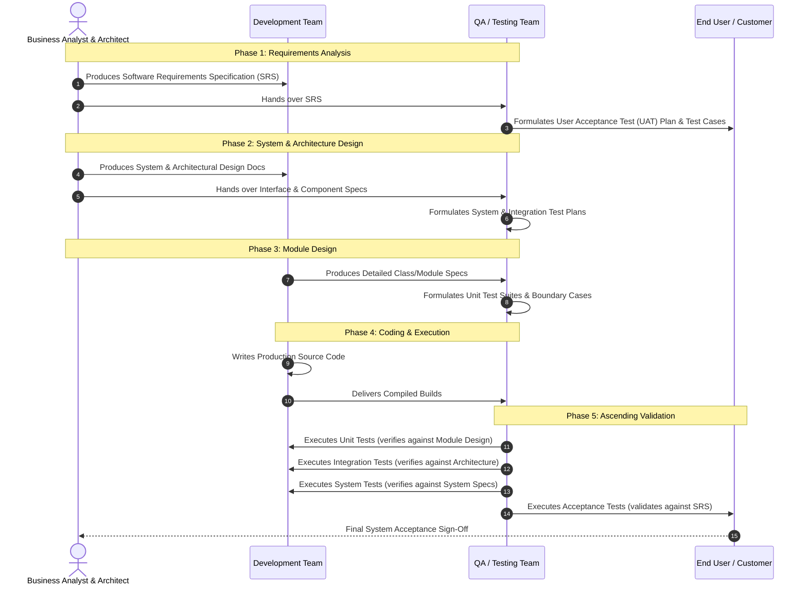

# V-Model: Visual Architecture & Verification-Validation Mapping

This document contains standardized, publication-grade Mermaid diagrams representing the **V-Model (Verification and Validation Model)**, highlighting phase-to-phase test planning correspondence and defect prevention principles.

---

## 1. The Classical V-Model (V-Shaped Architecture)

The V-Model visualizes software development as a symmetric V-shape. The descending left wing represents **Verification** (specification and design decomposition), the apex at the bottom represents **Coding**, and the ascending right wing represents **Validation** (dynamic testing and integration).

```mermaid
flowchart TD
    classDef leftWing fill:#e0f2fe,stroke:#0284c7,stroke-width:2px,color:#0369a1;
    classDef apex fill:#fef3c7,stroke:#d97706,stroke-width:3px,color:#78350f;
    classDef rightWing fill:#dcfce7,stroke:#16a34a,stroke-width:2px,color:#15803d;
    classDef linkStyle stroke:#dc2626,stroke-width:2px,stroke-dasharray: 5 5;

    subgraph Verification["LEFT WING: VERIFICATION (Specification & Design)"]
        V1["Requirements Analysis<br/>• User needs & business scope<br/>• Functional & non-functional SRS"]
        V2["System Design<br/>• System hardware/software specs<br/>• Data structures & communication"]
        V3["Architecture Design<br/>• High-level component decomposition<br/>• Subsystem interfaces & protocols"]
        V4["Module Design (Detailed)<br/>• Low-level algorithmic logic<br/>• Data tables & method signatures"]
    end

    subgraph Implementation["BOTTOM VERTEX: EXECUTION"]
        CODE["CODING & IMPLEMENTATION<br/>• Translating module design into source code<br/>• Compiling and static analysis"]
    end

    subgraph Validation["RIGHT WING: VALIDATION (Dynamic Testing & Execution)"]
        T4["Unit Testing<br/>• Verifies internal module algorithms<br/>• White-box & boundary tests"]
        T3["Integration Testing<br/>• Verifies inter-module communication<br/>• Subsystem interface tests"]
        T2["System Testing<br/>• Tests complete integrated system<br/>• Validates non-functional performance"]
        T1["Acceptance Testing<br/>• Validates business requirements<br/>• User Acceptance Testing (UAT)"]
    end

    %% Left descending flow
    V1 --> V2
    V2 --> V3
    V3 --> V4
    V4 --> CODE

    %% Right ascending flow
    CODE --> T4
    T4 --> T3
    T3 --> T2
    T2 --> T1

    %% Horizontal Verification & Validation Mapping (Early Test Design)
    V1 <-.->|"Defines Acceptance Test Plan"| T1
    V2 <-.->|"Defines System Test Plan"| T2
    V3 <-.->|"Defines Integration Test Plan"| T3
    V4 <-.->|"Defines Unit Test Plan"| T4

    class V1,V2,V3,V4 leftWing;
    class CODE apex;
    class T1,T2,T3,T4 rightWing;
```

### Explanation of Diagram Components:
1. **Left Wing (Verification):** Focuses on system decomposition and specification. At each level of design abstraction, specifications are created and static reviews/inspections are performed. Crucially, **the test plans for the corresponding right-wing validation phase are authored during these left-wing design phases**.
2. **Bottom Vertex (Coding):** The transition point. Low-level module designs are translated into executable source code using target programming languages and compiler toolchains.
3. **Right Wing (Validation):** Focuses on system integration and dynamic execution. Starting from small units up to the full operational system, software components are tested against the test plans authored during the corresponding design phases.
4. **Horizontal Dashed Relationships:** Illustrate the **Defect Prevention Principle**. Writing test cases while specifying requirements and designs identifies ambiguities, omissions, and contradictions before code is written.

---

## 2. Early Test Planning Workflow (The Defect Prevention Engine)

This sequence diagram illustrates how test artifacts are created concurrently with design documents rather than deferred to the end of the project:



### Explanation of Early Test Planning:
- In traditional models, testers wait idle until coding is complete.
- In the V-Model, test engineers work in parallel with design teams from Day 1. While architects design subsystems, test engineers formulate integration and acceptance test cases.
- If a test engineer cannot write an acceptance test because a requirement is vague, the requirement is immediately flagged and corrected during the design phase.
