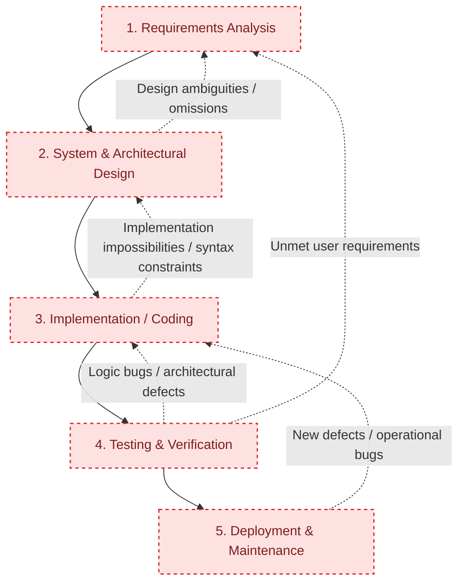

# Waterfall Model: Visual Architecture & Process Flow

This document contains publication-grade Mermaid diagrams representing the **Classical Waterfall Model** (Linear Sequential Model) and the **Waterfall Model with Feedback Loops** (Modified Waterfall).

---

## 1. Classical Waterfall Model (Linear Sequential Lifecycle)

Winston Royce (1970) originally described this model where each phase flows cascade-style into the next. Each phase must complete its formal deliverables before the next phase begins.

```mermaid
flowchart TD
    classDef phase fill:#e0f2fe,stroke:#0284c7,stroke-width:2px,color:#0369a1;
    classDef gate fill:#fef3c7,stroke:#d97706,stroke-width:1.5px,color:#78350f;
    classDef deliverable fill:#dcfce7,stroke:#16a34a,stroke-width:2px,color:#15803d;

    Start([Project Initiation]) --> P1["1. Communication & Requirements Gathering<br/>• Stakeholder interviews & feasibility studies<br/>• System domain analysis"]
    
    P1 --> G1{"Requirements Review & Sign-Off"}
    G1 -->|Approved| D1["Deliverable: Software Requirements Specification (SRS)"]
    D1 --> P2["2. System & Software Design<br/>• High-level architectural style<br/>• Database schema & module interfaces"]

    P2 --> G2{"Design Review & Sign-Off"}
    G2 -->|Approved| D2["Deliverable: Software Design Document (SDD)"]
    D2 --> P3["3. Implementation / Coding<br/>• Translating design into source code<br/>• Unit testing of individual modules"]

    P3 --> G3{"Code Review & Unit Test Pass"}
    G3 -->|Approved| D3["Deliverable: Compiled Source Code & Unit Test Logs"]
    D3 --> P4["4. Integration & System Testing<br/>• Assembling components into complete system<br/>• Functional, stress, security & acceptance tests"]

    P4 --> G4{"System Test & Acceptance Pass"}
    G4 -->|Approved| D4["Deliverable: Validated System & Test Report"]
    D4 --> P5["5. Deployment & Maintenance<br/>• Installation at client site<br/>• Corrective, adaptive & perfective maintenance"]

    P5 --> End([Operational Life / Retirement])

    class P1,P2,P3,P4,P5 phase;
    class G1,G2,G3,G4 gate;
    class D1,D2,D3,D4 deliverable;
```

---

## 2. Modified Waterfall Model with Iterative Feedback Loops

In real-world engineering practice, defects uncovered during a later phase necessitate feedback loops to the immediate predecessor phase:

### Explanation of Diagram Components:
1. **Requirements Phase:** Analyzes user needs to produce the Software Requirements Specification (SRS).
2. **Design Phase:** Translates the SRS into data structures, software architecture, and interface representations.
3. **Coding Phase:** Converts architectural designs into machine-executable source code.
4. **Testing Phase:** Validates that the software functions according to the SRS and detects anomalies.
5. **Deployment & Maintenance Phase:** Deploys software into user operations and provides patches and enhancements.
6. **Feedback Paths:** Highlight that when errors are found in testing or coding, rework cascades backward, causing heavy financial and schedule disruptions.
