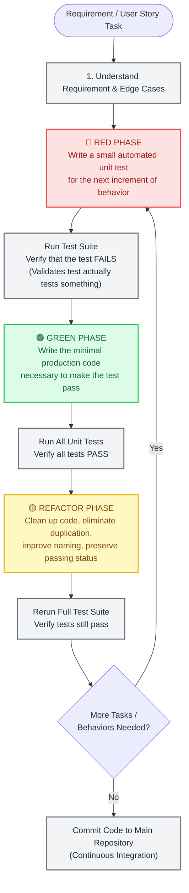
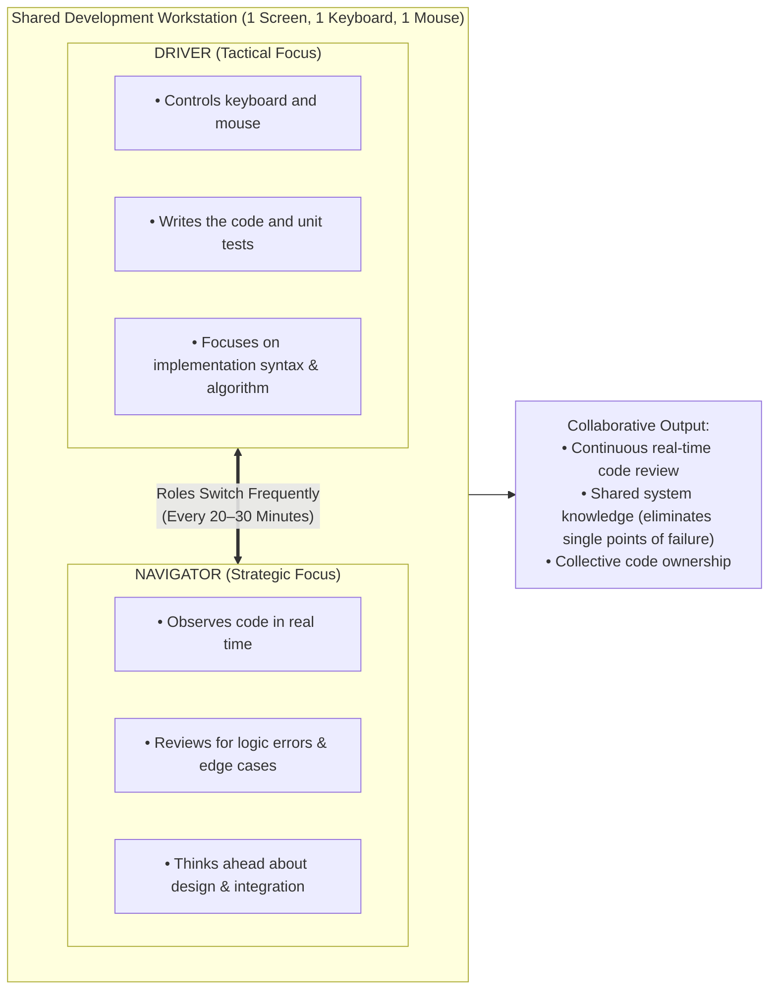
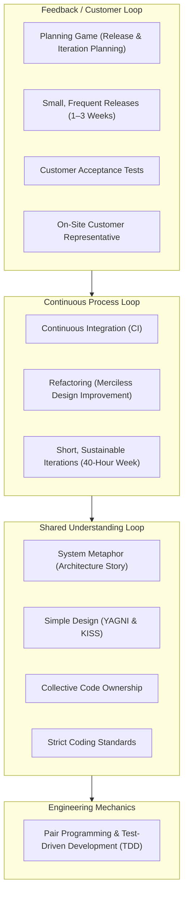

# Extreme Programming (XP): Visual Architecture & Diagrams

This document contains standardized, publication-grade Mermaid diagrams representing the Extreme Programming (XP) methodology, its official lifecycle, core development loops, and engineering practices.

---

## 1. The Complete 6-Phase XP Lifecycle

The official Extreme Programming lifecycle formulated by Kent Beck consists of six sequential and iterative phases: **Exploration**, **Planning**, **Iterations to Release**, **Productionizing**, **Maintenance**, and **Death**.

```mermaid
flowchart TD
    classDef phase fill:#e8f4fd,stroke:#1b6ec2,stroke-width:2px,color:#0b3c61;
    classDef loop fill:#fef3d6,stroke:#d97706,stroke-width:2px,color:#78350f;
    classDef decision fill:#fee2e2,stroke:#dc2626,stroke-width:2px,color:#7f1d1d;
    classDef finish fill:#f3f4f6,stroke:#4b5563,stroke-width:2px,color:#1f2937;

    Start([Project Inception]) --> Phase1["1. Exploration Phase<br/>• Customer writes User Stories on index cards<br/>• Developers explore architectural feasibility<br/>• Build Spike Solutions for risky technology"]
    
    Phase1 --> Phase2["2. Planning Phase<br/>• Customer prioritizes User Stories by business value<br/>• Developers estimate effort in story points / ideal days<br/>• Agree on initial Release Plan & velocity"]
    
    Phase2 --> Phase3["3. Iterations to Release Phase<br/>• 1 to 3 week fixed-duration iterations<br/>• Decompose user stories into engineering tasks<br/>• Test-Driven Development (TDD)<br/>• Pair Programming (Driver & Navigator)<br/>• Continuous Integration & daily testing"]
    
    Phase3 --> LoopCheck{"Iteration Goals<br/>Achieved & Ready<br/>for Release?"}
    LoopCheck -- "No (More Stories / Bugs)" --> Phase3
    LoopCheck -- "Yes (Target Set Complete)" --> Phase4["4. Productionizing Phase<br/>• End-to-end integration & performance testing<br/>• Security audits & operational readiness<br/>• Customer final acceptance sign-off<br/>• Production deployment"]
    
    Phase4 --> Phase5["5. Maintenance Phase<br/>• Post-release operational support<br/>• Incorporate customer change requests & new stories<br/>• Continuous refactoring to sustain code quality"]
    
    Phase5 --> NextRelease{"New Major<br/>Feature Set<br/>Required?"}
    NextRelease -- "Yes" --> Phase2
    NextRelease -- "No / Product Obsolete" --> Phase6["6. Death Phase<br/>• Customer requirements fully satisfied<br/>• System reaches end of economic life<br/>• Post-mortem documentation & code archiving"]
    
    Phase6 --> Done([Project Retired])

    class Phase1,Phase2,Phase4,Phase5 phase;
    class Phase3 loop;
    class LoopCheck,NextRelease decision;
    class Phase6 finish;
```

### Explanation of Diagram Components:
1. **Exploration Phase:** The team evaluates tools, technology stacks, and initial architectural ideas. Customers draft user stories representing system capabilities on index cards. Developers build rapid experimental prototypes called **Spike Solutions** to evaluate unfamiliar tools or risky technical features.
2. **Planning Phase:** Developers and customers collaborate in the "Planning Game". Customers prioritize stories by business value, while developers assign effort estimates. Together, they establish project velocity and define which stories fit into the first release.
3. **Iterations to Release Phase:** The core development heartbeat. The system is built across 1- to 3-week time-boxed iterations. Each iteration breaks user stories into granular programming tasks, implements them using Pair Programming and Test-Driven Development, and integrates them continuously into the baseline.
4. **Productionizing Phase:** Pre-release verification phase. The system undergoes operational readiness reviews, performance/stress benchmarking, security hardening, user documentation finalization, and customer sign-off before deploying to live production.
5. **Maintenance Phase:** The system is operational in production. New iterations incorporate incoming user feedback and feature requests while keeping existing automated test suites green and refactoring code to prevent architectural decay.
6. **Death Phase:** Occurs when the system has fulfilled all business objectives and requires no further development, or when continuing maintenance is no longer economically justifiable. Comprehensive post-mortem documentation is created, and the software is archived.

---

## 2. Test-Driven Development (TDD): The Red-Green-Refactor Cycle

The technical foundation of XP engineering is Test-Driven Development, operating in a rapid micro-cycle.

### Explanation of TDD Components:
- **Red Phase:** Developers write a focused automated unit test *before* implementing any business logic. The test must fail immediately because the feature does not yet exist. This confirms the test is valid and not passing trivially.
- **Green Phase:** Developers write only enough production code to satisfy the failing test. Aesthetic design, optimization, and perfection are deferred at this point—the single goal is to get tests passing quickly.
- **Refactor Phase:** With passing tests acting as an automated safety net, developers restructure the code to eliminate duplication, improve variable and function names, extract helper classes, and simplify logic without altering external functionality.

---

## 3. Pair Programming: Driver and Navigator Roles

### Explanation of Pair Programming Components:
- **Driver:** The programmer who actively types the code, manages the syntax, and handles tactical details of the immediate task.
- **Navigator:** The partner who continuously inspects the code as it is typed, verifies logic, considers corner cases, checks compliance with coding standards, and plans the next step.
- **Frequent Role Switching:** Developers trade places regularly so both remain mentally sharp and intimately familiar with the codebase.

---

## 4. The 12 XP Core Practices & 4 Interlocking Circles

Kent Beck structured the 12 core practices of Extreme Programming into four complementary, reinforcing feedback loops:

### Explanation of Practice Groupings:
1. **Feedback Loop (Customer & Business):** Connects technical developers directly to real business needs through the Planning Game, tiny release cadences, automated acceptance tests, and a dedicated on-site customer representative.
2. **Continuous Process Loop:** Keeps the project agile and healthy through daily continuous integration, continuous refactoring, and sustainable 40-hour work weeks that prevent engineer burnout.
3. **Shared Understanding Loop:** Establishes unity across the team using a shared system metaphor, rigorous simple design (avoiding over-engineering), collective code ownership (anyone can edit any module), and enforced coding standards.
4. **Engineering Mechanics:** The foundational daily programming practice—combining Test-Driven Development with Pair Programming to build resilient code.
