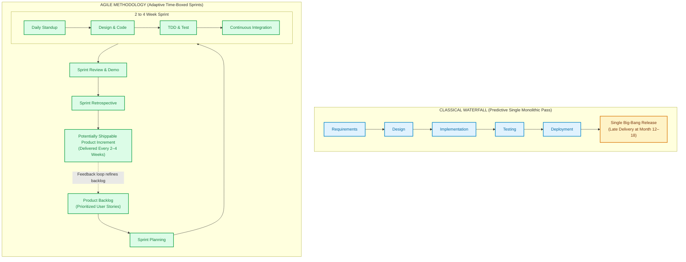
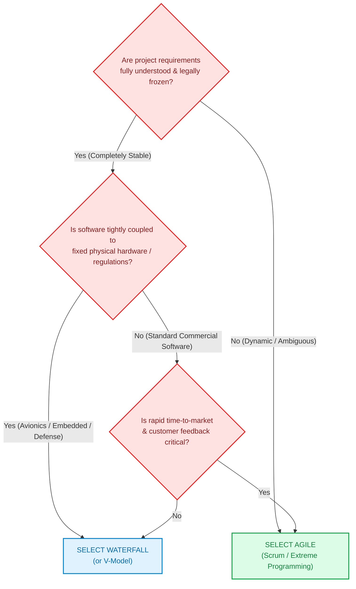

# University Exam Model Answer: Agile Methodology vs. Waterfall Model

**Course Code:** 24ITPC302 — Software Engineering  
**Unit:** Module I — Software Process & Agile Development  
**Target Marks:** 16 Marks (Core High-Yield Comparative Question)  
**Evaluation Standard:** Anna University / Autonomous Regulations 2024 Model

---

## Question:
> **Compare and contrast the Agile software development philosophy with the Classical Waterfall Model in exhaustive detail. Illustrate both paradigms with neat lifecycle diagrams. State the four core values of the Agile Manifesto, present a comprehensive comparison matrix across key software engineering dimensions, and provide a clear decision framework for when to select each model.** `[16 Marks]`

---

## 1. Definitions of the Two Paradigms

- **The Classical Waterfall Model (Predictive / Plan-Driven):** A linear sequential engineering process where development progresses systematically through rigid, non-overlapping phases (*Requirements $\rightarrow$ Design $\rightarrow$ Implementation $\rightarrow$ Verification $\rightarrow$ Deployment*). It operates on the premise that requirements can be fully understood, specified, and frozen upfront.
- **Agile Methodologies (Adaptive / Empirical):** An evolutionary, people-oriented, and iterative software engineering paradigm that delivers working software in short, time-boxed increments (1 to 4 weeks). It operates on the empirical reality that requirements evolve continuously as stakeholders interact with working software.

---

## 2. The Agile Manifesto: 4 Core Values & 12 Principles

In February 2001, seventeen software leaders formulated the **Agile Manifesto** at Snowbird, Utah:

```
+--------------------------------------------------------------------------------------------------+
|                              THE 4 VALUES OF THE AGILE MANIFESTO                                 |
+--------------------------------------------------------------------------------------------------+
| 1. Individuals and interactions      OVER   Processes and tools                                   |
| 2. Working software                  OVER   Comprehensive documentation                           |
| 3. Customer collaboration            OVER   Contract negotiation                                  |
| 4. Responding to change              OVER   Following a plan                                      |
+--------------------------------------------------------------------------------------------------+
| (While there is value in the items on the right, we value the items on the left more.)           |
+--------------------------------------------------------------------------------------------------+
```

### Key Principles of Agility:
1. Satisfy the customer through early and continuous delivery of valuable software.
2. Welcome changing requirements, even late in development.
3. Deliver working software frequently (weeks rather than months).
4. Business stakeholders and developers must work together daily.
5. Build projects around motivated individuals; provide trust and support.
6. The most efficient and effective method of communication is face-to-face conversation.
7. Working software is the primary measure of progress.
8. Maintain a sustainable, constant development pace indefinitely (no chronic overtime).
9. Continuous attention to technical excellence and good design enhances agility.
10. Simplicity—the art of maximizing the amount of work *not done*—is essential.
11. The best architectures, requirements, and designs emerge from self-organizing teams.
12. At regular intervals, the team reflects on how to become more effective (Retrospectives).

---

## 3. Comparative Architecture Diagrams



---

## 4. Comprehensive 10-Parameter Comparison Matrix

| Evaluation Dimension | Classical Waterfall Model | Agile Methodologies (Scrum, XP) |
| :--- | :--- | :--- |
| **1. Development Philosophy** | **Predictive / Plan-Driven:** Assumes the project landscape is predictable and fully plannable. | **Adaptive / Empirical:** Assumes change is inevitable and responds via short feedback loops. |
| **2. Requirements Management** | Requirements are **frozen upfront** in a detailed SRS. Changes are resisted via formal change boards. | Requirements are dynamic and documented as concise **User Stories** prioritized in a Product Backlog. |
| **3. Delivery Strategy** | **Monolithic ("Big Bang"):** Working software appears only at the very conclusion of the lifecycle. | **Incremental / Staged:** Usable, working software increments are delivered every 1 to 4 weeks. |
| **4. Customer Involvement** | **Isolated:** Heavy customer contact during requirements; customer disappears until final acceptance testing. | **Continuous:** Full-time collaboration; Product Owner or On-Site Customer works with team daily. |
| **5. Testing & Verification** | **Phased & Late:** Testing is a separate phase that begins only after complete code implementation. | **Continuous & Shift-Left:** Testing occurs daily within each sprint (often test-first via TDD). |
| **6. Cost of Change Curve** | **Exponential growth:** Introducing a requirement change late in the project incurs massive rework costs. | **Flat curve:** Modular code, continuous refactoring, and automated tests make late changes affordable. |
| **7. Risk Profile** | **High late risk:** Critical integration, architecture, and user dissatisfaction risks surface late in testing. | **Low continuous risk:** High-risk features are prioritized in early sprints; failures are caught early. |
| **8. Team Structure** | **Hierarchical & Functional:** Specialized silos (analysts, architects, developers, testers). | **Cross-Functional & Self-Organizing:** Multidisciplinary teams containing all needed skills. |
| **9. Documentation Standard** | **Heavy & Comprehensive:** Exhaustive formal specifications (SRS, SDD, Interface Specs). | **Lean & Just-in-Time:** Working code and automated test suites serve as living documentation. |
| **10. Measure of Progress** | **Milestone Artifacts:** Earned value against schedule, signed specification documents. | **Working Software:** Verified, running software increments in production or staging. |

---

## 5. The Cost-of-Change Curve Contrast

```
Cost of Change ($)
    ^
    |          /  WATERFALL: Exponential growth due to massive rework
    |         /   of frozen documentation, architecture, code, and test plans
    |        /
    |       /
    |      /  ----------------------------- AGILE: Kept relatively flat via TDD,
    |     /   Continuous Integration, simple design, and small increments
    |    /
    +---------------------------------------------> Project Timeline
       Requirements   Design   Coding   Testing   Deploy
```

- In **Waterfall**, a defect or requirement change introduced during requirements but discovered during system testing requires rewriting documents, redesigning components, recoding modules, and repeating tests—costing up to $50\times$ to $100\times$ more.
- In **Agile**, the 2-week iteration cadence ensures that changes or errors are detected within days, keeping remediation costs minimal and manageable.

---

## 6. Strengths and Weaknesses Comparison

### The Waterfall Model:
- **Strengths:** 
  - Clear, predictable contractual milestones and fixed-budget governance.
  - Comprehensive documentation facilitates maintenance by third-party contractors.
  - Well-suited for teams with junior developers who require precise, frozen specifications.
- **Weaknesses:**
  - Complete inability to respond to shifting market requirements.
  - Zero working software visibility for extended periods.
  - High risk of total project cancellation late in the schedule.

### Agile Methodologies:
- **Strengths:**
  - Rapid time-to-market with early operational increments.
  - High customer satisfaction through continuous involvement and direct steering.
  - Exceptional quality through automated regression testing and daily integration.
- **Weaknesses:**
  - Difficult to predict total project budget and final delivery date upfront.
  - Requires experienced, disciplined, self-organizing developers.
  - Heavy demand on customer time; an unavailable customer representative stalls the team.

---

## 7. Decision Framework: When to Choose Which Model



### Choose Waterfall When:
1. Requirements are completely stable, well understood, and frozen (e.g., standard compiler, tax calculation engine, legacy system migration).
2. The project is governed by strict, fixed-price, fixed-scope government contracts requiring exhaustive documentation.
3. Software is embedded into hardware that cannot be easily updated post-manufacturing.

### Choose Agile When:
1. Requirements are evolving, ambiguous, or highly dependent on market competition (e.g., e-commerce, social platforms, SaaS startups).
2. Early market entry and rapid feedback are essential for business survival.
3. The client can commit an active, authoritative representative to collaborate with the engineering team continuously.

---

## 8. Conclusion
Neither Agile nor Waterfall is universally superior; each is optimized for specific project environments. The Classical Waterfall Model provides unmatched structural discipline and documentation for predictable, safety-critical projects with frozen specifications. Conversely, Agile methodologies provide the responsiveness, quality, and velocity demanded by modern, fast-paced commercial software engineering where requirements change continuously.
