# University Exam Model Answer: The Incremental Process Model

**Course Code:** 24ITPC302 — Software Engineering  
**Unit:** Module I — Software Process & Agile Development  
**Target Marks:** 13 Marks / 16 Marks  
**Evaluation Standard:** Anna University / Autonomous Regulations 2024 Model

---

## Question:
> **(a) What is the Incremental Process Model? Explain its operational working mechanism from the Core Product to the final system release with a neat flowchart. [8 Marks]**  
> **(b) Detail the advantages, disadvantages, and applications of the Incremental Model. Compare the Incremental Model with the Classical Waterfall Model across development risk, customer feedback, and delivery strategy. [8 Marks]**

---

## 1. Definition
The **Incremental Process Model** is an evolutionary software development lifecycle model that delivers software in a series of small, manageable, fully operational releases called **increments**. 

It applies the linear sequential Waterfall phases (*Communication, Planning, Modeling, Construction, Deployment*) in a staggered, iterative progression. The initial release produces the **Core Product** (satisfying essential business requirements), and each subsequent release adds supplementary features and enhancements until the full system is realized.

---

## 2. Introduction & Objectives
In traditional linear sequential models, customers must wait until the very end of the project to receive working software. 

The Incremental Model was designed to provide **staged delivery**:
1. **Early Return on Investment (ROI):** Clients receive and deploy functioning software within weeks.
2. **Early Customer Feedback:** Real-world operational usage of early increments provides empirical feedback to guide subsequent development.
3. **Reduced Risk of Total Failure:** If project funding or time is cut short, the organization still retains a functional, deployable Core Product.
4. **Flexible Resource Utilization:** Allows small teams to deliver complex systems by focusing on one increment at a time.

---

## 3. The Incremental Model Diagram

```mermaid
flowchart TD
    classDef core fill:#e0f2fe,stroke:#0284c7,stroke-width:2px,color:#0369a1;
    classDef inc2 fill:#fef3c7,stroke:#d97706,stroke-width:2px,color:#78350f;
    classDef inc3 fill:#dcfce7,stroke:#16a34a,stroke-width:2px,color:#15803d;
    classDef deliverable fill:#ede9fe,stroke:#7c3aed,stroke-width:2px,color:#5b21b6;
    classDef feedback fill:#fee2e2,stroke:#dc2626,stroke-width:1.5px,stroke-dasharray: 4 4,color:#7f1d1d;

    Start([Project Kickoff]) --> GlobalReq["Global System Requirements & Architecture Planning"]

    %% Increment 1
    subgraph Inc1["INCREMENT 1: Core Product"]
        C1["Communication & Planning"] --> M1["Modeling (Analysis & Design)"]
        M1 --> B1["Construction (Coding & Unit Testing)"]
        B1 --> D1["Deployment of Increment 1"]
    end

    %% Increment 2
    subgraph Inc2["INCREMENT 2: Supplemental Features"]
        C2["Communication & Planning"] --> M2["Modeling (Analysis & Design)"]
        M2 --> B2["Construction (Coding & Regression Testing)"]
        B2 --> D2["Deployment of Increment 2"]
    end

    %% Increment 3
    subgraph Inc3["INCREMENT 3: Advanced Features & Final Polish"]
        C3["Communication & Planning"] --> M3["Modeling (Analysis & Design)"]
        M3 --> B3["Construction (Coding & System Testing)"]
        B3 --> D3["Deployment of Final Release"]
    end

    GlobalReq --> Inc1
    D1 --> P1["CORE PRODUCT RELEASE<br/>• Operational software in user hands<br/>• Essential workflows functional"]
    
    P1 --> F1["Customer Usage & Feedback"]
    F1 -.->|"Customer feedback refines scope"| C2
    P1 --> Inc2

    D2 --> P2["SECOND OPERATIONAL RELEASE<br/>• Core Product + Supplemental Features<br/>• Backward compatibility verified"]

    P2 --> F2["Customer Usage & Feedback"]
    F2 -.->|"Customer feedback refines scope"| C3
    P2 --> Inc3

    D3 --> FinalRelease["FINAL SOFTWARE PRODUCT<br/>• Full system integration complete<br/>• All requirements satisfied"]

    class C1,M1,B1,D1 core;
    class C2,M2,B2,D2 inc2;
    class C3,M3,B3,D3 inc3;
    class P1,P2,FinalRelease deliverable;
    class F1,F2 feedback;
```

---

## 4. Working Mechanism & Increment Progression

Each increment executes the five core software engineering activities:
1. **Communication:** Customer consultation to determine requirements for the specific increment.
2. **Planning:** Scheduling and effort estimation for the increment.
3. **Modeling:** Architectural analysis and detailed component design.
4. **Construction:** Writing source code, conducting code inspections, and executing unit and regression tests.
5. **Deployment:** Delivery of the operational increment to the client, followed by evaluation and feedback.

### The Staged Progression:
- **Increment 1 — The Core Product:**
  - Implements the foundational, high-priority features that address the client's primary business need.
  - *Example:* In a banking application, Increment 1 delivers user authentication, account balance inquiry, and simple cash withdrawals.
  - Deployed directly into live production; users immediately gain utility.
- **Increment 2 — Supplemental Enhancements:**
  - Builds secondary features (e.g., fund transfers, bill payments, transaction history exports).
  - Crucially, developers conduct **Regression Testing** to verify that new code does not destabilize the Core Product.
  - Informs subsequent design based on customer feedback from Increment 1.
- **Increment 3 to $n$ — Final Integration:**
  - Adds advanced capabilities (e.g., loan applications, investment modules, mobile check deposit).
  - Leads to the final, comprehensive system handover.

---

## 5. Distinction: Incremental vs Iterative Development

- **Incremental Development:** Adding **more pieces** of working software over time (staged delivery of functional slices). Example: Constructing a house room by room.
- **Iterative Development:** Repeatedly **refining and polishing the entire system** (evolutionary improvement of all components across cycles). Example: Painting a portrait in rough sketches first, followed by color layers and fine details.
- *Modern Agile combines both:* Agile methodologies are both iterative and incremental.

---

## 6. Advantages and Disadvantages

### Advantages:
1. **Early Business ROI:** Clients can put the software into revenue-generating or operational use months ahead of final completion.
2. **Mitigated Risk of Total Failure:** If funding or organizational priorities change, the client still possesses an operational, working Core Product.
3. **Continuous Customer Feedback:** Development of subsequent increments is guided by real-world user experience rather than static assumptions.
4. **Focused Testing on Critical Code:** Core product code is built first and tested during every subsequent increment, ensuring fundamental functions are exceptionally reliable.
5. **Flexible Staffing:** Core architectural teams build Increment 1; specialized staff (e.g., performance or security engineers) can be assigned selectively to later increments.

### Disadvantages:
1. **Architectural Rework Risk:** Demands rigorous upfront architectural planning; if module interfaces are not cleanly decoupled, adding future increments requires expensive refactoring.
2. **Total Cost Can Exceed Waterfall:** Ongoing regression testing, repeated deployments, and interface adjustments can make total project cost higher than a single build.
3. **Scope Creep Tendency:** When customers see working increments early, they often request numerous scope changes, threatening overall schedule targets.
4. **Configuration Management Complexity:** Maintaining live operational code in production while concurrently developing future increments demands disciplined version control.

---

## 7. Applications & Industrial Suitability

- **Market-Driven Commercial Software:** Web applications, mobile apps, and SaaS platforms where early time-to-market is critical to capture market share.
- **Projects with Partial Known Scope:** Systems where fundamental business workflows are understood, but auxiliary features require operational user discovery.
- **Projects with Phased Funding:** Corporate or government initiatives where budgets are released upon demonstrated operational milestones.

---

## 8. Comparison: Incremental Model vs Classical Waterfall Model

| Parameter | Incremental Process Model | Classical Waterfall Model |
| :--- | :--- | :--- |
| **Delivery Strategy** | **Staged Delivery:** Operational software delivered in successive increments ($1, 2, \dots, n$). | **Monolithic Delivery:** Single final release at the very conclusion of the project. |
| **First Working Code** | Delivered **very early** (upon completion of Increment 1). | Delivered **very late** (only in the final deployment phase). |
| **Customer Feedback** | **Continuous & Empirical:** Customer uses each increment and shapes future releases. | **Infrequent:** Customer is involved at project start and during final acceptance testing. |
| **Risk of Total Failure** | **Low:** A usable Core Product remains even if the project is cancelled midway. | **High:** Project cancellation during coding or testing leaves zero working software. |
| **Requirement Changes** | **Accommodated easily** into upcoming increment plans. | **Difficult & Expensive:** Changes disrupt frozen specifications and cause heavy rework. |
| **Testing Effort** | **Continuous:** Heavy emphasis on automated regression testing with every increment. | **Concentrated:** Single major testing phase conducted after all coding is complete. |
| **Architectural Dependency**| **Crucial:** Requires robust, modular upfront architecture for clean increment plug-in. | **Standard:** Architecture is defined for the entire system scope in one pass. |

---

## 9. Conclusion
The Incremental Process Model successfully overcomes the primary limitation of traditional linear models by decoupling working software delivery from total project completion. By delivering a functional Core Product early and expanding capabilities through customer-validated increments, it balances disciplined engineering planning with rapid market responsiveness and effective risk mitigation.
