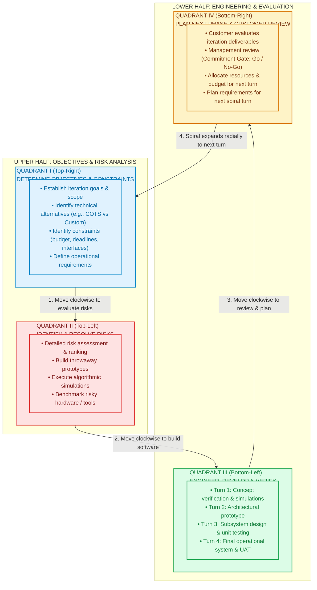
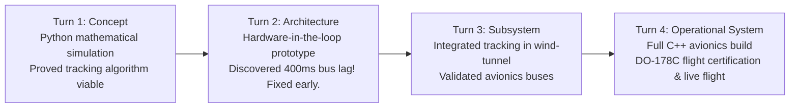

# University Exam Model Answer: Barry Boehm's Spiral Model

**Course Code:** 24ITPC302 — Software Engineering  
**Unit:** Module I — Software Process & Agile Development  
**Target Marks:** 16 Marks (Guaranteed High-Probability Long Question)  
**Evaluation Standard:** Anna University / Autonomous Regulations 2024 Model

---

## Question:
> **Explain Barry Boehm's Spiral Model of software development in detail with a neat diagram. Describe each of the four quadrants and explain why it is termed a "risk-driven" model. Provide a comprehensive real-life industry application where the Spiral Model is the optimal choice. State its advantages and disadvantages.** `[16 Marks]`

---

## 1. Definition
The **Spiral Model**, formulated by **Dr. Barry W. Boehm** in 1988, is an **evolutionary, risk-driven software process model generator**. It couples the iterative nature of prototyping with the controlled, systematic aspects of the linear sequential (Waterfall) model. 

Instead of progressing strictly downwards through rigid phases, software development is represented as a spiral where each loop (turn) represents an increasingly complete, verified release of the software, progressing radially outward from initial concept to full operational deployment.

---

## 2. Introduction & Fundamental Objectives
In traditional linear models, risk management is passive or implicit; risks are discovered late during integration or testing. 

The Spiral Model was developed to place **explicit, quantitative risk analysis at the heart of every development decision**.

### Primary Objectives:
1. **Systematic Risk Reduction:** Identify and eliminate technical, financial, and operational risks before committing major engineering capital.
2. **Evolutionary Development:** Accommodate changing requirements and expanding project scopes across multiple spiral loops.
3. **Early Working Prototypes:** Build rapid prototypes in early loops to clarify ambiguous requirements and validate unproven technologies.

---

## 3. Important Concepts: Geometry of the Spiral

The Spiral Model is governed by two geometric dimensions:

```
+--------------------------------------------------------------------------------------------------+
|                              THE GEOMETRIC DIMENSIONS OF THE SPIRAL                              |
+-------------------+------------------------------------------------------------------------------+
| 1. Radial Radius  | The distance from the center origin (r).                                     |
|                   | Represents CUMULATIVE PROJECT COST AND EFFORT incurred to date.             |
+-------------------+------------------------------------------------------------------------------+
| 2. Angular Motion | The angular rotation around the origin (θ).                                  |
|                   | Represents PROGRESS THROUGH LIFECYCLE PHASES within the current iteration.  |
|                   | Each complete 360° turn executes all four quadrants in a clockwise order.    |
+-------------------+------------------------------------------------------------------------------+
```

---

## 4. The Spiral Model Architecture Diagram (Four Quadrants)



---

## 5. Detailed Explanation of the Four Quadrants

Development traverses the four quadrants in a clockwise sequence during every turn of the spiral:

### Quadrant I: Determine Objectives, Alternatives, and Constraints (Top-Right)
- **Objectives:** Identifies specific goals for the current loop (e.g., proving real-time latency or establishing database throughput).
- **Alternatives:** Identifies alternative ways to achieve the objectives (e.g., building in-house vs licensing commercial software; relational SQL vs distributed NoSQL).
- **Constraints:** Defines engineering constraints such as cost budgets, interface limitations, hardware capabilities, and regulatory standards.

### Quadrant II: Evaluate Alternatives, Identify & Resolve Risks (Top-Left)
- **The Core Engine of the Spiral Model:** Every technical, financial, and organizational uncertainty is scrutinized.
- **Risk Mitigation Techniques:**
  - *Prototyping:* Rapid experimental mockups to resolve user interface ambiguities.
  - *Simulation & Benchmarking:* Algorithmic simulations to test network throughput and processing limits under heavy loads.
- **The Early Termination Checkpoint:** If an unresolvable technical barrier or excessive cost risk is detected, the project is terminated immediately, preventing catastrophic losses.

### Quadrant III: Develop, Verify, and Test the Next-Level Product (Bottom-Left)
- Software engineering activities are executed according to the findings of Quadrant II.
- The nature of development evolves with each turn:
  - *Turn 1 (Concept):* Constructs architectural simulations and mathematical models.
  - *Turn 2 (Requirements):* Builds functional prototypes and UI mockups.
  - *Turn 3 (Design):* Implements modular subsystems verified through unit and integration testing.
  - *Turn 4 (Operational System):* Builds the full-scale production code, verified via rigorous system testing, security audits, and acceptance testing.

### Quadrant IV: Plan Next Phase & Customer Evaluation (Bottom-Right)
- **Customer Evaluation:** Stakeholders review the deliverables produced in Quadrant III.
- **Commitment Review (Go / No-Go Gate):** Management reviews schedule, budget variance, and remaining risks.
- **Planning for Next Turn:** If approved, resources are allocated, and the project plans the scope for the next outward spiral loop.

---

## 6. Why is the Spiral Model Termed "Risk-Driven"?

In traditional models:
- **Waterfall** is *document-driven* (phases transition only when documents are signed).
- **Prototyping** is *code-driven* (development progresses by writing and rewriting code).

The Spiral Model is **risk-driven** because **the amount of effort, money, and detail invested in any activity is strictly proportional to the perceived risk of that activity**:
1. If user interface satisfaction is the highest risk, effort focuses on UI prototyping in Quadrant II.
2. If real-time network throughput is the highest risk, effort focuses on network simulation and load benchmarking.
3. If risk is low and requirements are fully understood, the model can collapse into a standard linear Waterfall step within Quadrant III.

---

## 7. Real-Life Industry Case Study: Military Radar Defense System

### Project Context:
The Department of Defense commissioned the development of an **Autonomous Airborne Early Warning & Radar Tracking System**.

### Why the Spiral Model was Mandatory:
The project faced massive technical risks:
- Novel radar signal processing algorithms had unproven latency over satellite data links.
- Hardware specifications were evolving concurrently with software.
- A failure during live flight could result in loss of aircraft and human life.



### The 4 Spiral Turns:
1. **Turn 1 (Concept of Operations):** Quadrant II built a pure mathematical simulation in Python to test tracking formulas. Proved the theoretical viability of the radar equations.
2. **Turn 2 (Architecture Prototype):** Built an avionics hardware emulator. **Risk Discovery:** The prototype revealed that the commercial satellite bus had an unacceptable 400ms communication lag! Because this was caught in Turn 2, architects switched to a dedicated fiber-optic military bus before writing production code.
3. **Turn 3 (Subsystem Implementation):** Implemented core tracking and target classification modules; verified performance inside a controlled wind-tunnel testbench.
4. **Turn 4 (Operational Flight Software):** Developed the flight-certified C++ codebase adhering to DO-178C avionics standards; executed final flight-acceptance tests.

**Outcome:** Catastrophic flight test failure was averted because sensor interface lag was detected and resolved in Turn 2 at less than 5% of the total project budget.

---

## 8. Advantages and Disadvantages

### Advantages:
1. **Unmatched Risk Mitigation:** Explicit risk analysis in Quadrant II ensures critical problems are resolved before heavy financial commitments.
2. **Accommodates Complex, Evolving Scope:** Evolutionary turns absorb changes gracefully without project disruption.
3. **Early Working Prototypes:** Provides continuous stakeholder visibility and early user feedback.
4. **Flexible Process Adaptability:** Can incorporate waterfall, prototyping, or incremental steps within individual turns.

### Disadvantages:
1. **High Dependency on Risk Assessment Expertise:** If analysts fail to identify a major risk in Quadrant II, the entire foundation of the model collapses.
2. **High Management & Process Overhead:** Complex documentation and continuous reviews make it expensive to operate.
3. **Unsuitable for Small or Low-Risk Projects:** Heavy overhead makes it cost-prohibitive for simple commercial software.
4. **Risk of Never-Ending Cycles:** Without disciplined management milestone gates, the spiral can continue in perpetual loops without reaching completion.

---

## 9. Applications & Industrial Suitability

- **Large-Scale, Mission-Critical Systems:** Aerospace flight controls, satellite communications, military defense weapons systems.
- **High-Risk Research & Development (R&D):** Novel artificial intelligence platforms, autonomous vehicle navigation, biotechnology software.
- **Multi-Year Enterprise Systems:** Global banking core transaction overhauls and nationwide healthcare record infrastructures.

---

## 10. Conclusion
Barry Boehm’s Spiral Model is the preeminent software process model for large, high-stakes engineering projects. By synthesizing the discipline of the Waterfall Model with the adaptability of prototyping, and positioning risk management as the primary governing factor, it provides a structured, economically sound methodology for managing projects where failure is not an option.
