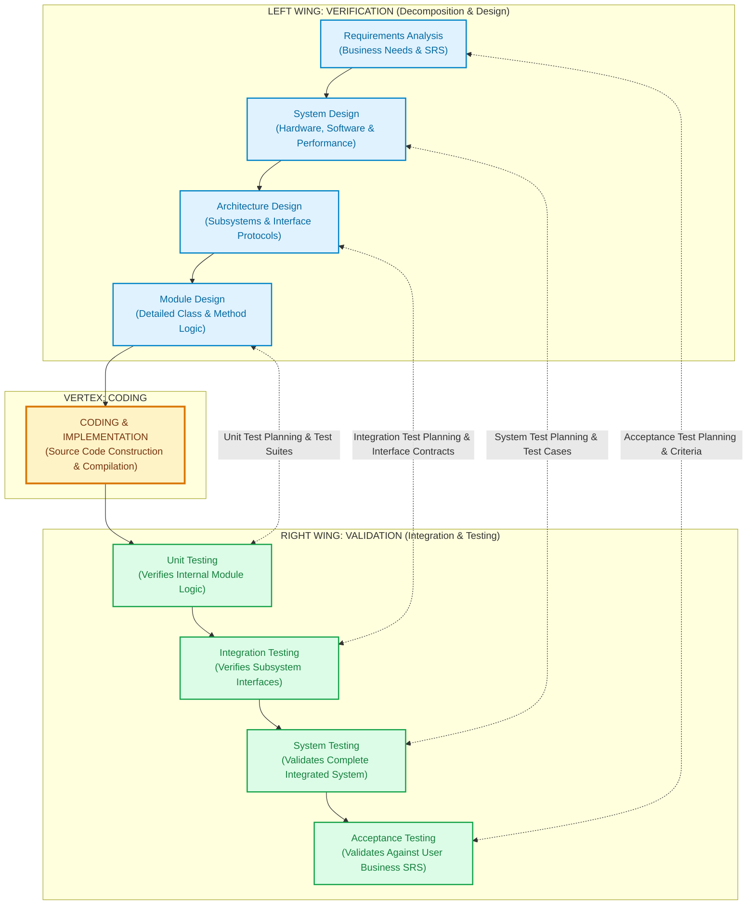

# University Exam Model Answer: The V-Model (V&V)

**Course Code:** 24ITPC302 — Software Engineering  
**Unit:** Module I — Software Process & Agile Development  
**Target Marks:** 13 Marks / 16 Marks  
**Evaluation Standard:** Anna University / Autonomous Regulations 2024 Model

---

## Question:
> **(a) Illustrate the V-Model of software development with a neat, fully labeled diagram. Distinguish clearly between Verification and Validation activities. [8 Marks]**  
> **(b) Explain the phase-to-phase correspondence between the development phases and testing phases in the V-Model. Discuss the Defect Prevention Principle, advantages, disadvantages, and applications. [8 Marks]**

---

## 1. Definition
The **V-Model (Verification and Validation Model)** is an advanced sequential software development lifecycle model in which the development phases and their corresponding testing phases are mapped symmetrically in a **V-shape**. 

Unlike linear models where testing occurs as a final phase after coding, the V-Model establishes that **test planning and design occur concurrently with each corresponding specification and design stage**.

---

## 2. Verification vs. Validation

Barry Boehm defined the fundamental difference between verification and validation through two concise engineering questions:

```
+--------------------------------------------------------------------------------------------------+
|                            VERIFICATION vs VALIDATION COMPARISON                                 |
+----------------------------------+---------------------------------------------------------------+
| Dimension                        | Verification                  | Validation                    |
+----------------------------------+-------------------------------+-------------------------------+
| Core Question                    | "Are we building the product  | "Are we building the right    |
|                                  | right?"                       | product?"                     |
| Primary Objective                | Confirms that intermediate    | Confirms that the final       |
|                                  | artifacts meet specifications.| product satisfies user needs. |
| Execution                        | Static (NO code execution).   | Dynamic (WITH code execution).|
| Techniques                       | Inspections, reviews, audits. | Unit, Integration, System, UAT|
| Position in V-Model              | Descending Left Wing.         | Ascending Right Wing.         |
+----------------------------------+-------------------------------+-------------------------------+
```

---

## 3. The Complete V-Model Diagram



---

## 4. Phase-to-Phase Correspondence & Working Mechanism

The V-Model is structured around strict horizontal correspondence between the left-wing specification phases and right-wing testing phases:

### 1. Requirements Analysis $\Longleftrightarrow$ Acceptance Testing
- **Left Wing:** Analysts gather user needs and compile the Software Requirements Specification (SRS), establishing functional requirements and business constraints.
- **Right Wing (Acceptance Testing / UAT):** End users test the system in an operational or staging environment to confirm it meets business expectations.
- **Early Test Connection:** The **Acceptance Test Plan and test cases are authored during the Requirements Analysis phase**, ensuring that all requirements are measurable and testable.

### 2. System Design $\Longleftrightarrow$ System Testing
- **Left Wing:** System architects define hardware/software boundaries, database schemas, performance targets, network topologies, and security policies.
- **Right Wing (System Testing):** The fully assembled system is evaluated for performance, load handling, security vulnerabilities, stress limits, and recovery.
- **Early Test Connection:** The **System Test Plan is designed during the System Design phase**, directly referencing architectural and non-functional requirements.

### 3. Architecture Design $\Longleftrightarrow$ Integration Testing
- **Left Wing:** High-level system structure is broken down into modular subsystems, defining APIs, communication channels, and data flow contracts between modules.
- **Right Wing (Integration Testing):** Focuses on verifying data exchanges and interface contracts between interacting modules.
- **Early Test Connection:** The **Integration Test Plan and interface test harnesses are created during Architectural Design**.

### 4. Module / Detailed Design $\Longleftrightarrow$ Unit Testing
- **Left Wing:** Detailed design specifies internal algorithmic logic, method signatures, data structures, and state transitions for each module.
- **Right Wing (Unit Testing):** Developers execute white-box and black-box tests on individual units/classes in isolation.
- **Early Test Connection:** **Unit test cases (including boundary and branch coverage tests) are written directly from the Module Design specifications** prior to coding.

### 5. Coding (The Bottom of the V)
- Sits at the apex of the V. Developers write and compile the source code based on detailed module designs. Code undergoes static linting before entering the dynamic testing wing.

---

## 5. The Defect Prevention Principle

In traditional software development, the cost of remediating errors increases exponentially across the lifecycle:
- An ambiguity caught during **Requirements** costs $1\times$.
- The same defect caught during **Design** costs $5\times$.
- Caught during **Coding**, it costs $10\times$.
- Caught during **System Testing**, it costs $20\times$.
- Caught in **Post-Release Operations**, it costs **$50\times$ to $100\times$** to resolve.

### How the V-Model Prevents Defects:
1. When QA engineers design test cases during requirements analysis and system design, they uncover ambiguities, conflicting statements, and omissions in specifications.
2. Defects are eliminated **before code is written**, saving enormous rework costs.
3. Test teams author test harnesses, data sets, and scripts concurrently with design, maximizing productivity.

---

## 6. Advantages and Disadvantages

### Advantages:
1. **Defect Prevention:** Early test design exposes specification defects when correction cost is minimal.
2. **Explicit Verification Checkpoints:** Strict entry and exit criteria govern each phase, ensuring high engineering discipline.
3. **Comprehensive Traceability:** Every requirement maps directly to an acceptance test, and every architectural interface maps to an integration test.
4. **Simple Milestone Management:** Clear phase boundaries make project tracking straightforward for project managers.
5. **High Software Reliability:** Produces exceptionally robust, verifiable systems with minimal critical runtime defects.

### Disadvantages:
1. **Rigidity to Scope Change:** Inflexible when requirements evolve; changes require revisiting and updating both the left-wing design document and its right-wing test plan.
2. **Delayed Working Software:** Working software is not produced until coding is completed at the bottom of the V; users cannot view early prototypes.
3. **Heavy Documentation Overhead:** Demands exhaustive, formal documentation at every level, making it uneconomical for lightweight applications.
4. **Poor Fit for Ambiguous Projects:** Unsuitable for projects where user needs are vague, exploratory, or dynamically shifting.

---

## 7. Applications & Industrial Suitability

- **Safety-Critical Systems:** Avionics flight control (DO-178C), medical diagnostic software (IEC 62304), automotive safety systems (ISO 26262), and nuclear reactor monitoring.
- **Embedded Firmware:** Microcontroller control systems where hardware specifications and interfaces are fixed early.
- **High-Assurance Commercial Systems:** Banking transaction cores, telecommunication switches, and defense systems.

---

## 8. Conclusion
The V-Model reinforces the principle that **software testing is an integral engineering discipline that begins at project inception, not an afterthought**. By maintaining symmetric horizontal mapping between specification and testing, the V-Model prevents defects early, guarantees bidirectional traceability, and remains the benchmark model for safety-critical, high-assurance software engineering.
