# University Exam Model Answer: The Classical Waterfall Model

**Course Code:** 24ITPC302 — Software Engineering  
**Unit:** Module I — Software Process & Agile Development  
**Target Marks:** 13 Marks / 16 Marks  
**Evaluation Standard:** Anna University / Autonomous Regulations 2024 Model

---

## Question:
> **Explain the Classical Waterfall Model of software development in detail. Draw a neat diagram illustrating its phases and explain the activities performed in each phase. State its advantages, disadvantages, and applications.** `[13 / 16 Marks]`

---

## 1. Definition
The **Classical Waterfall Model** (also known as the **Linear Sequential Lifecycle Model**) is a plan-driven, document-centric software process model introduced by **Dr. Winston W. Royce** in 1970. 

It organizes software development into a rigid, sequential cascade of distinct phases where each phase must be fully completed, documented, and verified before the subsequent phase can begin. Output from one phase serves as the direct formal input to the next.

---

## 2. Introduction & Objectives
Originating from traditional civil and mechanical engineering disciplines, the Waterfall Model assumes that software can be built like a physical structure: through exhaustive upfront planning and design.

### Core Objectives:
1. **Predictability:** Establish clear milestones, schedules, and deliverables upfront.
2. **High Discipline & Traceability:** Enforce formal documentation and review gates at every transition.
3. **Structured Governance:** Facilitate straightforward progress monitoring for project managers and clients.

---

## 3. Important Concepts & Principles
1. **Phase Containment:** Development flows strictly downwards like water over a rock cascade. Backward movement is prohibited in the classical definition.
2. **Milestone Review Gates:** Every phase ends with a formal review (e.g., Software Requirements Review, Architectural Design Review). The next phase cannot commence until stakeholders formally sign off on deliverables.
3. **Heavy Documentation:** Emphasizes written artifacts (SRS, SDD, Test Plans) over working prototypes in the early stages.

---

## 4. The Waterfall Model Diagram

```mermaid
flowchart TD
    classDef phase fill:#e0f2fe,stroke:#0284c7,stroke-width:2px,color:#0369a1;
    classDef gate fill:#fef3c7,stroke:#d97706,stroke-width:1.5px,color:#78350f;
    classDef deliverable fill:#dcfce7,stroke:#16a34a,stroke-width:2px,color:#15803d;

    Start([Project Initiation]) --> P1["1. Communication & Requirements Gathering<br/>• Stakeholder interviews & business domain analysis<br/>• Feasibility study: technical, economic, operational"]
    
    P1 --> G1{"Formal Review Gate"}
    G1 -->|Signed Off| D1["Deliverable: Software Requirements Specification (SRS)"]
    D1 --> P2["2. System & Software Design<br/>• Architectural styles & subsystem decomposition<br/>• Data structures, database schemas & API contracts"]

    P2 --> G2{"Formal Review Gate"}
    G2 -->|Signed Off| D2["Deliverable: Software Design Document (SDD)"]
    D2 --> P3["3. Implementation / Coding<br/>• Translating detailed design into source code<br/>• Unit testing of individual classes & modules"]

    P3 --> G3{"Code Review Gate"}
    G3 -->|Passed| D3["Deliverable: Compiled Source Code & Unit Test Logs"]
    D3 --> P4["4. Integration & System Testing<br/>• Assembling units into integrated subsystems<br/>• Functional, performance, security & UAT testing"]

    P4 --> G4{"Acceptance Gate"}
    G4 -->|Passed| D4["Deliverable: Validated System & Test Report"]
    D4 --> P5["5. Deployment & Maintenance<br/>• Live production installation & customer training<br/>• Corrective, adaptive, perfective & preventive maintenance"]

    P5 --> End([Project Complete / Maintenance Mode])

    class P1,P2,P3,P4,P5 phase;
    class G1,G2,G3,G4 gate;
    class D1,D2,D3,D4 deliverable;
```

---

## 5. Detailed Explanation of Each Phase

### 1. Communication & Requirements Analysis:
- Systems analysts interact extensively with business stakeholders and end users to understand project objectives.
- A comprehensive **Feasibility Study** is performed (Technical, Economic, and Operational feasibility).
- All functional and non-functional requirements are formalized into the **Software Requirements Specification (SRS)** document. Once signed off, requirements are **frozen**.

### 2. System & Software Design:
- Translates the SRS into a technical blueprint.
- Divided into two tiers:
  - *Preliminary / Architectural Design:* High-level system structure, database design, and subsystem communication interfaces.
  - *Detailed Design:* Low-level algorithmic logic, method signatures, and data table layouts.
- Output: Formal **Software Design Document (SDD)**.

### 3. Implementation / Coding:
- Programmers translate the SDD into source code using chosen programming languages (Java, C++, Python).
- Developers execute **Unit Testing** on individual modules to verify that internal logic and boundary conditions are correct.

### 4. Integration & System Testing:
- Individual modules are integrated into a complete software system.
- Comprehensive testing is conducted:
  - *Integration Testing:* Verifies interface contracts between interacting modules.
  - *System Testing:* Evaluates end-to-end functionality, performance under load, and security.
  - *Acceptance Testing:* End users perform User Acceptance Testing (UAT) to confirm compliance with the SRS.

### 5. Deployment & Maintenance:
- The system is installed on client infrastructure or deployed to live cloud servers.
- The software enters the longest phase of its lifecycle: **Maintenance**.
  - *Corrective:* Fixing residual defects discovered during live operations.
  - *Adaptive:* Modifying software to operate on new hardware, operating systems, or regulatory environments.
  - *Perfective:* Enhancing performance or adding minor user conveniences.
  - *Preventive:* Refactoring to improve maintainability and prevent future bugs.

---

## 6. Advantages and Disadvantages

### Advantages:
1. **Simple and Intuitive:** Easy to understand and implement; follows a logical progression of engineering activities.
2. **Strict Quality Control via Gates:** Each phase terminates with a formal sign-off gate, ensuring deliverables are fully documented before downstream work begins.
3. **Clear Milestone Tracking:** Deadlines, budgets, and deliverables are set upfront, simplifying contract management and progress tracking.
4. **Stable Architecture:** Exhaustive upfront design prevents hasty, poorly thought-out architectural shortcuts during coding.
5. **Staff Specialization:** Distinct phases allow specialists (analysts in Phase 1, architects in Phase 2, coders in Phase 3, testers in Phase 4) to focus on their core expertise.

### Disadvantages:
1. **Inflexible to Changing Requirements:** Changing requirements midway through development requires formal change control boards and causes heavy rework costs.
2. **Delayed Working Software:** No working software is produced until late in the lifecycle (Phase 4). Clients cannot view progress or evaluate tangible software for months.
3. **Late Risk Exposure:** Critical integration and architectural errors remain hidden until the testing phase, when remediation is most expensive.
4. **"Blocking States":** Upstream team delays stall downstream team members who must wait idle for predecessor deliverables.
5. **Unrealistic Assumption of Frozen Scope:** Real-world clients rarely know all their requirements precisely at project inception.

---

## 7. Applications & Industrial Suitability

| Suitable For | Unsuitable For |
| :--- | :--- |
| Projects with stable, well-understood, frozen requirements | Projects with dynamic, ambiguous, or rapidly shifting requirements |
| Safety-critical and defense systems requiring formal audits | Startups, e-commerce, and fast-paced commercial web applications |
| Developing software for fixed hardware (e.g., compilers, automotive microcontrollers) | Novel, exploratory domains (machine learning, innovative consumer UI) |
| Large migration projects where requirements simply mirror existing legacy systems | Projects requiring continuous user feedback and rapid market validation |

---

## 8. Conclusion
The Classical Waterfall Model remains a cornerstone of software engineering education and a benchmark for disciplined, document-driven development. While largely replaced by iterative and agile frameworks for modern web and mobile applications, it remains essential for safety-critical, contract-governed engineering projects with completely fixed, stable requirements.
