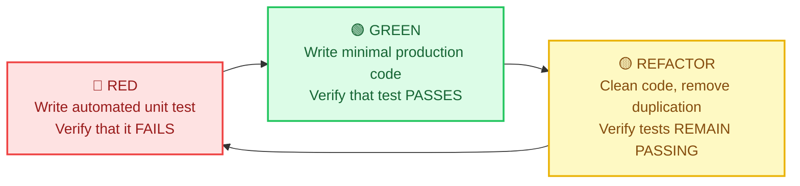

# University Exam Model Answer: Extreme Programming (XP)

**Course Code:** 24ITPC302 — Software Engineering  
**Unit:** Module I — Software Process & Agile Development  
**Target Marks:** 13 Marks / 16 Marks  
**Evaluation Standard:** Anna University / Autonomous Regulations 2024 Model

---

## Question:
> **Explain Extreme Programming (XP) in detail. Discuss its core philosophy, five values, the six-phase XP lifecycle with a neat flowchart, and its essential engineering practices including Pair Programming and Test-Driven Development (TDD). State its advantages, disadvantages, and applications.** `[13 / 16 Marks]`

---

## 1. Definition
**Extreme Programming (XP)** is a disciplined, lightweight, agile software development methodology developed by **Kent Beck** in 1996. It is designed to produce high-quality software rapidly in environments characterized by vague, rapidly changing, or high-risk requirements. 

XP is termed "extreme" because it takes beneficial, traditional software engineering practices (such as code inspection, testing, simple architecture, and customer involvement) and pushes them to their logical extremes—making them continuous and team-wide.

---

## 2. Introduction & Objectives
Traditional sequential models (such as the Waterfall model) assume that requirements can be fully frozen upfront. When requirements change late in development, the cost of rework escalates exponentially. 

Extreme Programming aims to keep the **cost-of-change curve flat** through continuous automated testing, small iteration cycles, and frequent refactoring.

```
Cost of Change
    ^
    |          /  Waterfall (Exponential Cost Growth)
    |         /
    |        /  
    |       /  ------------------------- Extreme Programming (Flat Cost Curve)
    |      /
    +----------------------------------------> Project Time
         Requirements  Design  Code  Test
```

### Objectives of XP:
1. **Rapid Value Delivery:** Deliver functioning software increments into customer hands within 1 to 3 weeks.
2. **Responsiveness to Change:** Welcome changing user requirements at any stage of the project lifecycle.
3. **High Software Reliability:** Eliminate defects at the source using Test-Driven Development (TDD) and Pair Programming.
4. **Sustainable Pace:** Maintain developer productivity, team health, and high morale through a standard 40-hour work week.

---

## 3. Important Concepts: The 5 Core Values of XP
Extreme Programming is governed by **five core values** that guide every technical decision:

1. **Communication:** Developers maintain continuous, informal verbal dialogue with each other and with the customer, avoiding reliance on unread formal specification memos.
2. **Simplicity:** The team implements only the simplest design that meets today's current automated tests. It adheres to **YAGNI** (*You Aren't Gonna Need It*) and avoids speculative over-engineering.
3. **Feedback:** Instant feedback is gathered continuously at three distinct levels:
   - *Unit level:* Immediate feedback via automated unit tests and pair programming partners.
   - *System level:* Continuous integration feedback on every commit.
   - *Customer level:* Acceptance testing feedback at the end of each short iteration.
4. **Courage:** Developers must have the courage to fearlessly refactor legacy code, discard flawed prototypes, report accurate progress estimates, and discard architectural designs that no longer serve business needs.
5. **Respect:** Developers respect the customer's business priorities; customers respect developers' technical estimates and the need for a sustainable working pace.

---

## 4. The Extreme Programming (XP) Lifecycle

The XP lifecycle consists of **six well-defined, iterative phases**:

```mermaid
flowchart TD
    classDef phase fill:#e8f4fd,stroke:#1b6ec2,stroke-width:2px,color:#0b3c61;
    classDef loop fill:#fef3d6,stroke:#d97706,stroke-width:2px,color:#78350f;
    classDef decision fill:#fee2e2,stroke:#dc2626,stroke-width:2px,color:#7f1d1d;
    classDef finish fill:#f3f4f6,stroke:#4b5563,stroke-width:2px,color:#1f2937;

    Start([Project Kickoff]) --> Phase1["1. Exploration Phase<br/>• User Stories written on index cards<br/>• Architecture & tool exploration<br/>• Spike Solutions for high-risk requirements"]
    
    Phase1 --> Phase2["2. Planning Phase<br/>• Customer prioritizes User Stories<br/>• Developers estimate effort in story points<br/>• Team agrees on Release Plan & Velocity"]
    
    Phase2 --> Phase3["3. Iterations to Release Phase<br/>• 1 to 3 week fixed iterations<br/>• Decompose stories into engineering tasks<br/>• Test-Driven Development (TDD)<br/>• Pair Programming (Driver & Navigator)<br/>• Continuous Integration & daily testing"]
    
    Phase3 --> Check{"Are Release<br/>Stories Complete &<br/>Accepted?"}
    Check -- "No (More Iterations)" --> Phase3
    Check -- "Yes" --> Phase4["4. Productionizing Phase<br/>• Operational performance & load testing<br/>• Security audits & platform readiness<br/>• Customer formal sign-off<br/>• Deployment to production"]
    
    Phase4 --> Phase5["5. Maintenance Phase<br/>• Live system operational support<br/>• Incorporate new user stories & enhancements<br/>• Continuous refactoring to maintain health"]
    
    Phase5 --> NextMajor{"Major New<br/>Release or System<br/>Obsolete?"}
    NextMajor -- "New Release" --> Phase2
    NextMajor -- "End of Life" --> Phase6["6. Death Phase<br/>• Customer needs fully met<br/>• System reaches economic retirement<br/>• Final post-mortem analysis & archiving"]
    
    Phase6 --> End([Project Terminated])

    class Phase1,Phase2,Phase4,Phase5 phase;
    class Phase3 loop;
    class Check,NextMajor decision;
    class Phase6 finish;
```



---

## 5. Explanation of Each Phase in the Lifecycle

### 1. Exploration Phase:
- **User Stories:** The customer documents functional requirements as concise stories on physical index cards.
- **Architectural Evaluation:** Developers experiment with database systems, frameworks, and interface tools.
- **Spike Solutions:** If a feature carries high technical risk or uncertainty, developers build an isolated, throwaway prototype called a "Spike Solution" to determine feasibility and refine estimates.

### 2. Planning Phase (The Planning Game):
- The customer arranges user stories in order of priority based on business value.
- Developers review each story and assign effort estimates (in story points or ideal engineering days).
- The team calculates project **velocity** (points delivered per iteration) and schedules stories into the first release (typically 2 to 3 months away).

### 3. Iterations to Release Phase:
- Work is organized into short, fixed-duration iterations (1 to 3 weeks).
- User stories selected for the iteration are broken down into granular technical tasks (1 to 3 days each).
- Developers implement tasks in pairs using **Pair Programming**.
- Code is developed using **Test-Driven Development (TDD)**: writing automated unit tests before writing functional code.
- Pairs continuously integrate code into the main repository using **Continuous Integration (CI)**.
- At the end of the iteration, the customer runs automated acceptance tests to verify completed stories.

### 4. Productionizing Phase:
- The release candidate undergoes operational readiness validation: stress testing, performance benchmarking, security testing, and final configuration audits.
- The on-site customer performs final acceptance validation.
- The software increment is deployed into the live production environment.

### 5. Maintenance Phase:
- The deployed system is monitored in live operations.
- The team simultaneously supports production operations and develops subsequent iterations.
- Customer feedback generates new user stories that feed back into the planning game.
- Continuous refactoring ensures the codebase remains clean and extensible.

### 6. Death Phase:
- Occurs when the customer has no further feature requests, or when the cost of maintaining the software exceeds its business value.
- The team conducts a post-mortem review, records final documentation, and archives the codebase.

---

## 6. Key Engineering Practices of Extreme Programming

Kent Beck codified 12 core practices, with four standing out as vital examination topics:

### A. Pair Programming
- **Mechanism:** Two programmers collaborate at a single workstation using one screen, keyboard, and mouse:
  - **Driver:** Operates the keyboard and mouse, focusing on tactical implementation details, language syntax, and writing unit tests.
  - **Navigator:** Continuously observes the code being written, evaluating overall design, identifying edge cases, catching typos/bugs, and thinking ahead about integration.
  - **Dynamic Rotation:** Partners switch Driver and Navigator roles every 20–30 minutes and rotate pairing partners across modules daily.
- **Benefits:**
  - Continuous real-time peer review (eliminates formal review bottlenecks).
  - Spreads system knowledge across the entire team (eliminates single points of failure).
  - Improves design simplicity and catches errors immediately.

### B. Test-Driven Development (TDD)
- **Mechanism:** Developers follow the strict **Red-Green-Refactor** micro-cycle:



1. **Red:** Write an automated unit test for a new feature and run it to verify it fails (confirming the test is valid).
2. **Green:** Write only the minimal production code necessary to pass the failing test.
3. **Refactor:** Restructure and clean the code to remove duplication and improve readability while ensuring all tests continue to pass.
- *Technical Note:* TDD builds an extensive regression test suite and enforces modularity, but does not automatically guarantee 100% test coverage or find conceptual requirement misunderstandings.

### C. Continuous Integration (CI)
- Developers merge their validated code into the shared main repository multiple times a day.
- An automated build server compiles the code and executes the complete test suite on every commit.
- *Benefit:* Eliminates "Integration Hell" where teams spend weeks resolving massive merge conflicts at project end.

### D. On-Site Customer
- A real business representative is stationed full-time with the development team.
- The customer writes user stories, clarifies requirements in real time, prioritizes features, and validates acceptance tests.
- *Benefit:* Replaces sluggish formal documentation exchanges with instant verbal decisions.

### Additional Essential Practices:
- **Small Releases:** Deploy small, functional releases frequently (every few weeks) to gather real-world user feedback.
- **Simple Design:** Implement the simplest possible solution that meets current automated test criteria (**YAGNI**).
- **Refactoring:** Continuously optimize and restructure code structure without altering external behavior.
- **Collective Code Ownership:** Any programmer has the authority to edit or refactor any line of code across the system.
- **Sustainable Pace (40-Hour Week):** Overtime is strictly avoided to prevent developer burnout and defect injection.
- **Coding Standards:** Common naming and stylistic guidelines ensure code appears as if authored by a single unified mind.

---

## 7. Advantages and Disadvantages

### Advantages:
1. **High Responsiveness to Change:** Rapid iterations allow shifting customer priorities to be absorbed smoothly between iterations.
2. **Early Defect Detection:** Combining continuous pair programming with TDD identifies defects immediately, reducing rework costs.
3. **Continuous Customer Satisfaction:** Delivering usable increments every 1–3 weeks builds stakeholder trust and visibility.
4. **Clean, Maintainable Codebase:** Merciless refactoring and collective ownership prevent code degradation and technical debt.
5. **No Integration Bottlenecks:** Continuous integration ensures the entire system remains in a working, deployable state daily.

### Disadvantages:
1. **Customer Availability Constraint:** Requires an authoritative, full-time on-site customer; unavailability becomes a project bottleneck.
2. **Interpersonal Strain:** Intense, daily pair programming can lead to social fatigue for some developers.
3. **Difficult to Scale:** Relies heavily on informal, co-located verbal communication, making it challenging for large teams (>15–20 developers).
4. **Minimal Architectural Documentation:** Light documentation can create onboarding difficulties if key engineers leave without writing architectural summaries.
5. **Contract Incompatibility:** Traditional fixed-scope, fixed-price contracts struggle to accommodate XP's variable-scope planning game.

---

## 8. Applications & Suitability

| Suitable For | Unsuitable For |
| :--- | :--- |
| Projects with highly dynamic, ambiguous requirements | Systems requiring formal mathematical proofs (e.g., aerospace flight control) |
| Small to medium teams (2 to 12 engineers) | Large, globally distributed teams without coordination frameworks |
| Fast-paced startups and web applications | Fixed-price, fixed-scope government procurement contracts |
| Environments with dedicated, available customer reps | Organizations where domain experts cannot be physically or virtually co-located |

---

## 9. Comparison: Extreme Programming (XP) vs Scrum

| Parameter | Extreme Programming (XP) | Scrum |
| :--- | :--- | :--- |
| **Primary Domain** | **Software engineering practices** (TDD, Pairing, CI). | **Project management & team ceremonies** (Sprints, Standups). |
| **Iteration Length** | Typically 1 to 2 weeks. | Typically 2 to 4 weeks. |
| **Mid-Iteration Scope** | Changes permitted if work on a story hasn't started. | Sprint backlog is strictly frozen during the sprint. |
| **Customer Role** | Full-time **On-Site Customer** sitting with developers. | **Product Owner** represents the customer. |
| **Engineering Rules** | Strict engineering rules enforced (TDD, Refactoring). | Does not mandate specific engineering practices. |

---

## 10. Conclusion
Extreme Programming represents a paradigm shift from rigid, plan-driven processes to an agile, customer-centric engineering philosophy. By turning proven practices like testing, peer review, and integration up to "extreme" levels, XP produces robust, adaptable software while maintaining a flat cost-of-change curve. For small, high-velocity engineering teams navigating uncertain domains, XP remains one of the most effective methodologies in modern software engineering.
