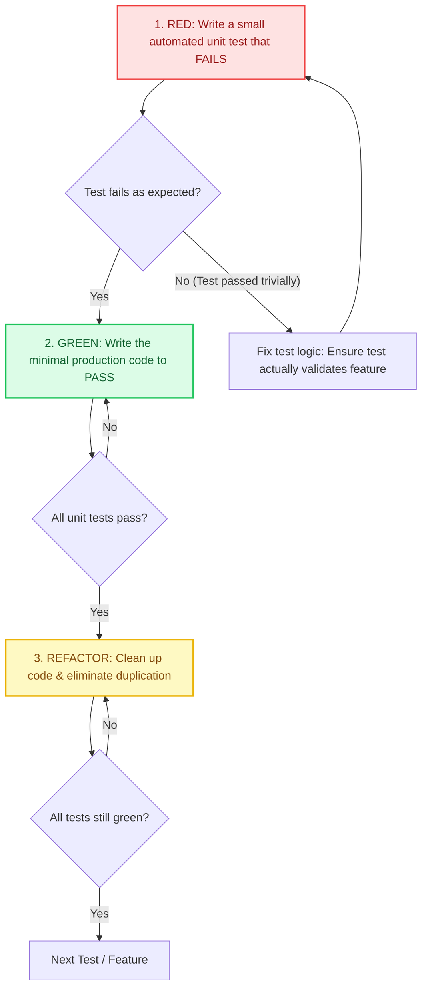

# Extreme Programming (XP): Comprehensive Academic & Exam Study Guide

**Course Code:** 24ITPC302 — Software Engineering  
**Module:** Unit I — Software Process & Agile Development  
**Standard:** 13-Mark & 16-Mark University Examination Level  
**Prescribed References:** Roger S. Pressman (Ch. 3–4), Ian Sommerville (Ch. 3), Kent Beck (*Extreme Programming Explained*)

---

## 🧭 Document Overview & Study Roadmap
This study resource provides two integrated levels of mastery:
1. **Level 1 — Conceptual Understanding:** Beginner-friendly explanations, intuitive analogies, and a practical real-world scenario demonstrating how XP works in practice and why each lifecycle stage is necessary.
2. **Level 2 — University Examination Master Answer:** A publication-grade, fully structured 13/16-mark model answer with clean diagrams, clear headings, verified technical facts, advantages, disadvantages, and comparison matrices.

---

# Part I: Level 1 — Conceptual Understanding

### 1. What is Extreme Programming (XP) in Plain English?
Imagine driving a car down a winding road. Traditional software engineering models (like Waterfall) attempt to point the car down the road, lock the steering wheel in place, step on the gas, and hope they reach their destination without crashing. If there is a sharp turn or an unexpected obstacle (a changing customer requirement), a locked-in plan causes a severe crash.

**Extreme Programming (XP)**, conceived by **Kent Beck** in 1996 during the Chrysler Comprehensive Compensation (C3) payroll project, takes the opposite approach. XP views software development as sitting in the driver’s seat with hands firmly on the wheel, constantly looking ahead and making hundreds of small, continuous steering corrections based on real-time feedback.

### 2. Why is it Called "Extreme"?
XP is not "extreme" in the sense of being dangerous or reckless. Rather, it takes **traditional, proven, healthy software engineering practices** and turns the dial up to the maximum level ("extreme"):
- If **code reviews** are good, developers review code continuously every second $\rightarrow$ **Pair Programming**.
- If **testing** is good, developers test every function before writing the code and run test suites multiple times an hour $\rightarrow$ **Test-Driven Development (TDD)** and **Automated Testing**.
- If **simple design** is good, developers only design for what is needed today and refuse to build speculative features $\rightarrow$ **Simple Design (YAGNI — You Aren't Gonna Need It)**.
- If **integration** is good, developers integrate and build the software multiple times every single day $\rightarrow$ **Continuous Integration (CI)**.
- If **customer involvement** is good, the customer sits directly inside the development room full-time $\rightarrow$ **On-Site Customer**.

---

### 3. Practical Walkthrough: Building a University Exam Portal with XP
To understand how XP operates in a realistic context, consider developing a **Student Course Registration and Exam Portal**:

1. **Exploration:** The university registrar (Customer) writes capabilities on index cards called **User Stories** (e.g., *"As a student, I want to add an elective course so that I complete my graduation credits"*). The software engineers experiment with database connection tools and build a quick prototype (**Spike Solution**) to verify that the database can handle 5,000 concurrent student logins during peak registration.
2. **Planning:** The team and registrar sit together for the **Planning Game**. The registrar marks elective selection as "High Priority". The developers estimate that this story will take 4 story points. Together, they schedule the elective selection feature into **Release 1** (scheduled in 3 weeks).
3. **Iterations to Release:** 
   - A programming pair sits together at one computer. Developer A acts as **Driver** (typing), and Developer B acts as **Navigator** (reviewing logic and spotting edge cases).
   - Before writing the course-adding logic, they write a failing test (**TDD - Red Phase**): `test_cannot_add_course_if_prerequisite_missing()`.
   - They write the minimal Java/Python code to make this test pass (**Green Phase**).
   - They clean up the code, extract helper methods, and remove duplication (**Refactor Phase**).
   - Before lunch, they check their code into the shared main branch; an automated server runs all 200 system unit tests to ensure nothing broke (**Continuous Integration**).
4. **Productionizing:** Two weeks before the live semester registration, the system is deployed into a staging environment. Load tests simulate thousands of students, security vulnerability scans run, user guides are finalized, and the registrar conducts final **Customer Acceptance Tests**.
5. **Maintenance:** The portal goes live. Students register for courses. When professors request a new feature to view enrolled students, the team writes new user stories, plans a 1-week iteration, runs existing tests to ensure zero regressions, and deploys the update smoothly.
6. **Death:** Ten years later, when the university migrates to an entirely new cloud enterprise ERP system, the legacy registration portal is formally retired. Its historical student data is archived, documentation is preserved, and the project reaches its planned, graceful conclusion.

---

### 4. Why is Each XP Stage Necessary?
- **Why Exploration?** Without exploration, developers commit to architectural designs and third-party libraries they have never tested, leading to disastrous mid-project discoveries that the chosen framework cannot scale.
- **Why Planning?** Without customer-driven planning, developers spend months building complex technical features that users never actually use or need.
- **Why Iterations to Release?** Short 1-to-3 week time-boxes force concrete deliverables. They eliminate the "90% done syndrome" where projects stay nearly complete for months without actually working.
- **Why Productionizing?** Real-world operations require more than passing unit tests; performance under real server loads, data migrations, and regulatory compliance require dedicated pre-release verification.
- **Why Maintenance?** Software is a living asset. The majority of a system's total lifetime cost occurs after initial deployment; maintaining a robust automated test harness prevents post-delivery updates from breaking existing logic.
- **Why Death?** Every system has an economic lifecycle. Formally recognizing when a system should be retired prevents organizations from pouring maintenance capital into obsolete legacy systems.

---

# Part II: Level 2 — University Examination Master Answer

## Question Model (13 Marks / 16 Marks)
> **(a)** Define Extreme Programming (XP). Explain the philosophy, five core values, and the complete XP development lifecycle with an appropriate flowchart. **[8 Marks]**  
> **(b)** Describe in detail the core engineering practices of XP, focusing on Pair Programming, Test-Driven Development (TDD), Continuous Integration, and On-Site Customer. Discuss its advantages, limitations, and industrial applications. **[8 Marks]**

---

### 1. Definition of Extreme Programming
**Extreme Programming (XP)** is a disciplined, lightweight, agile software development methodology designed by **Kent Beck** that emphasizes customer satisfaction, rapid iterative delivery, and technical software engineering excellence. It is specifically tailored for small-to-medium teams working on projects with ambiguous, volatile, or rapidly evolving requirements.

XP achieves agility by taking beneficial, traditional software engineering practices to extreme levels, enforcing short release cycles, automated test-first development, continuous peer review, and continuous collaboration with an on-site customer.

---

### 2. Introduction & Fundamental Objectives
In traditional plan-driven models (e.g., Waterfall), the cost of introducing changes rises exponentially as development progresses. XP flattens this **cost-of-change curve** by utilizing continuous automated testing, modular architecture, and frequent refactoring, ensuring that late requirement changes can be accommodated at reasonable cost.

```
Cost of Change
    ^
    |          /  (Traditional Waterfall: Exponential cost curve)
    |         /
    |        /
    |       /  ------------------------- (Extreme Programming: Flat cost curve)
    |      /
    |     /
    +----------------------------------------> Development Timeline
         Inception  Design  Coding  Testing
```

#### Core Objectives of Extreme Programming:
1. **Accelerate Business Value Delivery:** Deliver working software increments into customer hands within 1 to 3 weeks.
2. **Embrace Unavoidable Change:** Accommodate customer modifications even late in the development cycle without architectural collapse.
3. **Elevate Software Quality:** Prevent defect injection through Test-Driven Development (TDD) and continuous code reviews via Pair Programming.
4. **Sustain Developer Well-Being:** Maintain team productivity and morale through sustainable 40-hour work weeks and collective code ownership.

---

### 3. The Five Core Values of Extreme Programming
XP is grounded in five core human and organizational values:

```
+---------------------------------------------------------------------------------------+
|                       THE 5 CORE VALUES OF EXTREME PROGRAMMING                        |
+---------------------------------------------------------------------------------------+
| 1. COMMUNICATION | Face-to-face dialogue replaces voluminous, unread documentation.  |
| 2. SIMPLICITY    | Build only what is needed for today's tests; avoid speculation.    |
| 3. FEEDBACK       | Immediate feedback from automated tests, pair partners & customer.|
| 4. COURAGE       | Fearlessly refactor code, discard bad prototypes, and be honest.   |
| 5. RESPECT       | Team members value each other's work, code, and sustainable pace.  |
+---------------------------------------------------------------------------------------+
```

1. **Communication:** XP eliminates communication silos. Developers talk directly with customers daily, programmers sit in open bullpen workstations, and pair partners discuss design decisions continuously.
2. **Simplicity:** The guiding principle is **YAGNI** (*You Aren't Gonna Need It*) and **KISS** (*Keep It Simple, Stupid*). Developers design the simplest solution that satisfies today's requirements, rather than creating speculative abstractions for future features that may never be needed.
3. **Feedback:** Feedback operates at multiple timescales:
   - *Seconds:* Instant unit test results and feedback from a pair programming partner.
   - *Minutes/Hours:* Feedback from Continuous Integration builds and automated test suites.
   - *Days/Weeks:* Feedback from the on-site customer evaluating deployed iteration releases.
4. **Courage:** Developers must have the courage to rewrite poorly designed code (refactoring), discard unworkable spike solutions, admit when a feature cannot be delivered within an iteration, and speak truth to management regarding realistic velocities.
5. **Respect:** Introduced by Kent Beck in XP’s second edition. Developers respect the customer’s business authority; customers respect the developers’ technical expertise and right to a sustainable work pace.

---

### 4. The Extreme Programming (XP) Lifecycle

The complete XP lifecycle consists of **six distinct phases**:

```mermaid
flowchart TD
    classDef phase fill:#e8f4fd,stroke:#1b6ec2,stroke-width:2px,color:#0b3c61;
    classDef loop fill:#fef3d6,stroke:#d97706,stroke-width:2px,color:#78350f;
    classDef decision fill:#fee2e2,stroke:#dc2626,stroke-width:2px,color:#7f1d1d;
    classDef finish fill:#f3f4f6,stroke:#4b5563,stroke-width:2px,color:#1f2937;

    Start([Project Initiation]) --> Phase1["1. Exploration Phase<br/>• Customer writes User Stories on index cards<br/>• Team evaluates architectural tools & platforms<br/>• Build Spike Solutions for high-risk requirements"]
    
    Phase1 --> Phase2["2. Planning Phase<br/>• Customer prioritizes User Stories by business value<br/>• Developers estimate effort in story points<br/>• Team establishes velocity & Release Plan"]
    
    Phase2 --> Phase3["3. Iterations to Release Phase<br/>• 1 to 3 week time-boxed iterations<br/>• Decompose user stories into engineering tasks<br/>• Test-Driven Development (TDD: Red-Green-Refactor)<br/>• Pair Programming (Driver & Navigator)<br/>• Continuous Integration & daily test runs"]
    
    Phase3 --> LoopCheck{"Are All Stories<br/>for This Release<br/>Complete & Passing?"}
    LoopCheck -- "No (Next Iteration)" --> Phase3
    LoopCheck -- "Yes (Release Candidate Ready)" --> Phase4["4. Productionizing Phase<br/>• Full system integration & performance benchmarking<br/>• Operational environment testing & security audits<br/>• Customer conducts formal Acceptance Tests<br/>• Production Deployment"]
    
    Phase4 --> Phase5["5. Maintenance Phase<br/>• Live system operational support<br/>• Incorporate customer feedback & new user stories<br/>• Continuous refactoring to prevent technical debt"]
    
    Phase5 --> NextMajor{"Major New<br/>Release or System<br/>Obsolete?"}
    NextMajor -- "New Feature Scope" --> Phase2
    NextMajor -- "System End-of-Life" --> Phase6["6. Death Phase<br/>• Customer requirements fully satisfied<br/>• System reaches economic retirement<br/>• Post-mortem documentation & repository archiving"]
    
    Phase6 --> End([Project Terminated])

    class Phase1,Phase2,Phase4,Phase5 phase;
    class Phase3 loop;
    class LoopCheck,NextMajor decision;
    class Phase6 finish;
```



#### Detailed Explanation of Each Phase:

#### Phase 1: Exploration Phase
- **User Stories:** The customer writes high-level functional requirements on physical or digital index cards. Each user story captures a specific business need from an end-user perspective.
- **Architectural Exploration:** Developers explore candidate database systems, libraries, and communication protocols.
- **Spike Solutions:** When facing an unfamiliar technology or a high-risk technical challenge, developers write throwaway, experimental code called a "spike" to evaluate feasibility and obtain accurate effort estimates.

#### Phase 2: Planning Phase (The Planning Game)
- The customer prioritizes user stories based on market value, statutory requirements, and business ROI.
- Developers assess the technical difficulty of each story and assign estimates (e.g., story points or ideal engineering days).
- The team calculates its **velocity** (the number of story points completed per iteration).
- Customer and developers agree on the scope and delivery date of the upcoming release (typically 2 to 3 months out).

#### Phase 3: Iterations to Release Phase
- The project enters a repeating cycle of short, time-boxed iterations (1 to 3 weeks).
- At the start of each iteration, the customer selects the highest-priority user stories.
- Developers decompose stories into specific programming tasks (typically 1 to 3 days of work).
- Developers execute tasks using **Pair Programming** and **Test-Driven Development (TDD)**.
- Code is integrated and validated multiple times daily via **Continuous Integration (CI)**.
- Automated customer acceptance tests are executed to verify story completion.

#### Phase 4: Productionizing Phase
- The release candidate is prepared for deployment to the live operational environment.
- Testing shifts to non-functional attributes: load testing, stress testing, security audits, and deployment pipeline verification.
- Any defect detected during this phase is prioritized for immediate resolution.
- The customer signs off on the release, and the software is deployed to production.

#### Phase 5: Maintenance Phase
- The software runs in production while development continues.
- Developers handle minor operational bug fixes and incorporate new user stories requested by the customer.
- Teams continue to enforce TDD and pair programming to prevent codebase degradation over time.

#### Phase 6: Death Phase
- The software has satisfied all business objectives and requires no further enhancement, or continuing maintenance becomes economically non-viable.
- A final post-mortem analysis documents architectural insights and lessons learned, and the codebase and test assets are archived.

---

### 5. In-Depth Study of Core XP Engineering Practices

Kent Beck codified **12 core practices** divided into four interlocking operational areas:

```
+--------------------------------------------------------------------------------------------------+
|                              THE 12 CORE PRACTICES OF XP                                         |
+----------------------------------+---------------------------------------------------------------+
| Category                         | Core Engineering Practices                                    |
+----------------------------------+---------------------------------------------------------------+
| 1. Feedback / Customer Loop      | 1. The Planning Game       2. Small Releases                  |
|                                  | 3. Customer Acceptance Tests  4. On-Site Customer              |
+----------------------------------+---------------------------------------------------------------+
| 2. Continuous Process Loop       | 5. Continuous Integration  6. Refactoring                     |
|                                  | 7. 40-Hour Work Week (Sustainable Pace)                      |
+----------------------------------+---------------------------------------------------------------+
| 3. Shared Understanding Loop     | 8. Simple Design (YAGNI)   9. System Metaphor                 |
|                                  | 10. Collective Code Ownership 11. Coding Standards            |
+----------------------------------+---------------------------------------------------------------+
| 4. Daily Engineering Mechanics   | 12. Pair Programming & Test-Driven Development (TDD)           |
+----------------------------------+---------------------------------------------------------------+
```

#### Detailed Breakdown of the 4 Most Critical Exam Practices:

#### Practice A: Pair Programming
- **Mechanism:** Two programmers work simultaneously at a single computer workstation sharing one keyboard, mouse, and monitor.
  - **The Driver:** Holds the keyboard, typing source code and unit tests while focusing on tactical details (syntax, naming conventions, algorithm mechanics).
  - **The Navigator:** Observes every line in real time, focusing on strategic oversight (design coherence, corner cases, interface consistency, potential security bugs).
  - **Dynamic Rotation:** Roles rotate frequently (every 20–30 minutes), and pairs switch partners across modules daily.
- **Technical Benefits:**
  - *Continuous Peer Review:* Eliminates the delay and friction of post-hoc code inspections.
  - *Knowledge Redundancy:* Removes single points of failure (e.g., if a developer leaves, others already understand the code).
  - *Defect Interception:* The navigator catches typing, logic, and semantic mistakes as they occur.
- **Academic Nuance:** While pair programming increases active developer-hours by an estimated 15% to 25%, this cost is compensated by significant reductions in post-release debugging and maintenance effort.

#### Practice B: Test-Driven Development (TDD)
- **Mechanism:** Production code is never written until an automated unit test exists that proves the code is needed. TDD follows the strict **Red-Green-Refactor** micro-cycle:



1. **Red:** Write a small, self-contained unit test for a single expected behavior. Execute the test runner and verify that it fails (proving the test is valid and the feature does not exist yet).
2. **Green:** Write the simplest, quickest production code that makes the test pass. Avoid premature optimization or extra feature implementation.
3. **Refactor:** Clean up the implementation: eliminate redundant code, improve variable names, extract sub-methods, and maintain compliance with design standards—while ensuring the entire test suite remains green.
- **Technical Nuance (Exam Clarification):** TDD drives modular, decoupled designs and builds an extensive regression test suite. However, **TDD does not automatically guarantee 100% test coverage or the absence of bugs**, as developers can still write flawed tests if they misunderstand business requirements or overlook subtle edge cases.

#### Practice C: Continuous Integration (CI)
- **Mechanism:** Developers do not keep code isolated on long-lived private branches. Instead, pairs integrate their tested code into the shared main trunk multiple times a day (often after every passed TDD cycle).
- An automated integration server compiles the entire codebase, builds dependencies, and executes the complete automated test suite upon every commit.
- **Technical Benefit:** Avoids the dreaded **"Integration Hell"** of traditional development, where merging several months of disparate work reveals hundreds of irreconcilable interface conflicts.

#### Practice D: On-Site Customer
- **Mechanism:** A real business user (or designated customer proxy) is physically stationed inside the development room as a full-time, active team participant.
- **Responsibilities:** Writes user stories, establishes business priorities, answers ambiguous domain questions within minutes, and defines acceptance test criteria.
- **Technical Benefit:** Eliminates the latency of formal email exchanges, change control boards, and specification renegotiations, enabling rapid decisions during iterations.

---

### 6. Advantages and Disadvantages of Extreme Programming

#### Advantages:
1. **High Adaptability to Changing Requirements:** Short 1-to-3 week iterations and minimal speculative design allow customer priorities to change between iterations with minimal financial penalty.
2. **Superior Code Quality & Defect Reduction:** Continuous peer review (pair programming) combined with automated unit testing (TDD) detects defects early, when remediation is easiest and least expensive.
3. **Elimination of Integration Surprises:** Continuous Integration ensures that the complete system builds cleanly multiple times every day.
4. **Strong Code Maintainability:** Continuous refactoring and collective code ownership produce a clean, modular codebase that is easier to modify over time.
5. **High Customer Satisfaction:** Early, continuous releases provide visible progress and give stakeholders control over release priorities.

#### Disadvantages & Practical Limitations:
1. **High Reliance on Customer Availability:** Requires a dedicated, authoritative on-site customer. If the customer representative lacks domain knowledge or decision-making power, the team becomes blocked.
2. **Developer Resistance & Fatigue:** Pair programming and continuous pairing require sustained intense focus and interpersonal collaboration, which can lead to social fatigue for some developers.
3. **Unsuitable for Large, Distributed Teams:** XP’s reliance on informal communication, co-located bullpens, and osmotic communication makes it difficult to scale beyond 10–15 developers without additional frameworks.
4. **Minimal Documentation Risk:** Prioritizing working software over detailed specification documents can create onboarding challenges if key team members depart and historical design rationale was not documented.
5. **Cultural Friction in Contract-Driven Organizations:** Fixed-price, fixed-scope government or enterprise contracts that require exhaustive upfront specifications conflict directly with XP’s evolutionary planning model.

---

### 7. Applications & Industry Fit

| Highly Recommended For | Not Recommended For |
| :--- | :--- |
| Projects with rapidly changing, unclear requirements | Safety-critical systems requiring formal mathematical proof (e.g., flight control firmware) |
| Small to medium teams (2 to 12 developers) | Massive distributed teams across multiple continents without coordination frameworks |
| Systems where time-to-market is critical | Projects governed by rigid, fixed-price, fixed-scope government contracts |
| Highly collaborative, co-located engineering cultures | Organizations where customers refuse or are unable to provide full-time representatives |

---

### 8. Comparison: Extreme Programming (XP) vs Scrum vs Waterfall

| Evaluation Dimension | Extreme Programming (XP) | Scrum | Waterfall Model |
| :--- | :--- | :--- | :--- |
| **Primary Focus** | **Engineering & technical practices** (TDD, Pair Programming, Refactoring). | **Project management & team ceremonies** (Sprints, Daily Scrum, Retrospective). | **Phase governance & upfront documentation**. |
| **Iteration Duration** | Very short (1 to 2 weeks). | Short (2 to 4 weeks). | Single monolithic cycle (6 to 24 months). |
| **Handling Scope Changes** | Permitted within an iteration if work on a story hasn't started and effort matches. | Sprint backlog is strictly **frozen** once the sprint begins. | Rigid change control board; changes heavily discouraged. |
| **Customer Role** | **Full-time on-site customer** embedded directly with engineers. | **Product Owner** represents customer and prioritizes backlog. | Customer involved during initial requirements and final UAT. |
| **Testing Strategy** | **Test-Driven Development (TDD)** written *before* code by developers. | Testing handled within sprint, but specific methods left to team discretion. | Formal testing occurs as a distinct phase *after* complete coding. |
| **Code Ownership** | **Collective** (any pair can improve any code anywhere). | Team-oriented, but often assigned to feature specialists. | Individual / Component-based module ownership. |

---

### 9. Frequently Confused Concepts

1. **User Story vs Requirement Specification:**
   - A traditional requirement specification is an exhaustive, formal, contractual document detailing what the system must do.
   - A **User Story** is deliberately short—a "token representing a promise for a future conversation" between developer and customer, typically following the template: *"As a `<role>`, I want `<capability>` so that `<benefit>`"*.
2. **Pair Programming vs Code Review:**
   - Traditional code review is **asynchronous** and occurs after coding is finished, introducing delays while waiting for review feedback.
   - Pair programming is **synchronous, continuous code review** occurring in real time as each character is typed.
3. **TDD vs Unit Testing:**
   - Unit testing is the act of testing small modular units of software.
   - **TDD is a design methodology** where the unit test is written *before* the code, dictating the design, interfaces, and behavior of the production software.

---

### 10. High-Yield Examination Keywords & Quick Revision Points

> [!TIP]
> **Key Exam Terms to Include in Your Answer:**
> - **Kent Beck (1996)** — Founder of Extreme Programming (Chrysler C3 payroll system).
> - **Cost-of-Change Curve** — XP aims to keep the cost curve relatively flat across project phases.
> - **Five Values** — Communication, Simplicity, Feedback, Courage, Respect.
> - **Six Lifecycle Phases** — Exploration $\rightarrow$ Planning $\rightarrow$ Iterations to Release $\rightarrow$ Productionizing $\rightarrow$ Maintenance $\rightarrow$ Death.
> - **Planning Game** — Collaborative session balancing business priority against technical velocity.
> - **Spike Solution** — Minimal throwaway prototype built to mitigate risky technical unknowns.
> - **Driver & Navigator** — The two distinct roles in Pair Programming.
> - **Red-Green-Refactor** — The three-step foundational cycle of Test-Driven Development (TDD).
> - **YAGNI** — *You Aren't Gonna Need It* (avoiding speculative functionality).
> - **Continuous Integration (CI)** — Merging and automated verification into the main branch multiple times daily.
> - **On-Site Customer** — Dedicated domain expert providing continuous clarification and acceptance criteria.
