# The Incremental Process Model: Comprehensive Academic & Exam Study Guide

**Course Code:** 24ITPC302 — Software Engineering  
**Module:** Unit I — Software Process & Agile Development  
**Standard:** 13-Mark & 16-Mark University Examination Level  
**Prescribed References:** Roger S. Pressman (Ch. 2), Ian Sommerville (Ch. 2), Rajib Mall (Ch. 2)

---

## 🧭 Document Overview & Study Roadmap
This document provides two levels of mastery for the **Incremental Process Model**:
1. **Level 1 — Conceptual Understanding:** Beginner-friendly analogies, a clear distinction between "Incremental" and "Iterative", and a practical real-world scenario demonstrating staged product delivery.
2. **Level 2 — University Examination Master Answer:** A structured, publication-grade 13/16-mark model answer featuring the staggered multi-increment workflow, advantages, limitations, and an exhaustive comparative analysis against the Waterfall Model.

---

# Part I: Level 1 — Conceptual Understanding

### 1. What is the Incremental Model in Plain English?
Imagine you want to build a house, but you have limited funds and you need a place to live immediately. 
- Under a **Waterfall Model**, the construction crew refuses to let you inside until the foundation, bedrooms, guest rooms, garage, swimming pool, and interior paint are 100% finished. If it takes 2 years, you must rent an apartment for 2 full years, waiting for the house to be completed all at once.
- Under an **Incremental Model**, the architect designs the blueprint for the entire house. The crew immediately builds the foundation, a functional kitchen, bathroom, and master bedroom (**Increment 1 — The Core Product**). Within 4 months, you move into the house! While you are living in the house, the crew builds the guest bedrooms (**Increment 2**). Finally, they build the garage and swimming pool (**Increment 3**).

In software engineering, the **Incremental Model** delivers software in **small, usable, operational chunks called increments**. The first release delivers the essential, non-negotiable core features into user hands. Future increments add supplemental capabilities until the full system is realized.

---

### 2. The Core Distinction: Incremental vs Iterative Development
Students often confuse "incremental" with "iterative". They are distinct yet complementary concepts:

```
+--------------------------------------------------------------------------------------------------+
|                              INCREMENTAL vs ITERATIVE EXPLAINED                                  |
+--------------------------------------------------------------------------------------------------+
| INCREMENTAL DEVELOPMENT (Adding More Pieces):                                                    |
| - Building software piece by piece, where each piece is 100% finished and operational.           |
| - Analogy: Building a house room-by-room (bedroom first, then kitchen, then garage).             |
| - Focuses on STAGED DELIVERY of functional subsets.                                             |
+--------------------------------------------------------------------------------------------------+
| ITERATIVE DEVELOPMENT (Refining the Whole):                                                      |
| - Building an initial rough version of the ENTIRE system, then progressively refining it.        |
| - Analogy: Painting a portrait (pencil sketch of entire person -> watercolor wash -> oil details)|
| - Focuses on PROGRESSIVE REFINEMENT and evolutionary polishing.                                  |
+--------------------------------------------------------------------------------------------------+
| MODERN AGILE REALITY: Combines both! (Iterative & Incremental Development)                       |
+--------------------------------------------------------------------------------------------------+
```

---

### 3. Practical Scenario: Building an E-Commerce Platform Incrementally

Consider developing an online shopping platform like Amazon:

1. **Increment 1 (Core Product):**
   - *Scope:* User registration, product catalog browsing, basic shopping cart, and credit card payment.
   - *Result:* Within 6 weeks, the store is live on the internet! Real customers can buy products. The business begins generating revenue immediately.
2. **Increment 2 (Customer Experience Enhancements):**
   - *Scope:* Customer reviews, ratings, order tracking history, and discount promo codes.
   - *Feedback Injected:* Feedback from Increment 1 indicated that users struggled with password resets, so the team adds an SMS OTP login feature into Increment 2.
3. **Increment 3 (Advanced Intelligence & Ecosystem):**
   - *Scope:* AI-powered recommendation engine, vendor marketplace portal, multi-currency support, and international shipping calculators.
   - *Result:* The final, enterprise-grade e-commerce application is completed without ever delaying the initial revenue generation.

---

### 4. Why is Each Stage Necessary?
- **Why Global Requirements & Architecture First?** If you build Increment 1 without planning the overall system architecture, Increment 2 will break the database schema and require massive architectural rework.
- **Why Deliver a "Core Product" First?** It proves that the core business idea works, provides early return on investment (ROI), and ensures the company has a working fallback product even if budget cuts occur later.
- **Why Stagger Increments?** A small, focused engineering team can build high-quality increments sequentially, rather than requiring an unaffordable army of 100 engineers working simultaneously.

---

# Part II: Level 2 — University Examination Master Answer

## Question Model (13 Marks / 16 Marks)
> **(a)** Define the Incremental Process Model. Explain its operational working mechanism from Core Product to final system release with a neat flowchart. **[8 Marks]**  
> **(b)** Discuss the advantages, disadvantages, and applications of the Incremental Model. Compare the Incremental Model with the Classical Waterfall Model across major project parameters. **[8 Marks]**

---

### 1. Definition of the Incremental Process Model
The **Incremental Process Model** is an evolutionary software development approach that combines the structured, linear sequential phases of the Waterfall Model with the iterative philosophy of prototyping. 

The model delivers software in a sequence of usable, fully operational releases called **increments**. The initial release produces the **Core Product**, which satisfies the most fundamental, high-priority business requirements. Each subsequent increment integrates additional capabilities, enhancements, and refinements until the complete system is deployed.

---

### 2. Introduction & Core Objectives
In traditional linear sequential development, working software does not appear until the final deployment phase. If project deadlines are compressed, the software must either be cancelled or shipped unverified. 

The Incremental Model solves this problem by prioritizing staged delivery:

#### Primary Objectives:
1. **Accelerate Time-to-Market:** Deliver early, operational software into production within weeks rather than months or years.
2. **Early Business Return on Investment (ROI):** Enable the client to begin operational usage and revenue generation using the Core Product while future modules are still in development.
3. **Risk Mitigation:** De-escalate project risk by validating fundamental technical architectures and user requirements during early increments.
4. **Continuous Customer Feedback Integration:** Leverage real-world user feedback from early increments to steer subsequent requirements and designs.

---

### 3. Architecture & Working Mechanism Diagram

```mermaid
flowchart TD
    classDef core fill:#e0f2fe,stroke:#0284c7,stroke-width:2px,color:#0369a1;
    classDef inc2 fill:#fef3c7,stroke:#d97706,stroke-width:2px,color:#78350f;
    classDef inc3 fill:#dcfce7,stroke:#16a34a,stroke-width:2px,color:#15803d;
    classDef deliverable fill:#ede9fe,stroke:#7c3aed,stroke-width:2px,color:#5b21b6;
    classDef feedback fill:#fee2e2,stroke:#dc2626,stroke-width:1.5px,stroke-dasharray: 4 4,color:#7f1d1d;

    Start([Project Initiation]) --> GlobalReq["Global System Requirements & Architecture Baseline"]

    %% Increment 1
    subgraph Inc1["INCREMENT 1: Core Product (Basic Functional Backbone)"]
        C1["Communication & Planning"] --> M1["Modeling (Analysis & Architectural Design)"]
        M1 --> B1["Construction (Coding & Unit Testing)"]
        B1 --> D1["Deployment & Integration"]
    end

    %% Increment 2
    subgraph Inc2["INCREMENT 2: Supplemental Features & Enhancements"]
        C2["Communication & Planning"] --> M2["Modeling (Analysis & Component Design)"]
        M2 --> B2["Construction (Coding, Integration & Regression Testing)"]
        B2 --> D2["Deployment & Integration"]
    end

    %% Increment 3
    subgraph Inc3["INCREMENT 3: Advanced Capabilities & System Polish"]
        C3["Communication & Planning"] --> M3["Modeling (Analysis & Detailed Design)"]
        M3 --> B3["Construction (Coding, Full Testing & Verification)"]
        B3 --> D3["Deployment & System Handover"]
    end

    GlobalReq --> Inc1
    D1 --> P1["CORE PRODUCT RELEASE<br/>• Operational software in user hands<br/>• Foundational business workflows active"]
    
    P1 --> F1["Customer Usage & Evaluation"]
    F1 -.->|"Operational feedback refines scope"| C2
    P1 --> Inc2

    D2 --> P2["SECOND OPERATIONAL RELEASE<br/>• Core Product + Supplemental Features<br/>• Verified backward compatibility"]

    P2 --> F2["Customer Usage & Evaluation"]
    F2 -.->|"Operational feedback refines scope"| C3
    P2 --> Inc3

    D3 --> FinalRelease["FINAL SOFTWARE PRODUCT<br/>• Complete, fully integrated application<br/>• All requirements verified and accepted"]

    class C1,M1,B1,D1 core;
    class C2,M2,B2,D2 inc2;
    class C3,M3,B3,D3 inc3;
    class P1,P2,FinalRelease deliverable;
    class F1,F2 feedback;
```



---

### 4. Detailed Explanation of the Incremental Process

The model executes a structured five-activity framework sequentially within each increment:

```
+--------------------------------------------------------------------------------------------------+
|                            THE 5 GENERIC FRAMEWORK ACTIVITIES                                    |
+-------------------+------------------------------------------------------------------------------+
| 1. Communication  | Requirements gathering, customer stakeholder dialogue, and scope boundary.   |
| 2. Planning       | Estimation, scheduling, risk analysis, and increment feature assignment.     |
| 3. Modeling       | Software analysis (use cases/DFDs) and design (architecture and interfaces). |
| 4. Construction   | Source code generation, code review, unit testing, and integration testing.   |
| 5. Deployment     | Delivery of operational software increment to customer, followed by feedback.|
+-------------------+------------------------------------------------------------------------------+
```

#### Step-by-Step Staged Execution:

#### 1. Increment 1 (The Core Product):
- **Objective:** Deliver the bare minimum, indispensable functionality required to address the primary business problem.
- *Example:* For a word processor application, Increment 1 delivers basic text editing, character entry, file open/save, and simple printing capabilities. Fancy formatting, spell-check, and cloud syncing are deferred.
- **Delivery:** Increment 1 is deployed directly into production or user testing. End users begin practical work with the software.

#### 2. Customer Evaluation & Feedback Loop:
- The customer operates the Core Product in real-world conditions.
- Practical usage exposes workflow bottlenecks, ergonomic deficiencies, and newly clarified requirements.
- This feedback is channeled directly into the Planning phase of Increment 2.

#### 3. Increment 2 (Supplemental Features):
- **Objective:** Build the next priority tier of capabilities while maintaining seamless backward compatibility.
- *Example:* Adding document formatting (fonts, margins, paragraphs) and a basic spell checker.
- **Regression Testing:** During construction, the engineering team executes automated regression test suites to guarantee that the new code does not break the previously deployed Core Product.

#### 4. Increment 3 to $n$ (Completion & Polish):
- Successive increments deliver advanced features (macros, collaborative editing, cloud storage).
- The final increment delivers the complete, polished system satisfying the global software requirements specification.

---

### 5. Advantages and Disadvantages of the Incremental Model

#### Advantages:
1. **Early Return on Investment (ROI):** The customer receives usable software early, allowing operational adoption and revenue generation months before total project completion.
2. **Reduced Risk of Total Project Failure:** Even if funding is abruptly reduced after Increment 1 or 2, the customer possesses an operational, usable product rather than worthless partially written code.
3. **Integration of Real-World Feedback:** Successive increments are guided by empirical user experience rather than static, speculative assumptions.
4. **Optimized Resource Allocation:** Early increments can be developed by a small core team. Additional technical specialists (e.g., performance or security experts) can be brought on board selectively for later increments.
5. **Highest Quality on Critical Functions:** The Core Product is built in Increment 1 and exercised throughout all subsequent increments; consequently, core features receive the most comprehensive testing and validation.

#### Disadvantages & Practical Challenges:
1. **Requires Exceptional Upfront Architectural Planning:** If architects fail to design modular, decoupled subsystem interfaces during project inception, integrating future increments will require expensive, destructive rework.
2. **Total Cost Can Exceed Waterfall:** Staggered testing, ongoing regression testing, and repeated deployment cycles can cause total lifecycle development costs to exceed a single monolithic build.
3. **Risk of Feature Creep / Scope Creep:** Because users see working increments early, they are tempted to request numerous scope expansions between increments, threatening schedule stability.
4. **Configuration & Version Management Overhead:** Supporting live production increments while developing the next release demands disciplined source code branch management and version tracking.

---

### 6. Applications & Industrial Suitability

| Highly Recommended For | Unsuitable For |
| :--- | :--- |
| **Market-Driven Commercial Software:** Applications where early market entry is vital to capture market share ahead of competitors. | **Monolithic Hardware-Dependent Systems:** Applications where software cannot function until all physical hardware components are 100% fabricated. |
| **Web Platforms & Cloud SaaS:** Systems where basic service tiers can launch while premium features are developed in subsequent stages. | **Safety-Critical Embedded Systems with Interdependent Units:** Avionics firmware where incremental deployment is legally prohibited without full system re-certification. |
| **Projects with Phased Budgets:** Projects where clients release funding milestone-by-milestone based on demonstrated deliverables. | **Teams Lacking Architecture Discipline:** Organizations without strong modular design and interface standard governance. |
| **Familiar Core with Novel Extras:** Systems where the core domain is well understood, but auxiliary features require exploratory user feedback. | **Projects Requiring All-or-Nothing Functionality:** Systems where a partial release provides zero operational utility (e.g., mathematical compiler). |

---

### 7. Comprehensive Comparison: Incremental Model vs Classical Waterfall Model

| Comparison Parameter | Incremental Process Model | Classical Waterfall Model |
| :--- | :--- | :--- |
| **Delivery Strategy** | **Staged delivery:** Software is released in multiple operational increments ($1, 2, \dots, n$). | **Monolithic delivery:** Complete software is released in a single, final delivery at project completion. |
| **Working Software Availability** | Available **very early** in the project lifecycle (at completion of Increment 1). | Available **very late** in the project lifecycle (only during the final construction/deployment phase). |
| **Customer Involvement** | **Continuous:** Customer operates each increment and provides feedback that steers future increments. | **Isolated:** Customer is involved primarily during initial requirements and final user acceptance testing. |
| **Handling Requirement Changes** | **Flexible:** Changes and feedback are incorporated into the planning of subsequent increments. | **Rigid:** Changes require formal change control procedures and cause substantial financial and schedule disruption. |
| **Risk of Total Project Failure** | **Low:** Even if subsequent development halts, the customer retains an operational Core Product. | **High:** If project fails midway through coding or testing, no usable software exists. |
| **Architectural Dependency** | **High:** Demands robust, modular upfront architecture to support clean future increment integration. | **Moderate:** Architecture is designed for the entire known system at once. |
| **Testing Effort** | **Continuous & Repetitive:** Requires heavy regression testing on every new increment to ensure backward compatibility. | **Single Consolidated Effort:** Testing is conducted primarily in a single, dedicated phase after coding. |
| **Resource Management** | **Scalable:** Staff can be ramped up or down across increments as specific technical needs arise. | **Fixed Allocation:** Requires full multidisciplinary staffing throughout extended project phases. |

---

### 8. High-Yield Examination Keywords & Quick Revision Points

> [!TIP]
> **Key Exam Terms to Include in Your Answer:**
> - **Core Product** — The first operational deliverable that solves the fundamental, high-priority business need.
> - **Staged Delivery** — Releasing functioning software in planned sequential increments.
> - **Incremental vs Iterative** — Incremental is *staged addition of functional parts*; Iterative is *repeated refinement of the whole*.
> - **Continuous Regression Testing** — Ensuring that new increments do not break previously deployed operational code.
> - **Early ROI (Return on Investment)** — Customer begins realizing value and operational efficiency months before project completion.
> - **Architectural Robustness** — The foundational requirement that interfaces must be modular and decoupled to prevent architectural decay.
