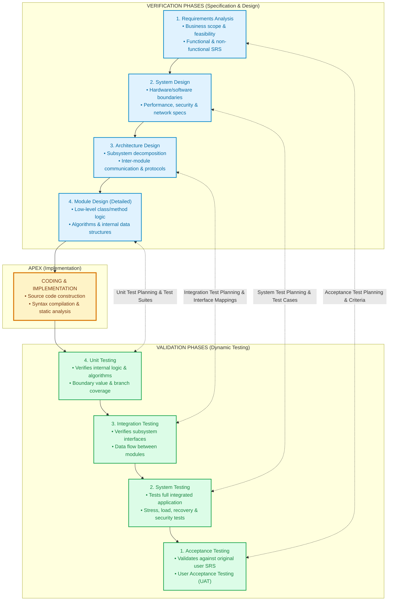

# The V-Model: Comprehensive Academic & Exam Study Guide

**Course Code:** 24ITPC302 — Software Engineering  
**Module:** Unit I — Software Process & Agile Development  
**Standard:** 13-Mark & 16-Mark University Examination Level  
**Prescribed References:** Roger S. Pressman (Ch. 2), Ian Sommerville (Ch. 2), Rajib Mall (Ch. 2)

---

## 🧭 Document Overview & Study Roadmap
This document provides two levels of mastery for the **V-Model (Verification and Validation Model)**:
1. **Level 1 — Conceptual Understanding:** Beginner-friendly analogies, an intuitive breakdown of Verification vs Validation, and the mechanics of the Defect Prevention Principle.
2. **Level 2 — University Examination Master Answer:** A structured, publication-grade 13/16-mark model answer featuring the classical symmetric V-diagram, phase-to-phase mapping, advantages, limitations, and industrial applications.

---

# Part I: Level 1 — Conceptual Understanding

### 1. What is the V-Model in Plain English?
In the traditional Waterfall Model, testing is treated as a late activity that begins only after programmers finish writing the entire system. If a misunderstanding occurred during requirements analysis, the defect remains hidden throughout architecture, design, and coding—only to explode during testing, when fixing it requires rewriting half the application.

The **V-Model (Verification and Validation Model)** addresses this flaw through symmetry. It bends the linear waterfall into a **V-shape**:
- As the project descends down the **left side** of the "V" (creating requirements and architectural blueprints), test engineers simultaneously write the test cases that will verify those blueprints.
- At the very bottom of the "V", programmers write the code.
- As the project climbs up the **right side** of the "V", the system is tested against the test plans written during the left-side phases.

### 2. The Core Distinction: Verification vs Validation
A central concept in software engineering is the distinction between **Verification** and **Validation** (formulated by Barry Boehm):

```
+--------------------------------------------------------------------------------------------------+
|                            VERIFICATION vs VALIDATION IN A NUTSHELL                              |
+--------------------------------------------------------------------------------------------------+
| VERIFICATION: "Are we building the product right?"                                               |
| - Checks whether the software conforms to its specified technical design and standards.         |
| - Static process: Done WITHOUT executing compiled code (reviews, walkthroughs, inspections).     |
| - Left wing of the V-Model.                                                                      |
+--------------------------------------------------------------------------------------------------+
| VALIDATION:   "Are we building the right product?"                                               |
| - Checks whether the software satisfies the real-world operational needs of the customer.        |
| - Dynamic process: Done WITH executing compiled code on test hardware.                           |
| - Right wing of the V-Model.                                                                     |
+--------------------------------------------------------------------------------------------------+
```

#### Real-World Analogy:
Imagine an automobile manufacturer designing a car:
- **Verification:** Reviewing the blueprints to verify that the brake line diameter matches the engineering drawings and that the hydraulic fluid meets industry standards. The car has not moved an inch; you are inspecting documents.
- **Validation:** Putting a test driver behind the wheel on a wet test track, slamming on the brakes at 100 km/h, and verifying whether the car stops safely within the required distance.

---

### 3. The Defect Prevention Principle Explained
Why write test cases months before the code is even written?

Consider this requirement: *"The system shall authenticate users quickly."*
1. **Under Traditional Waterfall:** The analyst writes this sentence in the SRS. The architect designs a login module. The programmer writes the code. Six months later, the tester tries logging in and complains: *"It takes 3 seconds, that's not quick!"* The developer replies: *"To me, 3 seconds is quick."* An argument ensues, requirements are revised, and code must be rewritten.
2. **Under the V-Model:** While the analyst writes the requirement, the test engineer attempts to write the corresponding **Acceptance Test Case**. The tester immediately asks: *"What does 'quickly' mean? Does it mean under 500 milliseconds under a 1,000-user concurrent load?"* The ambiguity is caught on **Day 2** before a single line of code is written!

This is the **Defect Prevention Principle**: by formulating test cases during requirements and design, defects are prevented at the specification stage rather than detected at the testing stage.

---

# Part II: Level 2 — University Examination Master Answer

## Question Model (13 Marks / 16 Marks)
> **(a)** Define the V-Model of software development. Differentiate between Verification and Validation activities with suitable examples. **[6 Marks]**  
> **(b)** Draw a neat, fully labeled diagram of the V-Model. Explain the phase-to-phase correspondence between the development (verification) phases and testing (validation) phases. Detail the Defect Prevention Principle, advantages, disadvantages, and applications. **[10 Marks]**

---

### 1. Definition of the V-Model
The **V-Model (Verification and Validation Model)** is an enhanced sequential software process model that establishes an explicit, symmetric relationship between each phase of software specification/design (Verification) and its corresponding phase of software testing (Validation). 

Originally developed in German and American defense engineering standards, the model demonstrates that testing is not a late phase that starts after coding, but a continuous engineering activity whose planning begins concurrently with the earliest requirement activities.

---

### 2. Verification vs. Validation (Theoretical & Practical Comparison)

| Dimension | Verification | Validation |
| :--- | :--- | :--- |
| **Philosophical Question** | **"Are we building the product right?"** | **"Are we building the right product?"** |
| **Primary Objective** | Confirm that intermediate work products conform to phase inputs and technical standards. | Confirm that the final operational software satisfies the customer's actual operational needs. |
| **Execution Nature** | **Static analysis:** Performed *without* executing compiled program code. | **Dynamic analysis:** Performed *with* executing compiled software on target test environments. |
| **Primary Techniques** | Formal inspections, peer reviews, structured walkthroughs, static code analysis. | Unit testing, integration testing, system testing, user acceptance testing (UAT). |
| **Timing in V-Model** | Occupies the **descending left wing** (Requirements, System, Architecture, Module Design). | Occupies the **ascending right wing** (Unit, Integration, System, Acceptance Testing). |
| **Responsibility** | Software engineers, architects, analysts, and quality assurance reviewers. | Independent testing teams, QA engineers, and end-user stakeholders. |

---

### 3. The Classical V-Model Architecture Diagram



---

### 4. Phase-to-Phase Correspondence & Working Mechanism

The core strength of the V-Model is the strict one-to-one horizontal mapping between development levels on the left and testing levels on the right:

#### 1. Requirements Analysis $\Longleftrightarrow$ Acceptance Testing
- **Left Wing Activity:** Systems analysts interview stakeholders to compile the Software Requirements Specification (SRS), documenting functional capabilities and business rules.
- **Corresponding Right Wing Activity (Acceptance Testing / UAT):** The system is evaluated directly by end users in a production-like staging environment to verify that business objectives are satisfied.
- **Early Test Connection:** The **Acceptance Test Plan and test scenarios are authored during the Requirements Analysis phase**. Writing acceptance criteria early ensures requirements are unambiguous, testable, and measurable.

#### 2. System Design $\Longleftrightarrow$ System Testing
- **Left Wing Activity:** Engineers design overall hardware/software configurations, database systems, communication infrastructures, and non-functional targets (throughput, latency, security).
- **Corresponding Right Wing Activity (System Testing):** The completely integrated software application is tested against performance benchmarks, security attack vectors, failover recovery, and operational limits.
- **Early Test Connection:** The **System Test Plan and load/stress scenarios are designed during System Design**, ensuring non-functional criteria are validated against architectural specifications.

#### 3. Architecture Design $\Longleftrightarrow$ Integration Testing
- **Left Wing Activity:** High-level system architecture is decomposed into distinct subsystems, defining communication interfaces, API endpoints, data pipelines, and protocols.
- **Corresponding Right Wing Activity (Integration Testing):** Focuses specifically on testing communication pathways and data exchange across subsystem boundaries (e.g., using Top-Down, Bottom-Up, or Sandwich integration).
- **Early Test Connection:** The **Integration Test Plan and Interface Verification Suites are authored during Architectural Design**, ensuring interface contracts (e.g., REST endpoints, RPC schemas) are verified.

#### 4. Module / Detailed Design $\Longleftrightarrow$ Unit Testing
- **Left Wing Activity:** Engineers define the internal logic of individual classes, methods, database tables, and algorithms (often using pseudocode, flowcharts, or class diagrams).
- **Corresponding Right Wing Activity (Unit Testing):** Developers execute white-box and black-box test cases on isolated units, verifying algorithmic precision, branch coverage, and boundary values.
- **Early Test Connection:** **Unit test suites and boundary test cases are authored directly from the Module Design specifications**, before source code construction begins.

#### 5. Coding (The Vertex of the V):
- Sits at the bottom tip of the V. Developers write the production source code in the chosen programming language based on the detailed module designs. Code undergoes static linting and compiler verification before ascending into the validation wing.

---

### 5. The Defect Prevention Principle

In traditional software development, the cost of remediating defects increases exponentially as the project advances (Boehm’s Cost of Quality Curve):

$$\text{Relative Cost to Fix Defect} = 
\begin{cases} 
1\times & \text{Requirements Phase} \\
5\times & \text{Design Phase} \\
10\times & \text{Coding Phase} \\
20\times & \text{System Testing Phase} \\
50\times - 100\times & \text{Post-Release Operations} 
\end{cases}$$

#### How the V-Model Implements Defect Prevention:
1. **Test-Driven Requirements Scrubbing:** When test engineers attempt to author acceptance test cases during requirements analysis, they identify vague adjectives (*"fast"*, *"user-friendly"*, *"robust"*), contradictions, and missing edge conditions.
2. **Early Elimination of Flaws:** By forcing requirement refinement before system design starts, errors are corrected at the $1\times$ cost stage rather than at the $50\times$ post-release stage.
3. **Parallel QA Productivity:** Test teams do not wait idle while developers code; they author test cases, test harnesses, stubs, and drivers concurrently with the design phases.

---

### 6. Advantages and Disadvantages of the V-Model

#### Advantages:
1. **Explicit Focus on Quality & Verification:** Establishes rigorous verification checkpoints at every phase rather than treating testing as an afterthought.
2. **Early Defect Identification:** Authorship of test plans during early design phases exposes specification ambiguities before code implementation.
3. **High Discipline & Traceability:** Each development deliverable has a directly corresponding test verification document, ensuring complete bidirectional traceability.
4. **Structured Milestone Management:** Progress is easily measured; clear entrance and exit criteria govern transitions between phases.
5. **High Reliability:** Produces exceptionally stable, robust software suitable for mission-critical deployments.

#### Disadvantages:
1. **Rigid & Inflexible:** Struggles to accommodate requirement changes once the left wing has been traversed; mid-project changes trigger extensive redesign of both design and test documents.
2. **Delayed Working Software:** No working software is produced until the bottom vertex of the V is reached, delaying operational visibility for end users.
3. **High Upfront Documentation Overhead:** Requires exhaustive, formal documentation at every level, creating high overhead for small or rapidly evolving projects.
4. **Poor Fit for Exploratory Projects:** Ineffective when requirements are uncertain, novel, or heavily dependent on iterative user discovery.

---

### 7. Applications & Industrial Suitability

| Highly Recommended For | Unsuitable For |
| :--- | :--- |
| **Safety-Critical Systems:** Medical devices, automotive control (ISO 26262), avionics (DO-178C), railway signaling | **Rapid Startups / Web Apps:** Consumer apps where user preferences shift weekly |
| **High-Reliability Embedded Systems:** Microcontroller firmware, automotive ECU controllers | **Exploratory Software:** Machine learning research, experimental user interfaces |
| **Strict Regulatory Environments:** Defense and aerospace systems requiring formal compliance audits | **Projects with Volatile Requirements:** Commercial websites requiring continuous feature pivots |
| **Well-Understood System Domains:** Projects where requirements can be clearly specified upfront | **Small, Budget-Constrained Projects:** High documentation overhead outweighs benefits |

---

### 8. Comparison: V-Model vs Classical Waterfall vs Agile

| Parameter | Classical Waterfall | V-Model | Agile (Scrum / XP) |
| :--- | :--- | :--- | :--- |
| **Testing Philosophy** | Late activity performed after full coding is complete. | Early activity; test plans designed concurrently with specifications. | Continuous activity; tests written before or during iteration development. |
| **Process Geometry** | Linear sequential single line ($\downarrow$). | Symmetric V-shape ($\searrow \text{Coding} \nearrow$). | Cyclic iterative loops ($\circlearrowright$). |
| **Cost of Change** | Extremely high late in the project. | Moderate-to-high (mitigated early by test planning). | Low; designed to absorb change continuously. |
| **Working Software Delivery** | Only at the very end of the project. | Only at the very end of the project. | Every 1 to 4 weeks in working increments. |
| **Defect Mitigation** | Defect detection during testing phase. | **Defect prevention** during specification & design. | Defect prevention via TDD & pair programming. |

---

### 9. High-Yield Examination Keywords & Quick Revision Points

> [!TIP]
> **Key Exam Terms to Include in Your Answer:**
> - **Symmetric V-Shape** — Verification descends the left wing; Validation ascends the right wing.
> - **Verification** — "Are we building the product right?" (Static reviews, inspections, without code execution).
> - **Validation** — "Are we building the right product?" (Dynamic testing, with code execution).
> - **Horizontal Mapping Pairs**:
>   - Requirements Analysis $\Longleftrightarrow$ Acceptance Testing
>   - System Design $\Longleftrightarrow$ System Testing
>   - Architecture Design $\Longleftrightarrow$ Integration Testing
>   - Module Design $\Longleftrightarrow$ Unit Testing
> - **Bottom Apex** — Coding / Implementation.
> - **Defect Prevention Principle** — Writing test cases early exposes specification defects when remediation cost is $1\times$ rather than $50\times$–$100\times$.
> - **Industrial Fit** — Safety-critical, medical, avionics, defense, and embedded systems.
