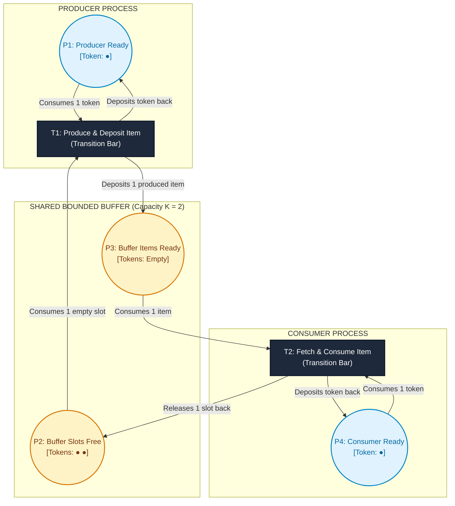
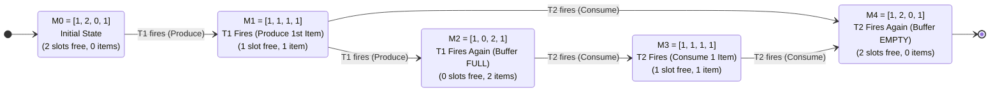

# Petri Nets: Visual Modeling & Producer-Consumer State Transitions

This document contains standardized, publication-grade Mermaid diagrams representing **Petri Nets** as a formal mathematical tool for modeling concurrent, asynchronous, and distributed systems.

---

## 1. The Producer-Consumer Synchronization Model (Bounded Buffer)

The classical Producer-Consumer system coordinates two asynchronous processes sharing a finite buffer of capacity $K=2$.

---

## 2. Token Reachability & State Transition Trace

A Petri Net execution is traced via its **Marking Vector** $M = [M(P_1), M(P_2), M(P_3), M(P_4)]$:

### Explanation of Petri Net Dynamics:
1. **Initial Marking ($M_0 = [1, 2, 0, 1]$):**
   - Place $P_1$ has 1 token: Producer is idle and ready.
   - Place $P_2$ has 2 tokens: 2 buffer slots are vacant.
   - Place $P_3$ has 0 tokens: No items are available in the buffer.
   - Place $P_4$ has 1 token: Consumer is idle and ready.
2. **Firing Transition $T_1$ (Produce):**
   - $T_1$ is enabled because its input places ($P_1$ and $P_2$) both contain tokens.
   - When $T_1$ fires, it consumes 1 token from $P_1$ and 1 token from $P_2$, producing 1 item into $P_3$ and returning 1 token to $P_1$.
   - Resulting Marking: $M_1 = [1, 1, 1, 1]$.
3. **Buffer Underflow Prevention:**
   - Transition $T_2$ (Consume) cannot fire from $M_0$ because input place $P_3$ has 0 tokens! This mathematically guarantees that the consumer can never read from an empty buffer.
4. **Buffer Overflow Prevention:**
   - From $M_2 = [1, 0, 2, 1]$, transition $T_1$ cannot fire because $P_2$ has 0 tokens (buffer is full). The producer is safely blocked until the consumer frees a slot via $T_2$.
