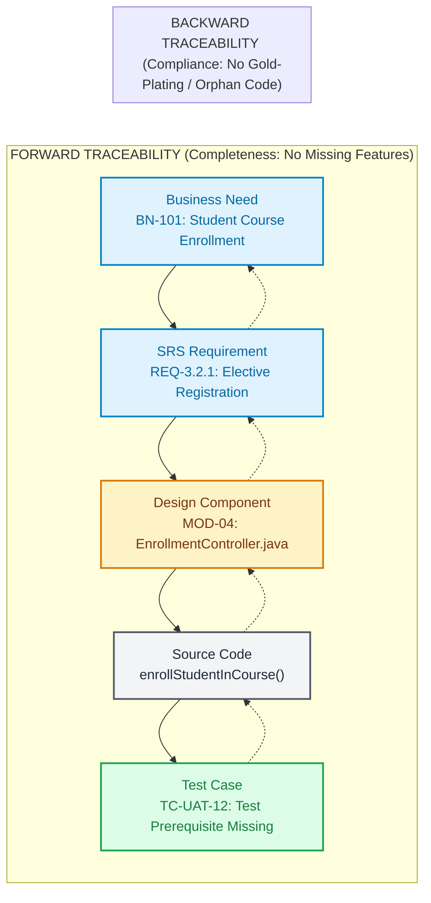

# Requirements Engineering Process: Visual Workflow & Phase Architecture

This document contains standardized, publication-grade Mermaid diagrams representing the **Requirements Engineering (RE) Process**, its iterative feedback loops, deliverables, and the Requirements Traceability Matrix (RTM).

---

## 1. The Complete End-to-End Requirements Engineering Lifecycle

The Requirements Engineering process is an iterative, structured sequence of engineering activities transforming stakeholder business desires into an unambiguous, validated, and manageable **Software Requirements Specification (SRS)**.

```mermaid
flowchart TD
    classDef phase fill:#e0f2fe,stroke:#0284c7,stroke-width:2px,color:#0369a1;
    classDef gate fill:#fef3c7,stroke:#d97706,stroke-width:1.5px,color:#78350f;
    classDef deliverable fill:#dcfce7,stroke:#16a34a,stroke-width:2px,color:#15803d;
    classDef feedback fill:#fee2e2,stroke:#dc2626,stroke-width:1.5px,stroke-dasharray: 4 4,color:#7f1d1d;

    Start([Business Need / Problem Statement]) --> P1["1. Feasibility Study<br/>• Technical: skills, tech stack, hardware<br/>• Economic: Cost-Benefit Analysis & ROI<br/>• Operational: user adoption & organizational fit<br/>• Legal & Schedule feasibility"]

    P1 --> G1{"Feasibility Gate:<br/>Project Viable?"}
    G1 -- "No" --> Abort([Cancel Project / Minimize Sunk Cost])
    G1 -- "Yes" --> D1["Deliverable: Feasibility Report"]

    D1 --> P2["2. Requirements Elicitation<br/>• Stakeholder interviews & surveys<br/>• Joint Application Development (JAD)<br/>• Brainstorming & on-site observation<br/>• Use cases & user story collection"]

    P2 --> P3["3. Requirements Analysis & Elaboration<br/>• Categorize into Functional vs Non-Functional<br/>• Resolve conflicting stakeholder demands<br/>• Model system boundaries & DFD Level 0/1<br/>• Identify edge cases & constraints"]

    P3 --> P4["4. Requirements Negotiation<br/>• Prioritize features by business value vs technical cost<br/>• Agree on compromises with stakeholders<br/>• Resolve scope vs budget trade-offs"]

    P4 --> P5["5. Requirements Specification<br/>• Formalize into IEEE 830 SRS standard<br/>• Section 1: Introduction & Scope<br/>• Section 2: Overall Product Description<br/>• Section 3: Specific Functional & Quality Attributes"]

    P5 --> D2["Deliverable: Draft SRS Document"]
    D2 --> P6["6. Requirements Validation<br/>• Formal inspection reviews & walkthroughs<br/>• Verification against 6 quality criteria<br/>• Prototyping risky user interfaces<br/>• Model-based consistency checking"]

    P6 --> G2{"Validation Gate:<br/>SRS Complete &<br/>Unambiguous?"}
    G2 -- "No (Defects Found)" --> F1["Feedback Loop:<br/>Clarify & Correct Ambiguities"]
    F1 -.-> P2
    G2 -- "Yes" --> D3["Formal Baselined IEEE 830 SRS"]

    D3 --> P7["7. Requirements Management (Continuous Umbrella)<br/>• Change Control Board (CCB) governance<br/>• Version control of baseline SRS<br/>• Bidirectional Requirements Traceability Matrix (RTM)"]

    P7 --> Dev([Handover to Architectural Design & Construction])

    class P1,P2,P3,P4,P5,P6,P7 phase;
    class G1,G2 gate;
    class D1,D2,D3 deliverable;
    class F1 feedback;
```

### Explanation of Diagram Components:
1. **Feasibility Study:** Evaluates whether the proposed system is technically, economically, and operationally viable before committing capital. If unfeasible, the project is terminated early.
2. **Elicitation:** Gathers requirements from diverse stakeholders using interviews, workshops (JAD), questionnaires, and observation.
3. **Analysis & Elaboration:** Discovers boundaries, classifies requirements into functional and non-functional, and builds initial models (DFDs, use cases).
4. **Negotiation:** Resolves conflicts between stakeholders with competing priorities (e.g., marketing wants speed, finance wants low cost).
5. **Specification:** Transcribes informal requirements into the formal **IEEE 830 SRS** standard document.
6. **Validation:** Formal reviews check the draft SRS for completeness, consistency, testability, and clarity. Uncovered defects loop back to elicitation.
7. **Requirements Management:** Governs scope changes via a formal Change Control Board (CCB) and tracks each requirement using a Traceability Matrix.

---

## 2. Bidirectional Requirements Traceability Matrix (RTM)

The Requirements Traceability Matrix guarantees that every requirement is implemented in design, written in code, and verified in test cases:

### Explanation of Traceability:
- **Forward Traceability:** Ensures that every customer business need flows directly into the SRS, then into architectural modules, code, and test cases without omissions.
- **Backward Traceability:** Ensures that every module or test case can be traced back to an explicit customer requirement, eliminating unauthorized "gold-plating" (unrequested features added by developers).
