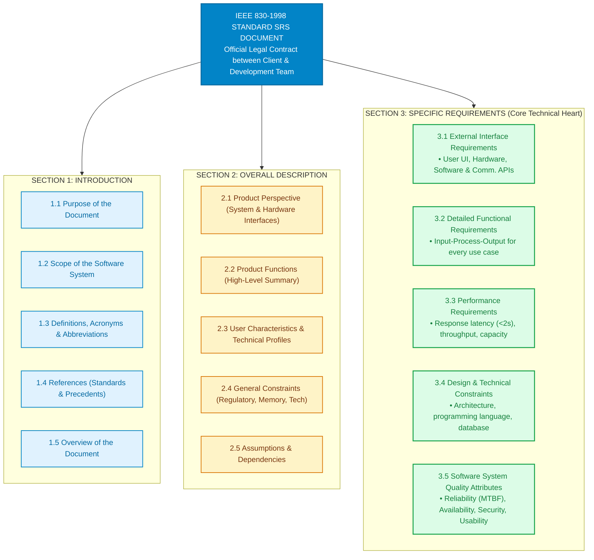
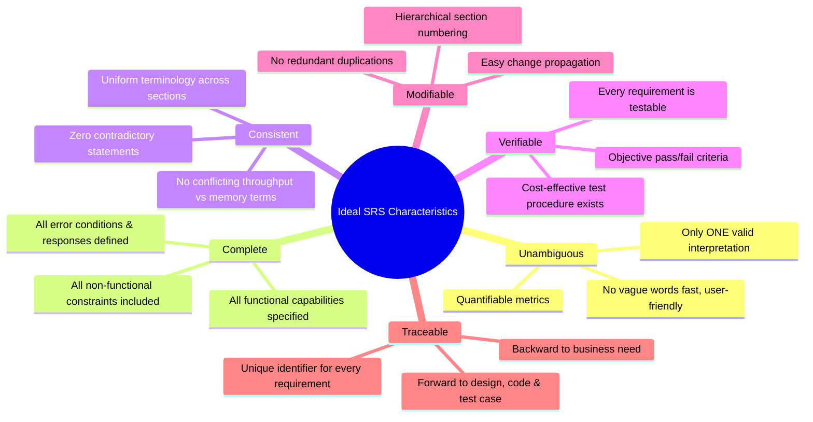

# IEEE 830 SRS Standard: Structure & Quality Attributes Architecture

This document contains standardized, publication-grade Mermaid diagrams representing the **IEEE 830-1998 Software Requirements Specification (SRS)** standard structure and its six essential quality characteristics.

---

## 1. The Standard IEEE 830-1998 Hierarchical Structure

---

## 2. The 6 Essential Quality Characteristics of a Good SRS

### Explanation of Characteristics:
1. **Unambiguous:** A sentence like *"The system shall respond quickly"* is defective. An unambiguous requirement states: *"The system shall return search query results within 500 milliseconds under a 2,000 concurrent user load."*
2. **Complete:** Specifies all valid inputs, all invalid inputs, and exact system responses to hardware/software faults.
3. **Consistent:** Requirements must not clash (e.g., Section 2.4 says *"runs on 2GB RAM"* but Section 3.3 demands *"in-memory caching of 8GB data"*).
4. **Verifiable:** An independent QA tester must be able to design a cost-effective test that yields an objective TRUE or FALSE pass.
5. **Modifiable:** A well-indexed table of contents and cross-references allow updates without creating inconsistencies.
6. **Traceable:** Every requirement has a unique label (e.g., `REQ-SEC-01`) enabling full lifecycle tracing in an RTM.
