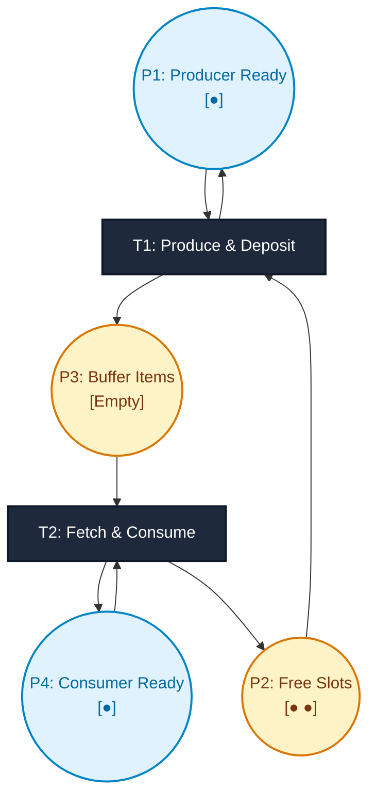

# University Exam Model Answer: Petri Nets (Concurrency & Synchronization)

**Course Code:** 24ITPC302 — Software Engineering  
**Unit:** Module II — Requirements Analysis & Specification  
**Target Marks:** 13 Marks / 16 Marks  
**Evaluation Standard:** Anna University / Autonomous Regulations 2024 Model

---

## Question:
> **(a) Define a Petri Net formally as a mathematical 5-tuple. Describe the four graphical primitives and the transition enabling and firing rules. [7 Marks]**  
> **(b) Construct a Petri Net model representing the classical Producer-Consumer synchronization problem with a bounded buffer of capacity K = 2. Trace its state transitions through two successive firings using a marking table. Explain Boundedness, Liveness, and Deadlock. [6 Marks]**

---

## 1. Formal Mathematical Definition
A **Petri Net** is a mathematical and graphical modeling language invented by **Carl Adam Petri** in 1962 for modeling concurrent, asynchronous, parallel, and distributed systems. 

Formally, a Petri Net is defined as an ordered 5-tuple:

$$\mathbf{PN = (P, T, F, W, M_0)}$$

Where:
1. $\mathbf{P = \{p_1, p_2, \dots, p_m\}}$ is a finite, non-empty set of **Places** (representing conditions or system states).
2. $\mathbf{T = \{t_1, t_2, \dots, t_n\}}$ is a finite, non-empty set of **Transitions** (representing events or computational actions), with $P \cap T = \emptyset$ (bipartite graph).
3. $\mathbf{F \subseteq (P \times T) \cup (T \times P)}$ is a set of **Directed Arcs** connecting Places to Transitions and Transitions to Places. Arcs never connect Place-to-Place or Transition-to-Transition.
4. $\mathbf{W: F \to \{1, 2, 3, \dots\}}$ is the **Arc Weight Function** assigning positive integer weights to arcs (defaults to 1).
5. $\mathbf{M_0: P \to \{0, 1, 2, \dots\}}$ is the **Initial Marking Vector**, denoting the initial distribution of tokens across places.

---

## 2. The Four Graphical Primitives

```
+--------------------------------------------------------------------------------------------------+
|                               THE 4 PETRI NET GRAPHICAL PRIMITIVES                               |
+-------------------+--------------------+---------------------------------------------------------+
| Element           | Graphical Symbol   | Engineering Semantics                                   |
+-------------------+--------------------+---------------------------------------------------------+
| 1. Places (P)     | Open Circles (○)   | System states, preconditions, buffers, resource pools.  |
| 2. Transitions (T)| Solid Bars / Boxes | Events, actions, processing tasks, state transitions.   |
| 3. Arcs (F)       | Directed Arrows (→)| Causal dependency, pathway of token/resource flow.      |
| 4. Tokens (●)     | Black Dots inside ○| Availability of dynamic resources or data packets.      |
+-------------------+--------------------+---------------------------------------------------------+
```

---

## 3. Transition Enabling & Firing Rules

### A. The Enabling Rule:
A transition $t$ is **enabled** (ready to fire) at marking $M$ if and only if each of its input places contains at least as many tokens as the connecting arc weight:

$$\forall p \in I(t), \quad M(p) \ge W(p, t)$$

*(Where $I(t)$ is the set of input places connected to transition $t$.)*

### B. The Firing Rule:
When an enabled transition $t$ fires:
1. It **consumes** $W(p, t)$ tokens from each of its input places $p \in I(t)$.
2. It **deposits** $W(t, p')$ tokens into each of its output places $p' \in O(t)$.
3. The new state (Marking $M'$) is computed via:
   $$M'(p) = M(p) - W(p, t) + W(t, p)$$

---

## 4. Producer-Consumer Model with Bounded Buffer ($K = 2$)

### System Elements:
- **Places:**
  - $P_1$: Producer Ready (Initial tokens: 1)
  - $P_2$: Buffer Slots Available (Initial tokens: 2, since capacity $K=2$)
  - $P_3$: Buffer Items Ready (Initial tokens: 0)
  - $P_4$: Consumer Ready (Initial tokens: 1)
- **Transitions:**
  - $T_1$: Produce and Deposit item into buffer.
  - $T_2$: Fetch and Consume item from buffer.



---

## 5. Step-by-Step State Transition Trace (Marking Table)

Let marking vector $M = [M(P_1), M(P_2), M(P_3), M(P_4)]$:

| Step | System Marking Vector | Active Firing | Tokens Consumed | Tokens Deposited | Engineering Interpretation |
| :---: | :---: | :---: | :---: | :---: | :--- |
| **0** | **$M_0 = [1, 2, 0, 1]$** | Initial State | None | None | 2 slots free; 0 items. $T_1$ enabled; **$T_2$ disabled** (prevents buffer underflow). |
| **1** | **$M_1 = [1, 1, 1, 1]$** | **$T_1$ fires** | 1 from $P_1$<br>1 from $P_2$ | 1 into $P_1$<br>1 into $P_3$ | 1 item produced and buffered. 1 slot free. Both $T_1$ and $T_2$ enabled! |
| **2** | **$M_2 = [1, 0, 2, 1]$** | **$T_1$ fires again** | 1 from $P_1$<br>1 from $P_2$ | 1 into $P_1$<br>1 into $P_3$ | Buffer is **FULL** (2 items). **$T_1$ disabled** (prevents buffer overflow). |
| **3** | **$M_3 = [1, 1, 1, 1]$** | **$T_2$ fires** | 1 from $P_3$<br>1 from $P_4$ | 1 into $P_4$<br>1 into $P_2$ | Consumer fetched 1 item. 1 slot freed. $T_1$ re-enabled. |
| **4** | **$M_4 = [1, 2, 0, 1]$** | **$T_2$ fires again** | 1 from $P_3$<br>1 from $P_4$ | 1 into $P_4$<br>1 into $P_2$ | Buffer is **EMPTY**. Returns to initial state $M_0$. |

---

## 6. Behavioral Properties of Petri Nets

1. **Boundedness & Safeness:**
   - A place $p$ is **$k$-bounded** if its token count never exceeds $k$ in any reachable state ($M(p) \le k$).
   - A net is **Safe (1-bounded)** if $k=1$. In our model, $P_2$ and $P_3$ are 2-bounded, proving the buffer will never overflow beyond capacity $K=2$.
2. **Liveness (Deadlock-Freedom):**
   - A transition $t$ is *live* if it can be enabled from any reachable marking.
   - The system is **Deadlock-Free** because at no reachable marking are both $T_1$ and $T_2$ disabled simultaneously.
3. **Reachability:** Confirms that critical desirable states can always be reached through valid firing paths.

---

## 7. Conclusion
Petri Nets provide a formal, mathematically verifiable framework for analyzing concurrent, multi-threaded software. By visualizing states as places, actions as transitions, and system resources as tokens, they enable software engineers to mathematically prove the absence of race conditions, buffer overflows, and deadlocks in complex systems.
