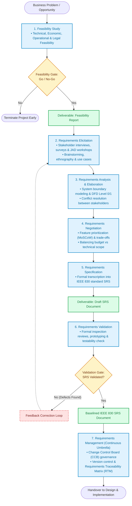
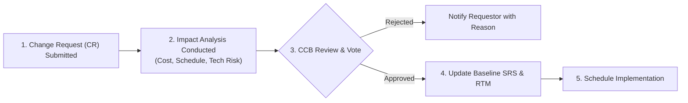

# University Exam Model Answer: The Requirements Engineering Process

**Course Code:** 24ITPC302 — Software Engineering  
**Unit:** Module II — Requirements Analysis & Specification  
**Target Marks:** 13 Marks / 16 Marks  
**Evaluation Standard:** Anna University / Autonomous Regulations 2024 Model

---

## Question:
> **(a) Illustrate the Requirements Engineering (RE) process with a neat flowchart. Explain the activities performed in each of its phases from Feasibility Study to Requirements Management. [8 Marks]**  
> **(b) Discuss the various techniques used for Requirements Elicitation. How are requirements validated, and how does a Change Control Board (CCB) manage requirement changes? [8 Marks]**

---

## 1. Definition
The **Requirements Engineering (RE) Process** is a disciplined, systematic, and iterative sequence of software engineering activities concerned with discovering, analyzing, documenting, validating, and managing the requirements of a proposed software system. 

It bridges the gap between informal customer business needs and the formal, baselined **Software Requirements Specification (SRS)** that directs all downstream architecture, coding, and testing activities.

---

## 2. Requirements Engineering Process Architecture Flowchart

---

## 3. Explanation of Each Phase in the RE Process

### 1. Feasibility Study:
- Determines whether the project should be initiated:
  - **Technical Feasibility:** Assesses availability of development skills, hardware, and software tools.
  - **Economic Feasibility:** Cost-Benefit Analysis (CBA) to establish Return on Investment (ROI).
  - **Operational Feasibility:** Evaluates user readiness to adopt the new system.
  - **Legal Feasibility:** Assesses compliance with privacy laws (GDPR, HIPAA) and licensing.

### 2. Requirements Elicitation:
- Discovers user needs through stakeholder collaboration. Primary techniques:
  - *Interviews:* Formal structured or informal discussions with users.
  - *Joint Application Development (JAD):* 2–3 day intensive workshops bringing business and technical staff together.
  - *Questionnaires & Surveys:* Gathers feedback from large, geographically distributed user groups.
  - *On-Site Observation (Ethnography):* Analysts observe operational workflows in practice.
  - *Use Cases / User Stories:* Scenarios describing interactions between external actors and the system.

### 3. Requirements Analysis & Elaboration:
- Scrutinizes raw requirements to remove ambiguities and resolve stakeholder conflicts.
- Establishes clear system boundaries using **Context Diagrams (DFD Level 0)** and **Functional Decomposition (DFD Level 1)**.
- Classifies requirements into **Functional** (behaviors) and **Non-Functional** (performance, security).

### 4. Requirements Negotiation:
- Reconciles competing stakeholder demands against budget and time constraints.
- Prioritizes requirements using methods such as **MoSCoW** (*Must-have, Should-have, Could-have, Won't-have*).

### 5. Requirements Specification:
- Authors the agreed requirements into a formal **Software Requirements Specification (SRS)** following the **IEEE Std 830-1998** standard structure.

### 6. Requirements Validation:
- Ensures the draft SRS meets high quality standards before code construction begins:
  - *Formal Inspections & Walkthroughs:* Multidisciplinary review panel inspects every page.
  - *Prototyping:* Users test UI mockups to validate confusing workflows.
  - *Verification against 6 Quality Criteria:* Unambiguous, Complete, Consistent, Verifiable, Modifiable, Traceable.

### 7. Requirements Management:
- Governs evolving requirements throughout the software lifecycle.
- Freezes the approved SRS as a baseline (Version 1.0).
- Employs a **Change Control Board (CCB)** and a **Requirements Traceability Matrix (RTM)** to manage scope changes.

---

## 4. The Change Control Board (CCB) Process

1. **Submission:** A stakeholder submits a formal Change Request (CR) specifying proposed alterations and business justification.
2. **Impact Analysis:** Software engineers evaluate technical feasibility, schedule delay, cost increase, and regression risk.
3. **CCB Deliberation:** The committee (Project Manager, Client Lead, Chief Architect, QA Lead) formally reviews the analysis and votes.
4. **Baselining:** If approved, the SRS version increments (e.g., Version 1.0 $\to$ 1.1), the RTM is updated, and work is scheduled.

---

## 5. Conclusion
The Requirements Engineering Process establishes an essential, disciplined bridge between fuzzy human problems and precise digital solutions. By ensuring systematic feasibility, stakeholder elicitation, rigorous validation, and formal change control, it prevents the leading causes of project failure: scope creep, ambiguous specifications, and unverified assumptions.
