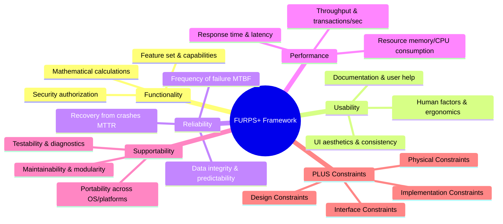

# Functional vs. Non-Functional Requirements: Academic & Exam Guide

**Course Code:** 24ITPC302 — Software Engineering  
**Module:** Unit II — Requirements Analysis & Specification  
**Standard:** 13-Mark & 16-Mark University Examination Level  
**Prescribed References:** Roger S. Pressman (Ch. 5 & 7), Ian Sommerville (Ch. 4), ISO/IEC 25010 Quality Model

---

## 🧭 Document Overview & Study Roadmap
This document provides two levels of mastery for **Functional vs. Non-Functional Requirements**:
1. **Level 1 — Conceptual Understanding:** The intuitive distinction ("What the system does" vs "How well the system does it"), why non-functional requirements break projects when neglected, and how to make vague requirements testable.
2. **Level 2 — University Examination Master Answer:** 10-parameter comparison matrix, the FURPS+ framework, ISO/IEC 25010 quality model, quantifiable measurement metrics, and architectural trade-off analysis.

---

# Part I: Level 1 — Conceptual Understanding

### 1. The Core Distinction in Plain English
Imagine purchasing an automobile:
- **Functional Requirements ("What it does"):** The car must accelerate when pressing the pedal, brake when pressing the brake pedal, have headlights that turn on at night, and shift gears. If any of these fail, the car does not work.
- **Non-Functional Requirements ("How well it does it"):** The car must reach 0 to 100 km/h in 6.5 seconds (**Performance**); it must have an anti-lock braking system that prevents skidding on ice (**Safety/Reliability**); it must achieve 20 km per liter of fuel (**Efficiency**); the seats must be ergonomically comfortable for 5 hours of driving (**Usability**); and replacement tires must be standard and easy to buy (**Maintainability**).

In software engineering:
- **Functional Requirements (FR):** Define the specific behavioral calculations, data flows, input validations, and business services the system must execute.
- **Non-Functional Requirements (NFR / Quality Attributes):** Define the operational qualities, performance thresholds, security standards, and environmental constraints under which the functional services must be delivered.

---

### 2. Why Are Non-Functional Requirements Critical?
If a developer fails to implement a functional requirement (e.g., forgets the "Print Receipt" button), the defect is isolated and can be added later in a single patch.

However, if an architect fails to design for a non-functional requirement (e.g., neglects security encryption, or builds a database that crashes under 500 concurrent users), **the entire system architecture may have to be scrapped and rebuilt from scratch!**

---

# Part II: Level 2 — University Examination Master Answer

## Question Model (13 Marks / 16 Marks)
> **(a)** Distinguish clearly between Functional and Non-Functional Requirements with suitable examples. Explain the FURPS+ classification framework and the ISO/IEC 25010 quality model. **[7 Marks]**  
> **(b)** Why are Non-Functional Requirements notoriously difficult to specify and verify? Provide objective, quantifiable test metrics for Performance, Reliability, Availability, and Usability. **[6 Marks]**

---

### 1. Comprehensive 10-Parameter Comparison Matrix

| Evaluation Dimension | Functional Requirements (FR) | Non-Functional Requirements (NFR) |
| :--- | :--- | :--- |
| **1. Fundamental Question** | **"What does the system do?"** | **"How well does the system perform its functions?"** |
| **2. Definition** | Statements of services, computations, data transformations, and input-output behaviors. | Constraints on services: performance bounds, security protocols, reliability, and usability standards. |
| **3. Scope of Impact** | **Localized:** Often confined to a single module, class, or use case. | **Cross-Cutting:** Pervades the entire software architecture, infrastructure, and database design. |
| **4. Origin** | Derived directly from customer business operations and user workflows. | Derived from technical constraints, legal regulations, performance needs, and user experience standards. |
| **5. Measurement** | Binary (**Pass / Fail**): The calculation is either executed correctly or not. | Continuous / Quantitative: Measured against numeric thresholds (latency, throughput, uptime). |
| **6. Architectural Impact** | Influences low-level component logic and algorithm design. | Dictates high-level architectural styles (e.g., microservices, caching, redundancy). |
| **7. Specification Style** | Expressed via Use Cases, User Stories, and Input-Process-Output (IPO) tables. | Expressed as quantifiable constraints using standard engineering metrics. |
| **8. Testing Technique** | Functional Black-Box testing, unit testing, integration testing. | Stress testing, load profiling, penetration testing, usability lab tests. |
| **9. Consequence of Failure** | Feature does not work, but remaining system modules continue operating. | System collapse: whole platform crashes, data is breached, or users abandon slow app. |
| **10. Concrete Example** | *"The system shall calculate 8% sales tax on shopping cart items."* | *"The transaction processing engine shall execute under 200 ms latency at 5,000 req/sec."* |

---

### 2. The FURPS+ Classification Framework

Originally developed at Hewlett-Packard by Robert Grady, **FURPS+** is the industry-standard taxonomy for classifying software requirements:

1. **Functionality ($F$):** Core business features, mathematical algorithms, security controls, and general system services.
2. **Usability ($U$):** Ergonomics, visual consistency, navigation ease, help systems, and accessibility.
3. **Reliability ($R$):** Precision of outputs, crash recovery, Mean Time Between Failures ($MTBF$), and predictability under exceptional inputs.
4. **Performance ($P$):** Processing speed, response latency, throughput, memory footprints, and resource consumption.
5. **Supportability ($S$):** Ease of maintenance, diagnostic logging, testability, extensibility, and portability across operating environments.
6. **The "+" Constraints:** 
   - *Design constraints:* Mandated architectural patterns (e.g., MVC, Microservices).
   - *Implementation constraints:* Required programming languages, tools, or libraries.
   - *Interface constraints:* Required interaction protocols with legacy external systems.
   - *Physical constraints:* Hardware limitations (size, weight, battery power).

---

### 3. Why Are Non-Functional Requirements Difficult to Specify & Verify?

1. **Natural Language Ambiguity:** Stakeholders describe NFRs using subjective, non-testable adjectives (*"fast"*, *"secure"*, *"user-friendly"*, *"robust"*).
2. **Conflicting Architectural Priorities:** NFRs frequently pull in opposing directions:
   - Enhancing **Security** (multi-layer encryption, biometric scans) severely degrades **Performance** and **Usability**.
   - Enhancing **Performance** (in-memory caching, relaxed synchronization) can compromise **Data Consistency**.
3. **Cross-Cutting System Scope:** An NFR like "Security" or "Reliability" cannot be implemented in an isolated file; it requires consistent coordination across UI, middleware, network layers, operating systems, and physical databases.

---

### 4. Objective, Quantifiable Metrics for NFRs

An NFR must never be left as an informal statement. It must be translated into **verifiable, quantifiable engineering metrics**:

| Quality Attribute | Defective / Vague Requirement | Valid, Quantifiable & Testable Requirement | Engineering Metric Used |
| :--- | :--- | :--- | :--- |
| **Performance (Latency)** | *"The system must respond quickly to queries."* | *"Search query results shall be rendered within 500 ms for 95% of queries under a load of 2,000 concurrent users."* | Response Latency (Milliseconds) at specific user concurrency. |
| **Performance (Throughput)** | *"The system must handle large order volumes."* | *"The order ingestion pipeline shall process a minimum of 3,500 orders per second under peak festival traffic."* | Throughput (Transactions / Queries per Second - TPS). |
| **Reliability** | *"The software should rarely crash."* | *"The software shall exhibit a Mean Time Between Failures (MTBF) of at least 2,500 hours of continuous operations."* | Mean Time Between Failures ($MTBF$). |
| **Availability** | *"The portal must always be online."* | *"The system shall maintain an operational availability of 99.99% ('Four Nines'), allowing less than 52.6 minutes of downtime per year."* | Availability Formula: $A = \frac{MTBF}{MTBF + MTTR} \times 100\%$ |
| **Usability** | *"The user interface must be easy to learn."* | *"A newly hired clerk shall complete a customer account creation task within 3 minutes with zero errors after 30 minutes of training."* | Task Completion Time & Error Rate on Benchmark Users. |
| **Security** | *"The customer database must be safe from hackers."* | *"All stored patient health records shall be encrypted using AES-256 at rest, and all HTTP transmissions must enforce TLS 1.3 encryption."* | Industry Encryption Standard & Protocol Version. |

---

### 5. Mathematical Availability Calculation Example (Exam Problem)

$$\text{Availability } (A) = \frac{\text{MTBF}}{\text{MTBF} + \text{MTTR}} \times 100\%$$

- **Problem:** An e-commerce cloud server has a Mean Time Between Failures ($MTBF$) of 990 hours. When a crash occurs, the automated failover system has a Mean Time to Repair ($MTTR$) of 10 hours. Calculate its availability.
- **Solution:**
  $$A = \frac{990}{990 + 10} \times 100\% = \frac{990}{1000} \times 100\% = \mathbf{99.0\%}$$
  *(This represents 3.65 days of downtime per year, indicating a need for redundant hot-standby servers to reach "Four Nines" 99.99%.)*
