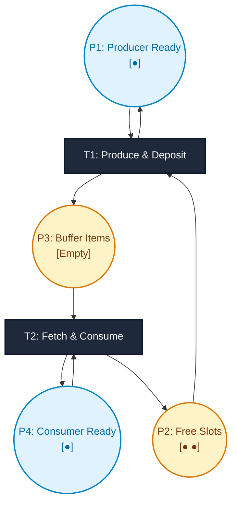

# Petri Nets: Formal Modeling of Concurrent Systems — Academic & Exam Guide

**Course Code:** 24ITPC302 — Software Engineering  
**Module:** Unit II — Requirements Analysis & Specification  
**Standard:** 13-Mark & 16-Mark University Examination Level  
**Prescribed References:** Roger S. Pressman (Ch. 6), Carl Adam Petri (1962), James L. Peterson (*Petri Net Theory*)

---

## 🧭 Document Overview & Study Roadmap
This document provides two levels of mastery for **Petri Nets**:
1. **Level 1 — Conceptual Understanding:** Why sequential models (like flowcharts) fail to model concurrency, how tokens represent resources, and the intuition behind event firing.
2. **Level 2 — University Examination Master Answer:** The formal 5-tuple mathematical definition, the 4 graphical primitives, exact firing rules, a complete Producer-Consumer bounded buffer model with step-by-step marking traces, and essential behavioral properties (Liveness, Boundedness, Deadlock-freedom).

---

# Part I: Level 1 — Conceptual Understanding

### 1. Why Do We Need Petri Nets?
Standard modeling tools like flowcharts or classical Data Flow Diagrams (DFDs) are excellent for modeling sequential, single-threaded operations. However, modern software systems—such as operating systems, multi-threaded servers, distributed databases, and automated banking systems—involve **concurrency, synchronization, and shared resources**.

In concurrent systems:
- Two or more processes execute simultaneously at independent speeds.
- Processes compete for shared resources (e.g., memory buffers, printer queues, database locks).
- If two processes attempt to access a shared buffer simultaneously, the system can crash or enter a **Deadlock** (where Process A waits for Process B, and Process B waits for Process A, freezing the system forever).

Invented by German mathematician **Carl Adam Petri** in 1962, a **Petri Net** is a mathematical and graphical modeling language specifically engineered to model, simulate, and mathematically prove the correctness of **concurrent, asynchronous, distributed, parallel, and resource-sharing systems**.

---

# Part II: Level 2 — University Examination Master Answer

## Question Model (13 Marks / 16 Marks)
> **(a)** Define a Petri Net formally as a mathematical 5-tuple. Describe the four graphical primitives and the fundamental transition firing rules. **[7 Marks]**  
> **(b)** Model the classical Producer-Consumer synchronization problem with a bounded buffer ($K = 2$) using a Petri Net. Trace its state transitions through two successive firings using a marking table. Explain the concepts of Boundedness, Liveness, and Deadlock. **[6 Marks]**

---

### 1. Formal Mathematical Definition of a Petri Net
A **Petri Net** is mathematically defined as an ordered 5-tuple:

$$\mathbf{PN = (P, T, F, W, M_0)}$$

Where:
1. $\mathbf{P = \{p_1, p_2, \dots, p_m\}}$ is a finite, non-empty set of **Places** (representing conditions or states).
2. $\mathbf{T = \{t_1, t_2, \dots, t_n\}}$ is a finite, non-empty set of **Transitions** (representing events or actions), such that $P \cap T = \emptyset$ (Places and Transitions are disjoint sets).
3. $\mathbf{F \subseteq (P \times T) \cup (T \times P)}$ is a set of **Directed Arcs** connecting Places to Transitions and Transitions to Places. Arcs *never* connect Place-to-Place or Transition-to-Transition (the graph is bipartite).
4. $\mathbf{W: F \to \{1, 2, 3, \dots\}}$ is the **Arc Weight Function** assigning a positive integer weight to each arc (defaults to 1 if omitted).
5. $\mathbf{M_0: P \to \{0, 1, 2, \dots\}}$ is the **Initial Marking Vector**, assigning a non-negative integer number of tokens to each place at initial state.

---

### 2. The Four Graphical Primitives

```
+--------------------------------------------------------------------------------------------------+
|                               THE 4 PETRI NET GRAPHICAL PRIMITIVES                               |
+-------------------+--------------------+---------------------------------------------------------+
| Element           | Graphical Symbol   | Systems Engineering Semantics                           |
+-------------------+--------------------+---------------------------------------------------------+
| 1. Places (P)     | Open Circles (○)   | System states, resource pools, buffers, preconditions.  |
| 2. Transitions (T)| Solid Bars / Boxes | Actions, computational events, state changes.           |
| 3. Arcs (F)       | Directed Arrows (→)| Causal dependency, pathway of resource/control flow.    |
| 4. Tokens (●)     | Black Dots inside ○| Availability of dynamic resources, data packets, tokens.|
+-------------------+--------------------+---------------------------------------------------------+
```

---

### 3. Transition Enabling & Firing Rules

Dynamic behavior in a Petri Net is governed by two formal rules:

#### A. The Enabling Rule (Precondition Check):
A transition $t \in T$ is said to be **enabled** (ready to fire) at marking $M$ if and only if **each of its input places contains at least as many tokens as the weight of the connecting arc**:

$$\forall p \in I(t), \quad M(p) \ge W(p, t)$$

*(Where $I(t) = \{p \in P \mid (p, t) \in F\}$ denotes the set of input places of transition $t$.)*

#### B. The Firing Rule (State Transformation):
When an enabled transition $t$ fires:
1. It **consumes** $W(p, t)$ tokens from each of its input places $p \in I(t)$.
2. It **deposits** $W(t, p')$ tokens into each of its output places $p' \in O(t)$.
3. The new system state (Marking $M'$) is computed via the state transition equation:

$$M'(p) = M(p) - W(p, t) + W(t, p)$$

*(Transitions fire atomically and instantaneously.)*

---

### 4. Concrete Model: Producer-Consumer with a Bounded Buffer ($K = 2$)

#### System Description:
- An asynchronous **Producer** generates data items and deposits them into a shared buffer of fixed capacity $K = 2$.
- An asynchronous **Consumer** removes items from the buffer and consumes them.
- **Mutual Exclusion & Boundary Constraints:**
  - The producer cannot deposit an item if the buffer is full (Capacity $= 2$).
  - The consumer cannot fetch an item if the buffer is empty (Capacity $= 0$).

#### Petri Net Construction:
- **Places ($P$):**
  - $P_1$: Producer Ready (1 token initially)
  - $P_2$: Buffer Slots Empty / Available (2 tokens initially, since $K=2$)
  - $P_3$: Buffer Items Ready (0 tokens initially)
  - $P_4$: Consumer Ready (1 token initially)
- **Transitions ($T$):**
  - $T_1$: Produce and Deposit item into buffer.
  - $T_2$: Fetch item and Consume from buffer.



---

### 5. Step-by-Step State Transition Trace (Marking Table)

Let the system marking be denoted by the vector $M = [M(P_1), M(P_2), M(P_3), M(P_4)]$:

| Step | State / Marking Vector | Active Firing | Tokens Consumed | Tokens Deposited | Physical System Interpretation |
| :---: | :---: | :---: | :---: | :---: | :--- |
| **0** | **$M_0 = [1, 2, 0, 1]$** | Initial State | None | None | Producer & Consumer ready; 2 buffer slots free; 0 items. $T_1$ enabled, **$T_2$ disabled** (prevents underflow). |
| **1** | **$M_1 = [1, 1, 1, 1]$** | **$T_1$ fires** | 1 from $P_1$<br>1 from $P_2$ | 1 into $P_1$<br>1 into $P_3$ | Producer deposited 1st item. 1 slot free, 1 item ready. Both $T_1$ and $T_2$ are now enabled! |
| **2** | **$M_2 = [1, 0, 2, 1]$** | **$T_1$ fires again** | 1 from $P_1$<br>1 from $P_2$ | 1 into $P_1$<br>1 into $P_3$ | Producer deposited 2nd item. Buffer is **FULL** (0 free slots). **$T_1$ disabled** (prevents overflow). |
| **3** | **$M_3 = [1, 1, 1, 1]$** | **$T_2$ fires** | 1 from $P_3$<br>1 from $P_4$ | 1 into $P_4$<br>1 into $P_2$ | Consumer consumed 1 item. Buffer now has 1 slot free and 1 item remaining. |
| **4** | **$M_4 = [1, 2, 0, 1]$** | **$T_2$ fires again** | 1 from $P_3$<br>1 from $P_4$ | 1 into $P_4$<br>1 into $P_2$ | Consumer consumed last item. Buffer is **EMPTY** again. Cycle returns to $M_0$. |

---

### 6. Essential Behavioral Properties of Petri Nets

Evaluators consistently test these formal analytical properties:

1. **Reachability:** A marking $M_n$ is reachable from $M_0$ if there exists a valid firing sequence $t_1, t_2, \dots, t_n$ that transforms $M_0$ into $M_n$. Reachability trees confirm that required operational states can be achieved.
2. **Boundedness & Safeness:**
   - A Petri Net is **$k$-bounded** if the number of tokens in any place never exceeds integer $k$ for all reachable markings ($\forall p \in P, M(p) \le k$).
   - A Petri Net is **Safe (1-bounded)** if no place ever holds more than 1 token ($k = 1$). Boundedness guarantees that physical hardware buffers will not overflow.
3. **Liveness (Deadlock-Freedom):**
   - A transition $t$ is *live* if from any reachable marking, it is always possible to eventually fire $t$.
   - A Petri Net is **Deadlock-Free** if at least one transition remains enabled at every reachable state, ensuring the software will never permanently freeze.
4. **Reversibility:** A Petri Net is reversible if from any reachable state $M$, it is always possible to return to the initial state $M_0$.

---

### 7. Applications in Software Engineering

| Software Engineering Domain | Practical Application of Petri Nets |
| :--- | :--- |
| **Concurrent Operating Systems** | Modeling semaphore locks, mutual exclusion (mutex), and race condition prevention. |
| **Distributed Communication Protocols**| Validating TCP/IP handshakes, packet acknowledgment windows, and routing buffers. |
| **Real-Time Embedded Systems** | Proving timing deadlines, sensor interrupt handling, and automotive ECU scheduling. |
| **Business Workflow Automation** | Modeling multi-stage loan approvals, supply chain handoffs, and ERP transactional workflows. |
