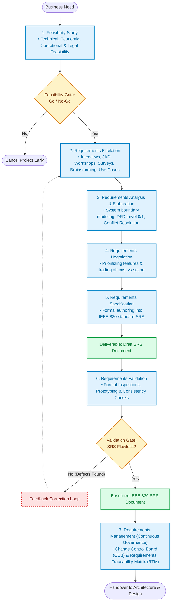
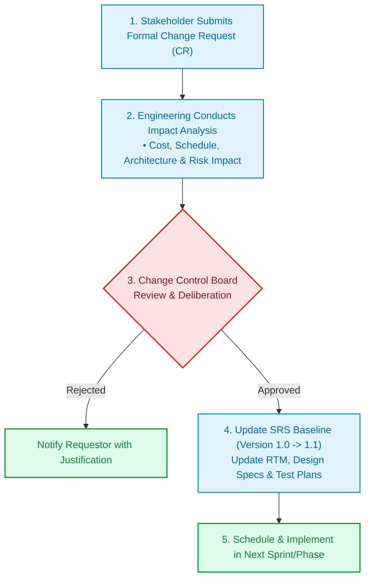

# The Requirements Engineering Process: Comprehensive Academic & Exam Guide

**Course Code:** 24ITPC302 — Software Engineering  
**Module:** Unit II — Requirements Analysis & Specification  
**Standard:** 13-Mark & 16-Mark University Examination Level  
**Prescribed References:** Roger S. Pressman (Ch. 5), Ian Sommerville (Ch. 4), Rajib Mall (Ch. 3)

---

## 🧭 Document Overview & Study Roadmap
This document provides two levels of mastery for the **Requirements Engineering (RE) Process**:
1. **Level 1 — Conceptual Understanding:** Why gathering requirements is the hardest part of software development, communication barriers between business and technical staff, and how each stage prevents costly rework.
2. **Level 2 — University Examination Master Answer:** The complete 7-stage RE framework, in-depth feasibility analysis criteria, elicitation techniques, validation methods, and the Change Control Board (CCB) process.

---

# Part I: Level 1 — Conceptual Understanding

### 1. Why is Requirements Engineering So Difficult?
Fred Brooks (author of *The Mythical Man-Month*) wrote:
> *"The hardest single part of building a software system is deciding precisely what to build. No other part of the conceptual work is so difficult as establishing the detailed technical requirements... No other part of the work so cripples the resulting system if done wrong."*

Why do software projects struggle with requirements?
1. **The "I'll know it when I see it" Syndrome:** Customers often cannot articulate what they want until they see a working screen.
2. **Communication Chasm:** Business users speak in terms of profit margins and sales pipelines; developers speak in terms of database normalized forms, APIs, and thread safety.
3. **Changing Realities:** Markets, laws, and competitor products change while requirements are being written.
4. **Conflicting Demands:** The finance director wants to cut server costs; the marketing director wants an ultra-fast real-time video feed; the security officer wants 3-factor authentication that frustrates users.

The **Requirements Engineering Process** is the structured engineering discipline that navigates this chaos to produce an agreed, unambiguous specification.

---

# Part II: Level 2 — University Examination Master Answer

## Question Model (13 Marks / 16 Marks)
> **(a)** Diagram and describe the key phases of the Requirements Engineering Process in detail, from Feasibility Study to Requirements Management. **[8 Marks]**  
> **(b)** Explain the various Requirements Elicitation techniques. How are requirements validated, and how does a Change Control Board (CCB) govern requirement modifications? **[8 Marks]**

---

### 1. Definition of the Requirements Engineering Process
The **Requirements Engineering (RE) Process** is a disciplined, systematic, and iterative sequence of software engineering activities concerned with discovering, analyzing, documenting, validating, and managing the services and constraints of a proposed software system. 

It transforms informal, often vague user desires into a precise, validated, and baselined **Software Requirements Specification (SRS)** that serves as the technical contract for downstream engineering.

---

### 2. The Requirements Engineering Process Architecture Diagram

---

### 3. Detailed Examination Breakdown of the 7 RE Phases

#### 1. Feasibility Study
Before spending substantial capital, the organization conducts an objective feasibility assessment to determine whether the proposed system should be built:
- **Technical Feasibility:** Do we have the required development expertise, hardware infrastructure, cloud capabilities, and software tools?
- **Economic Feasibility:** Conducts a formal **Cost-Benefit Analysis (CBA)** to calculate the expected Return on Investment (ROI) and payback period.
- **Operational Feasibility:** Evaluates whether end users will actually adopt and operate the software in their daily organizational workflows.
- **Legal & Regulatory Feasibility:** Confirms compliance with data privacy laws (GDPR, HIPAA), intellectual property rights, and industry safety standards.
- *Deliverable:* **Feasibility Report** concluding with a formal Go / No-Go decision.

#### 2. Requirements Elicitation
The discovery phase where engineers interact with end users and stakeholders to extract raw requirements. Primary techniques include:
- **Stakeholder Interviews:** Structured (formal questions) and unstructured (freeform discussions) with users at all organizational levels.
- **Joint Application Development (JAD):** Intensive, structured workshops bringing business users, managers, and software engineers together for 2–3 days of facilitated consensus building.
- **Questionnaires & Surveys:** Distributed to hundreds of geographically dispersed users to gather statistical feedback on desired features.
- **On-Site Observation (Ethnography):** Software analysts shadow operational staff in their actual work environment to observe real workflows, workarounds, and pain points.
- **Brainstorming:** Uninhibited group ideation sessions focused on generating innovative feature sets without immediate criticism.
- **Use Cases & User Stories:** Documenting end-to-end interactions between external **Actors** and the system to accomplish specific goals.

#### 3. Requirements Analysis & Elaboration
Raw requirements gathered during elicitation are scrutinized, refined, and modeled:
- Resolves conflicting demands between different stakeholder groups.
- Defines clear **system boundaries** (what is inside the system vs. what is external).
- Builds initial structural models: **Data Flow Diagrams (DFDs)**, Use Case Diagrams, and State Transition Diagrams.
- Classifies requirements into **Functional** (behavioral services) and **Non-Functional** (quality constraints).

#### 4. Requirements Negotiation
When stakeholder desires exceed budget or technical constraints, formal negotiation is required:
- Developers provide realistic cost, time, and complexity estimates for each candidate requirement.
- Customers prioritize requirements into categories (e.g., using the **MoSCoW technique**: *Must-have, Should-have, Could-have, Won't-have*).
- Compromises are struck, establishing a realistic project scope.

#### 5. Requirements Specification
The negotiated requirements are formalized into the authoritative **Software Requirements Specification (SRS)** following the **IEEE Std 830-1998** standard structure, documenting Section 1 (Introduction), Section 2 (Overall Description), and Section 3 (Specific Requirements).

#### 6. Requirements Validation
A formal quality control process ensuring the draft SRS is fit for implementation:
- **Requirements Reviews / Inspections:** A multidisciplinary review panel (analysts, developers, QA testers, clients) methodically examines the SRS page-by-page.
- **Prototyping:** Rapid UI mockups or throwaway prototypes are built to let users test and validate ambiguous requirements.
- **Model Validation:** Verifies that Data Flow Diagrams and Petri Nets are syntactically and semantically balanced.
- **Verification against 6 Quality Criteria:** Confirms the SRS is *Unambiguous, Complete, Consistent, Verifiable, Modifiable, and Traceable*.

#### 7. Requirements Management (Continuous Lifecycle Governance)
Because requirements inevitably evolve during development, Requirements Management governs change:
- **Baseline Establishment:** Once validated, the SRS is frozen as Version 1.0. No developer may alter requirements without formal authorization.
- **Change Control Board (CCB):** A formal committee (Project Manager, Client Lead, Chief Architect, QA Lead) that reviews all proposed **Change Requests (CRs)**, assesses schedule/budget impacts, and formally approves or rejects changes.
- **Requirements Traceability Matrix (RTM):** Links every requirement to its originating business goal, architectural design module, source code file, and test case.

---

### 4. The Change Control Process Flowchart

---

### 5. Summary & Exam Takeaways
The Requirements Engineering process is an active, structured discipline that prevents downstream software failures. By pairing thorough upfront **Feasibility** and collaborative **Elicitation** with formal **Validation** and disciplined **Change Control (CCB & RTM)**, it guarantees that the engineering team builds the *right system* on time and within budget.
