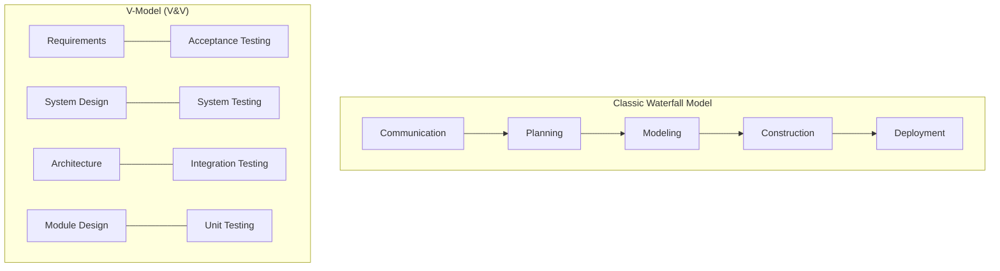

# Module I: Software Process and Agile Development

**Course Code:** 24ITPC302 | **Lecture Periods:** 7  
**Core Reference:** Roger S. Pressman (Ch 1–4), Ian Sommerville (Ch 2–3), DevOps Handbook (Ch 1–3)

---

## 🎯 Executive Summary & Learning Outcomes
This module establishes the foundational principles of software engineering as an engineering discipline. It contrasts traditional prescriptive process models against modern adaptive/agile methodologies and details the Extreme Programming (XP) framework.

---

## 📖 Key Syllabus Topics & Deep-Dive Concepts

### 1. Introduction to Software Engineering & The Software Crisis
- **Software Crisis:** Historical manifestation of projects running over budget, exceeding delivery deadlines, having poor code quality, and proving unmaintainable.
- **Software Myths:** Management myths ("We have books full of standards"), Customer myths ("General statement of objectives is enough"), Practitioner myths ("Our job is done when we deliver working code").
- **Software Characteristics:** Software is engineered, not manufactured in the classical sense; software does not wear out (bathtub curve vs software failure rate curve showing degradation from changes).

### 2. Prescriptive Process Models (Comparative Analysis)

| Model | Lifecycle Characteristics | Strengths | Major Weaknesses | Best Fit Projects |
| :--- | :--- | :--- | :--- | :--- |
| **Waterfall Model** | Linear, sequential, strictly phased. | Simple, easy to manage, clear milestones. | Inflexible, working software appears late, blocking states. | Well-understood requirements (e.g. compilers, payroll systems). |
| **V-Model** | Dual-pathway: left wing is verification (specification/design); right wing is validation (testing). | Emphasizes test planning at each design stage. | Rigid, struggles with changing scope. | High-reliability systems (medical, automotive, avionics). |
| **Incremental Model** | Delivers software in successive, usable releases (Core product first). | Early value delivery, early customer feedback. | Architecture degradation if increments are poorly planned. | Market-driven software where rapid early launch is required. |
| **RAD Model** | Component-based, rapid 60–90 day cycle using visual tools and 4GL. | Extremely fast development, reusable components. | Requires heavy human resources, high modularity dependency. | Information systems with well-defined database scopes. |
| **Prototyping Model** | Build mock-up $\to$ customer review $\to$ refine $\to$ final build. | Clarifies ambiguous requirements, reduces misunderstandings. | Customer may mistake prototype for final product; poor design. | Systems with novel UI or unknown user requirements. |
| **Spiral Model (Boehm)** | Risk-driven, evolutionary 4 quadrants: (1) Determine objectives, (2) Risk analysis, (3) Development, (4) Planning next phase. | Explicit risk assessment at every turn, accommodates changes. | High expertise needed for risk evaluation, expensive. | Large, complex, high-risk mission-critical systems. |

### 3. Specialized Process Models
- **Component-Based Development (CBD):** Assembly of pre-packaged, standardized software components (COTS - Commercial Off-The-Shelf).
- **Formal Methods Model:** Rigorous mathematical specification, syntax, and semantics using predicate calculus and set theory (Z-language, VDM) to prove program correctness.
- **Aspect-Oriented Software Development (AOSD):** Modularizes cross-cutting concerns (logging, security, transaction management) into independent aspects.

### 4. Introduction to Agility & The Agile Process
- **Agile Manifesto (4 Core Values):**
  1. Individuals and interactions over processes and tools.
  2. Working software over comprehensive documentation.
  3. Customer collaboration over contract negotiation.
  4. Responding to change over following a plan.
- **12 Agile Principles:** Early and continuous delivery, welcoming changing requirements, frequent releases (weeks not months), business and developers working together daily, motivated individuals, face-to-face communication, working software as primary measure of progress, sustainable pace, technical excellence, simplicity (maximizing work not done), self-organizing teams, regular retrospectives.

### 5. Extreme Programming (XP)
- **4 Core Values:** Communication, Simplicity, Feedback, Courage (and Respect).
- **XP Process Cycle:**
  1. *Planning:* User stories, release planning, velocity estimation.
  2. *Design:* Keep It Simple (KISS), CRC (Class-Responsibility-Collaborator) cards, Spike solutions for risk mitigation.
  3. *Coding:* Pair Programming (Driver & Navigator), Test-Driven Development (TDD: write unit test before writing code), Coding standards.
  4. *Testing:* Automated unit test harnesses, Daily acceptance testing by customer.
- **Key XP Practices:** Continuous Integration (CI), Small 2-week Releases, 40-hour Sustainable Work Week, Collective Code Ownership, On-site Customer.

---

## 🎯 Model University Questions & Combos
- **Combo 1.1 (13M):** Describe Boehm's Spiral Model with its 4 quadrants. Contrast its risk-driven nature with the classic Waterfall model.
- **Combo 1.2 (13M):** State the 4 Agile Manifesto values. Explain the Extreme Programming (XP) process lifecycle, highlighting Pair Programming and Test-Driven Development (TDD).
