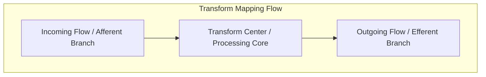

# Module III: Software Design

**Course Code:** 24ITPC302 | **Lecture Periods:** 8  
**Core Reference:** Roger S. Pressman (Ch 9–12), Ian Sommerville (Ch 6–7), Pankaj Jalote (Ch 5)

---

## 🎯 Executive Summary & Learning Outcomes
This module addresses the translation of software requirements into technical architectural and detailed component designs. It covers fundamental design concepts, the mathematical hierarchies of Cohesion and Coupling, architectural styles, data flow mapping (Transform & Transaction), UI Golden Rules, and component-level design.

---

## 📖 Key Syllabus Topics & Deep-Dive Concepts

### 1. Fundamental Design Concepts
- **Abstraction:** Suppression of low-level operational details to focus on core behaviors (Data Abstraction, Procedural Abstraction, Control Abstraction).
- **Modularity:** Partitioning software into named, addressable, and manageable components (modules) that integrate to solve the overall problem.
- **Information Hiding (David Parnas):** Designing modules such that their internal data structures and procedural logic are inaccessible to other modules that do not need to know them. Interfaces must be narrow and explicit.
- **Functional Independence:** Measured through two complementary metrics: **Cohesion** and **Coupling**.

### 2. Functional Independence: Cohesion vs Coupling

> [!IMPORTANT]
> **The Golden Law of Software Design:**
> Maximize **Cohesion** (High intra-module strength) and Minimize **Coupling** (Low inter-module dependency).

#### Cohesion Hierarchy (Worst $\to$ Best)
1. **Coincidental Cohesion (Worst):** Parts of a module are grouped together purely arbitrarily with no meaningful relationship (e.g., `Utilities` file with random functions).
2. **Logical Cohesion:** Elements perform logically similar tasks, but the specific operation is decided by an input control flag (e.g., single `print_report()` function with flags for PDF, Excel, Text).
3. **Temporal Cohesion:** Elements are grouped because they must be executed at the same point in time (e.g., `system_startup()` initializing database, loggers, GUI).
4. **Procedural Cohesion:** Elements are executed in a specific sequential order, but operate on different data items.
5. **Communicational Cohesion:** Elements operate on the exact same input data structure or produce the same output data.
6. **Sequential Cohesion:** The output of one processing element serves as the direct input to the next element within the module (pipeline).
7. **Functional Cohesion (Best / Ideal):** Every element in the module is dedicated exclusively to performing a single, well-defined mathematical or logical function (e.g., `compute_sine()`, `calculate_payroll()`).

#### Coupling Hierarchy (Worst $\to$ Best)
1. **Content Coupling (Worst / Pathological):** One module directly modifies or accesses internal data or instruction code of another module.
2. **Common Coupling:** Multiple modules share read/write access to global variables or shared global memory pools.
3. **Control Coupling:** One module explicitly controls the execution logic of another by passing control flags (`is_admin`, `mode`).
4. **Stamp Coupling (Data-Structure Coupling):** Two modules pass an entire composite data structure (e.g., complete `CustomerRecord` struct) when the receiving module only requires a single field (`customer_age`).
5. **Data Coupling (Best practical):** Modules communicate strictly through simple parameter values (primitive data types like `int`, `float`, `string`).
6. **Uncoupled (Ideal theoretical):** Complete zero interaction.

---

### 3. Design Heuristics & Architectural Metrics
- **Fan-Out (Span of Control):** Number of sub-modules directly controlled or invoked by a given module.  
  *Rule of Thumb:* High fan-out at top levels indicates poor decomposition. Optimal: $3 \le \text{Fan-Out} \le 7$.
- **Fan-In:** Number of modules that invoke a given module.  
  *Rule of Thumb:* High fan-in is highly desirable; indicates reusability and utility design.
- **Scope of Effect vs Scope of Control:**
  - *Scope of Control:* A module plus all modules subordinate to it.
  - *Scope of Effect:* All modules affected by a decision made within that module.
  - *Heuristic Rule:* The scope of effect of a decision should always be a strict subset of the scope of control of the deciding module.

---

### 4. Software Architectural Styles
1. **Data-Centered Architecture (Repository / Blackboard):**
   - Central data store accessed by independent client components (e.g. IDEs, modern databases).
2. **Data-Flow Architecture (Pipe-and-Filter):**
   - Independent filter components transform input data streams and send outputs along pipes (e.g. Unix pipelines, audio processing).
3. **Call-and-Return Architecture:**
   - Classical Main-Program and Subroutine, Remote Procedure Call (RPC), or **Layered Systems** (Presentation $\to$ Business Logic $\to$ Data Access $\to$ Database).
4. **Object-Oriented Architecture:**
   - System decomposed into interacting autonomous objects encapsulating data and operations.
5. **Event-Driven Architecture (Publish-Subscribe):**
   - Asynchronous decoupled components communicating via event buses or message brokers (Kafka, RabbitMQ).

---

### 5. Architectural Mapping: Transform vs Transaction Mapping
Translates Data Flow Diagrams (DFDs) into software Structure Charts:

- **Transform Mapping:**
  1. Identify the *Transform Center* in the DFD (the boundary where input data loses its physical format and undergoes central computation before being converted to output format).
  2. Map the root executive controller at the top.
  3. Create afferent branches (input processing controllers) on the left.
  4. Create central computational controllers in the middle.
  5. Create efferent branches (output formatting controllers) on the right.
- **Transaction Mapping:**
  - Applied when a single data stream (the transaction trigger) causes a fork into multiple distinct, mutually exclusive execution paths based on transaction type (e.g. ATM card selection: Balance Inquiry, Withdrawal, Mini-statement).

---

### 6. User Interface (UI) Design & Golden Rules (Theo Mandel)
1. **Place the User in Control:** Provide flexible interaction modes, allow undo/redo, provide graceful cancellation, do not trap the user.
2. **Reduce the User's Memory Load:** Enable recognition rather than recall, use progressive disclosure, set meaningful defaults, establish intuitive shortcuts.
3. **Make the Interface Consistent:** Uniform typography, consistent visual hierarchies, uniform error dialogs, standardized terminology.

---

### 7. Component-Level Design & SOLID Principles
- **S**ingle Responsibility Principle (SRP)
- **O**pen/Closed Principle (OCP: Open for extension, closed for modification)
- **L**iskov Substitution Principle (LSP: Subtypes must be substitutable for base types)
- **I**nterface Segregation Principle (ISP: Many client-specific interfaces are better than one general-purpose interface)
- **D**ependency Inversion Principle (DIP: High-level modules should depend on abstractions, not concrete implementations)

---

## 🎯 Model University Questions & Combos
- **Combo 3.1 (13M):** Distinguish between Cohesion and Coupling. Enumerate all 7 levels of Cohesion from worst to best with practical programming examples.
- **Combo 3.2 (13M):** Explain the architectural styles: Layered Architecture and Pipe-and-Filter Architecture. Detail the complete step-by-step procedure of Transform Mapping from DFD to Structure Chart.
