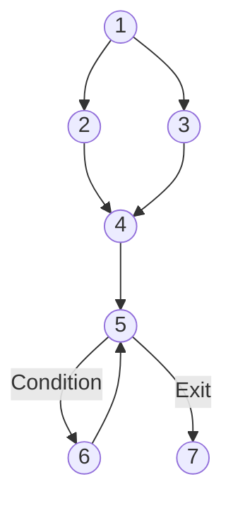

# Module IV: Testing and Maintenance

**Course Code:** 24ITPC302 | **Lecture Periods:** 8  
**Core Reference:** Roger S. Pressman (Ch 17–19, 29), Ian Sommerville (Ch 8–9), Rajib Mall (Ch 8)

---

## 🎯 Executive Summary & Learning Outcomes
This module covers structural (White-Box) and behavioral (Black-Box) testing strategies, testing levels (Unit, Integration, System, Acceptance), debugging methodologies, clean coding/refactoring, software maintenance models, and reverse/forward reengineering.

---

## 📖 Key Syllabus Topics & Deep-Dive Concepts

### 1. Software Testing Fundamentals
- **Verification vs Validation (Boehm's Definitions):**
  - *Verification:* "Are we building the product right?" (Conformity to design and specs through reviews, walkthroughs, inspections).
  - *Validation:* "Are we building the right product?" (Does the software satisfy the customer's actual operational needs? Through executable dynamic tests).
- **Error $\to$ Fault $\to$ Failure Lifecycle:**
  - *Error / Mistake:* Human psychological action producing an incorrect result.
  - *Fault / Bug / Defect:* Manifestation of an error in the source code or design.
  - *Failure:* Inability of the system or component to perform its required function within specified performance limits during dynamic runtime execution.

---

### 2. White-Box Testing (Structural Testing)

#### Basis Path Testing (Tom McCabe)
Derives test cases to guarantee that **every executable statement and branch condition** is executed at least once.

1. **Draw Control Flow Graph (CFG):**
   - Sequential statements $\to$ Single node
   - Decision points (`if`, `while`) $\to$ Predicate nodes with multiple outgoing edges.
2. **Compute Cyclomatic Complexity ($V(G)$):**
   - **Method 1:** $V(G) = E - N + 2P$ ($E$ = edges, $N$ = nodes, $P$ = components).
   - **Method 2:** $V(G) = P' + 1$ ($P'$ = number of predicate/decision nodes).
   - **Method 3:** $V(G) = R$ ($R$ = number of enclosed regions plus the unbounded exterior region).
3. **Determine Linearly Independent Basis Paths:**
   - Path 1: $1 \to 2 \to 4 \to 5 \to 7$
   - Path 2: $1 \to 3 \to 4 \to 5 \to 7$
   - Path 3: $1 \to 2 \to 4 \to 5 \to 6 \to 5 \to 7$
4. **Design Test Cases:** Synthesize specific input values to execute each independent basis path.

#### Control Structure Testing
- **Condition Testing:** Test boolean conditions (branch coverage, condition coverage, Multiple Condition Coverage / MCC).
- **Data Flow Testing:** Tracks Definition-Use ($DU$) chains of program variables.
- **Loop Testing:** Evaluates simple, nested, concatenated, and unstructured loops across 5 critical boundaries: (1) Skip loop entirely, (2) Exactly 1 pass, (3) Exactly 2 passes, (4) Typical $m$ passes ($m < n$), (5) $n-1, n, n+1$ boundary passes.

---

### 3. Black-Box Testing (Functional Testing)
Evaluates external inputs and expected outputs without looking at internal source code:

1. **Equivalence Class Partitioning:**
   - Divide input domain into valid and invalid equivalence partitions.
   - Select one representative test case from each partition.
   - *Example:* Age input $[18, 60]$:
     - Partition 1 (Invalid): $\text{Age} < 18$ (e.g. 15)
     - Partition 2 (Valid): $18 \le \text{Age} \le 60$ (e.g. 30)
     - Partition 3 (Invalid): $\text{Age} > 60$ (e.g. 65)
2. **Boundary Value Analysis (BVA):**
   - Defects concentrate disproportionately at the boundaries of input ranges.
   - For range $[a, b]$, test values:
     $$\mathbf{a, \quad a+1, \quad \text{Nominal}, \quad b-1, \quad b}$$
   - *Robust BVA:* Adds extreme out-of-bound values: $a-1$ and $b+1$.
3. **Cause-Effect Graphing & Decision Tables:**
   - Maps combinatorial combinations of logical input conditions (causes) to output states (effects).

---

### 4. Levels of Testing & Strategies
- **Unit Testing:** Focuses on individual modules, classes, or routines in isolation. Requires **Drivers** (mock calling programs) and **Stubs** (mock called routines).
- **Integration Testing:**
  - *Big-Bang (Non-incremental):* Combine all modules at once and test (Catastrophic debugging!).
  - *Top-Down Integration:* Start with main control module; subordinate modules replaced by **Stubs**. Verifies major architectural control logic early.
  - *Bottom-Up Integration:* Start with atomic low-level modules; invoke via **Drivers**. Replaces drivers with actual modules as integration proceeds upward.
  - *Sandwich / Hybrid Integration:* Top-down for upper layers and bottom-up for lower layers.
- **Validation Testing:**
  - *Alpha Testing:* Conducted by users at the developer's site in a controlled environment.
  - *Beta Testing:* Conducted by "real-world" end-users at their own operational sites without developer presence.
  - *Acceptance Testing:* Formal verification against SRS contract before client signs off.
- **System Testing:** Recovery Testing, Security Testing, Stress Testing (extreme resource starvation), Performance Testing (load and latency benchmarking).
- **Regression Testing:** Re-running previous test suites upon codebase modification to ensure new changes do not introduce unintended bugs into previously working functionality.

---

### 5. Maintenance & Software Reengineering
- **4 Types of Software Maintenance (Lientz & Swanson):**
  1. *Corrective Maintenance (21%):* Fixing discovered bugs and errors.
  2. *Adaptive Maintenance (25%):* Modifying software to adapt to environmental changes (new OS, new hardware, regulatory updates).
  3. *Perfective Maintenance (50%):* Enhancing existing functionality, performance, or user experience based on user feedback.
  4. *Preventive Maintenance (4%):* Refactoring and updating documentation to improve future maintainability.
- **Business Process Reengineering (BPR):** Fundamental rethinking and radical redesign of core business processes to achieve dramatic improvements in cost, quality, and speed.
- **Software Reengineering Process Model:**
  $$\text{Inventory Analysis} \longrightarrow \text{Document Restructuring} \longrightarrow \mathbf{\text{Reverse Engineering}} \longrightarrow \text{Code/Data Restructuring} \longrightarrow \mathbf{\text{Forward Engineering}}$$
  - **Reverse Engineering:** Analyzing a system to identify its components, interrelationships, and recreate representations at a higher abstraction level (rebuilding design models from existing source code).
  - **Forward Engineering:** Applying modern engineering practices to reconstruct the system incorporating modern architectures.

---

## 🎯 Model University Questions & Combos
- **Combo 4.1 (13M):** Draw a Control Flow Graph for a given code segment containing loops and decisions. Calculate Cyclomatic Complexity using all three methods, and derive all linearly independent test paths.
- **Combo 4.2 (13M):** Distinguish between Top-Down and Bottom-Up integration testing with stubs and drivers. Formulate Equivalence Partitioning and BVA test cases for an input range.
