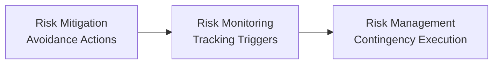
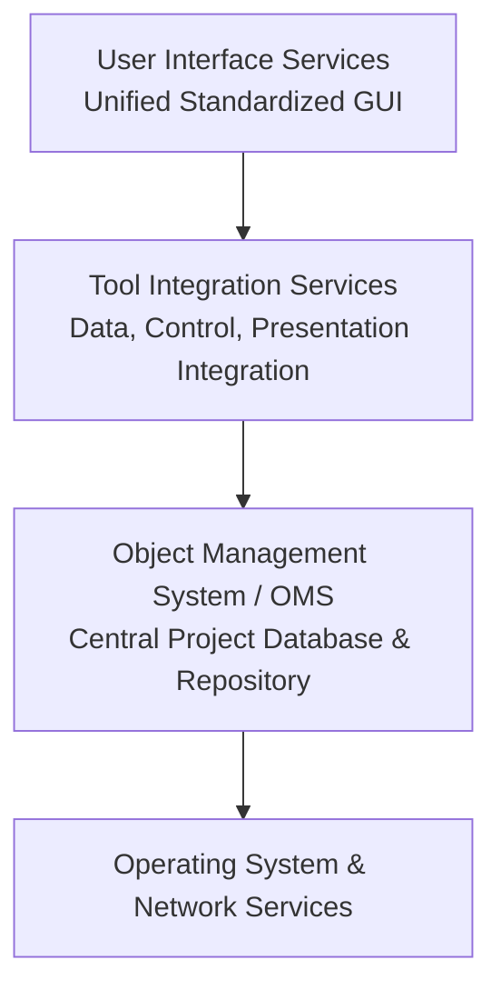

# Module VI: Risk Management and CASE Tools

**Course Code:** 24ITPC302 | **Lecture Periods:** 7  
**Core Reference:** Roger S. Pressman (Ch 28, 31), Ian Sommerville (Ch 5), Rajib Mall (Ch 6)

---

## 🎯 Executive Summary & Learning Outcomes
This module addresses software risk management strategies (identification, projection, and the formal RMMM Plan) and Computer-Aided Software Engineering (CASE) tools, detailing CASE environment architectures, central repositories (OMS), and tool taxonomies.

---

## 📖 Key Syllabus Topics & Deep-Dive Concepts

### 1. Software Risk Management Strategies
- **Reactive Strategy ("Firefighting"):** Team ignores risks until they occur, then scrambles into crisis mode to mitigate catastrophic failure.
- **Proactive Strategy (Formal Engineering):** Formal risk management process initiated early during project planning; continuously identifies, assesses, monitors, and establishes contingency plans.

### 2. Categories of Software Risks
1. **Project Risks:** Threaten project schedule and budget (e.g. staff turnover, loss of experienced architect, delayed hardware delivery).
2. **Technical Risks:** Threaten design quality, architecture, and maintainability (e.g. immature technology, unproven algorithms, interface ambiguities).
3. **Business Risks:** Threaten the commercial viability of the product:
   - *Market Risk:* Building an exceptional product that nobody wants.
   - *Strategic Risk:* Product no longer fits the company's overall business model.
   - *Sales Risk:* Sales department lacks technical training to market the product.
   - *Management Risk:* Loss of executive sponsorship.
   - *Budget Risk:* Loss of corporate financial funding.
4. **Epistemological Classification:**
   - *Known Risks:* Discovered after careful project plan evaluation (unrealistic delivery dates, lack of software tools).
   - *Predictable Risks:* Extrapolated from past project history (staff attrition, miscommunication with client).
   - *Unpredictable Risks:* True black swans (catastrophic vendor bankruptcy, natural disasters).

---

### 3. Risk Projection / Assessment & Risk Table
A **Risk Table** quantifies each identified risk:
1. Probability ($P$): Likelihood from $0.0$ (impossible) to $1.0$ (certain).
2. Impact ($C$): Categorized as Catastrophic (1), Critical (2), Marginal (3), or Negligible (4).
3. **Risk Exposure ($RE$):**
   $$\mathbf{RE = P \times C}$$
4. Sort table by $RE$ in descending order to identify the top 20% critical risks that account for 80% of project danger (Pareto principle).

---

### 4. The RMMM Plan (Risk Mitigation, Monitoring, and Management)

1. **Risk Mitigation (Proactive Prevention):**
   - Concrete steps taken before the risk occurs to reduce the probability or impact.
   - *Example (High Staff Turnover):* Maintain comprehensive code documentation, implement Pair Programming, conduct weekly knowledge-sharing sessions, offer competitive retention bonuses.
2. **Risk Monitoring (Tracking Indicators & Triggers):**
   - Continuously tracking early warning signs that indicate the risk is becoming reality.
   - *Example (Staff Turnover Triggers):* Team member morale decline, uncharacteristic absences, complaints regarding compensation.
3. **Risk Management (Contingency Execution):**
   - Emergency plan executed immediately when the risk materializes into a real problem.
   - *Example (Staff Leaves):* Immediately reassign the pair partner to lead the module, onboard backup contractor trained during the mitigation phase.

---

### 5. Computer-Aided Software Engineering (CASE) Tools

#### Definition & Benefits
Software automated tools that assist human engineers across all software development lifecycle (SDLC) activities.
- **Tangible Benefits:** Accelerated development speed, automated code generation, automated consistency checking across DFDs/ERDs, reduced human typing errors.
- **Intangible Benefits:** Higher product quality, standardized documentation, enhanced long-term maintainability.

#### Architecture of a CASE Environment
A modern integrated CASE environment consists of 4 foundational building blocks:

1. **User Interface (UI) Services:** Standardized presentation layer providing uniform menus, keyboard shortcuts, and diagram notations across all integrated tools.
2. **Tool Integration Services:**
   - *Data Integration:* Common file and metadata schema exchange.
   - *Control Integration:* Ability of one tool to notify and trigger actions in another tool (e.g., saving a design diagram automatically invokes the code skeleton generator).
   - *Presentation Integration:* Uniform look-and-feel.
3. **Object Management System (OMS) / Central Repository:**
   - The central repository that stores all project artifacts (requirements specifications, DFDs, UML diagrams, source code, test suites, bug reports) and maintains their dependency graph and version history.
4. **Operating System & Network Layer:** Core OS services and distributed file locking.

---

### 6. Classification / Types of CASE Tools
1. **Upper CASE Tools (Front-End Tools):**
   - Support early SDLC phases (Planning, Requirement Analysis, High-Level Design).
   - *Examples:* Diagramming tools (Rational Rose, Enterprise Architect, Draw.io), DFD modelers, requirements management tools (DOORS), GUI prototyping tools.
2. **Lower CASE Tools (Back-End Tools):**
   - Support late SDLC phases (Detailed Design, Implementation, Testing, Maintenance).
   - *Examples:* Compilers, IDEs (VS Code, IntelliJ), automated test frameworks (JUnit, Selenium), static code analyzers (SonarQube), automated code generators.
3. **Integrated CASE (I-CASE) Tools:**
   - Unified environments that support the entire software development lifecycle end-to-end, seamlessly propagating changes from SRS $\to$ UML Design $\to$ Code $\to$ Test Suite.
   - *Examples:* Jira + Confluence + Bitbucket suites, IBM Rational Team Concert, GitLab CI/CD suites.

---

## 🎯 Model University Questions & Combos
- **Combo 6.1 (13M):** Distinguish between Reactive and Proactive risk management. Explain how a Risk Table is constructed. Develop a complete RMMM Plan for the risk: "Key system architects resign during critical implementation".
- **Combo 6.2 (13M):** Describe the architectural building blocks of a modern CASE environment with a diagram. Classify CASE tools into Upper, Lower, and Integrated CASE with examples.
