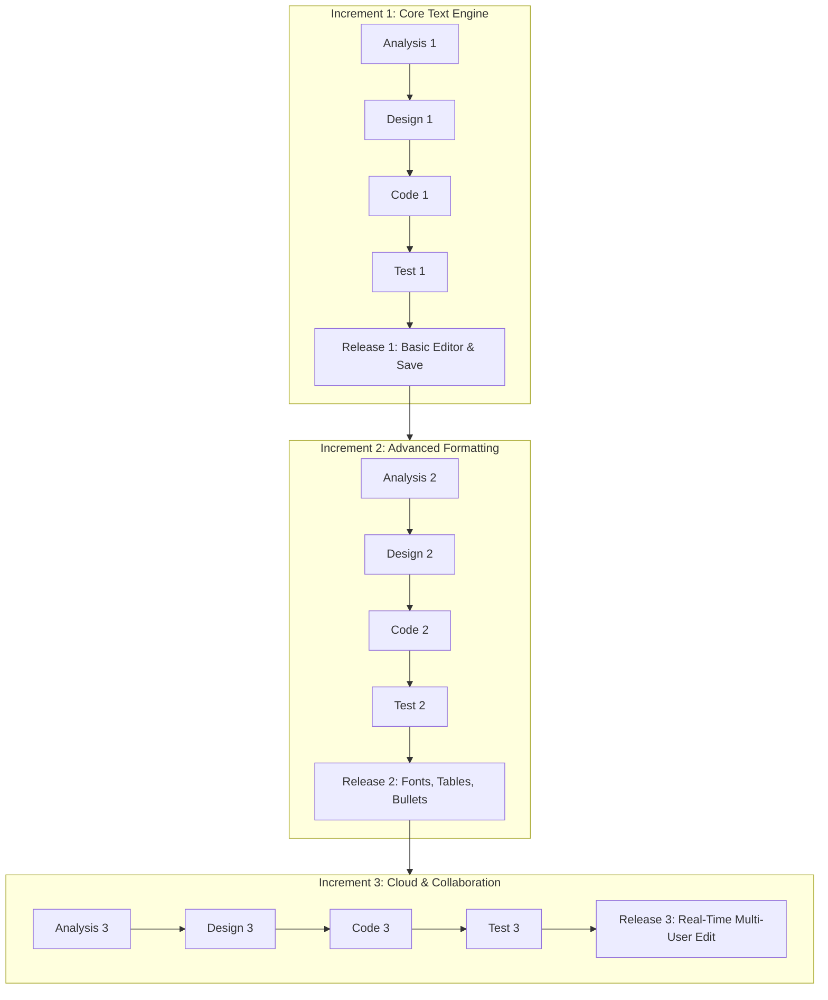
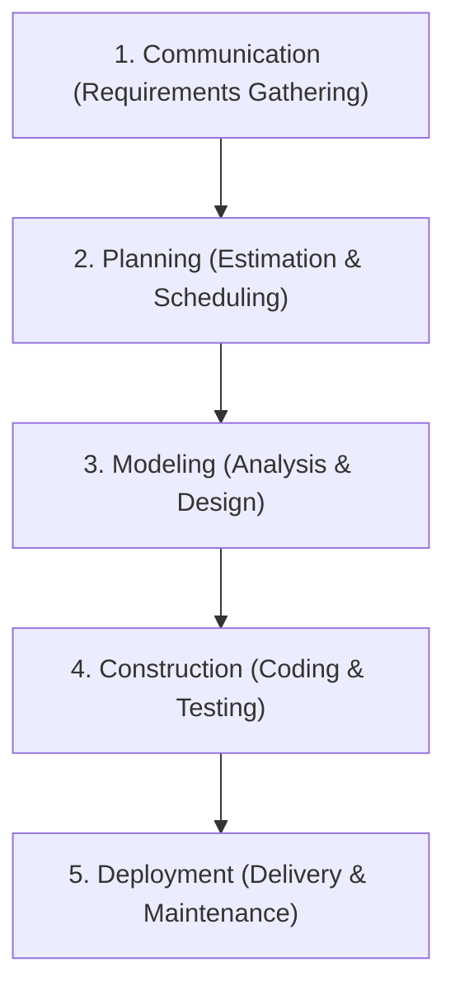

# 24ITPC302: Module I Official CAT Question Bank Solutions
### Course: 24ITPC302 – Software Engineering (Regulations 2024)
### Source: Official College CAT Question Bank (`CAT_QB_24ITPC302_SOFTWARE ENGINEERING`)
### Coverage: Module I (Part A: 26 Questions | Part B: 9 Questions | Part C: 5 Application Scenarios)

---

# 📌 PART A: 2-MARK QUESTIONS (Q1 TO Q26)

### Q1. What is software engineering? [2M | K1 | CO1]
**Answer:**
Software Engineering is the establishment and use of sound engineering principles to obtain economically software that is reliable and works efficiently on real machines (Fritz Bauer).  
It encompasses a collection of three key elements: **Process**, **Methods** (practices/techniques), and **Tools** (automated support).

---

### Q2. What are the characteristics of software? [2M | K1 | CO1]
**Answer:**
1. **Software is engineered or developed, not manufactured** in the classical industrial sense.
2. **Software does not "wear out"**; unlike hardware, it does not suffer from environmental degradation or physical friction.
3. **Most software continues to be custom-built**, although the industry is moving toward component-based assembly.

---

### Q3. What are the fundamental activities of a software process? [2M | K1 | CO1]
**Answer:**
The five generic framework activities defined by Pressman are:
1. **Communication:** Collaborative requirements gathering and stakeholder interaction.
2. **Planning:** Resource estimation, risk analysis, task scheduling, and tracking.
3. **Modeling:** Creation of analysis models and architectural/component designs.
4. **Construction:** Source coding and unit/integration testing.
5. **Deployment:** Delivery of operational software increment, customer evaluation, and feedback.

---

### Q4. What are the umbrella activities of a software process? [2M | K1 | CO1]
**Answer:**
Umbrella activities occur across the entire lifecycle to manage and control progress, quality, and change:
1. **Software Project Tracking and Control:** Monitoring progress against planned milestones.
2. **Risk Management:** Continual identification, assessment, and mitigation of risks.
3. **Software Quality Assurance (SQA):** Verifying compliance with defined standards.
4. **Software Configuration Management (SCM):** Managing changes across artifacts and baselines.
5. **Technical Reviews:** Assessing work products to eliminate defect propagation.
6. **Reusability Management & Measurement:** Tracking metrics and promoting reusable assets.

---

### Q5. List the process maturity levels in SEI's CMM. [2M | K1 | CO1]
**Answer:**
The Software Engineering Institute (SEI) Capability Maturity Model (CMM) defines 5 maturity levels:
- **Level 1 — Initial:** Ad-hoc, chaotic processes; success depends on individual heroics.
- **Level 2 — Repeatable:** Basic project management disciplines (cost, schedule) established.
- **Level 3 — Defined:** Standardized, documented, and integrated organizational engineering processes.
- **Level 4 — Managed:** Detailed quantitative metrics collected; process and product quality measured.
- **Level 5 — Optimizing:** Continuous process improvement driven by quantitative feedback and innovative technologies.

---

### Q6. Why is it called "Extreme" in Extreme Programming (XP)? [2M | K2 | CO1]
**Answer:**
It is termed **"Extreme"** because it takes common sense software engineering best practices and pushes them to extreme levels:
- If code reviews are good, review code constantly $\implies$ **Pair Programming (continuous real-time review)**.
- If testing is good, write automated unit tests for every function before coding $\implies$ **Test-Driven Development (TDD)**.
- If integration is good, integrate multiple times a day $\implies$ **Continuous Integration (CI)**.
- If simplicity is good, design only for current requirements $\implies$ **Simple Design (YAGNI)**.

---

### Q7. List any four principles of agile technology. [2M | K1 | CO1]
**Answer:**
1. Highest priority is to satisfy the customer through early and continuous delivery of valuable software.
2. Welcome changing requirements, even late in development, for competitive advantage.
3. Deliver working software frequently (weeks rather than months).
4. Business people and developers must work together daily throughout the project.

---

### Q8. What is software crisis? [2M | K1 | CO1]
**Answer:**
The **Software Crisis** refers to a historical period (beginning in the late 1960s) characterized by software projects that routinely:
- Significantly exceeded allocated budgets and schedules.
- Delivered poor quality, unreliable software full of critical defects.
- Were excessively difficult or impossible to maintain.
- Failed to meet actual user and business expectations.

---

### Q9. Name the Evolutionary process Models. [2M | K1 | CO1]
**Answer:**
1. **Prototyping Model** (Throwaway and Evolutionary prototyping).
2. **Boehm's Spiral Model**.
3. **Concurrent Development Model** (Concurrent Engineering).
4. **Win-Win Spiral Model**.

---

### Q10. Write down the generic process framework applicable to any software project / relationship between work product, task, activity and system. [2M | K1 | CO1]
**Answer:**
A software process is organized hierarchically:
$$\text{Process} \implies \text{Framework Activities} \implies \text{Actions} \implies \text{Task Sets}$$
- **Task:** A small atomic unit of engineering work (e.g., write an algorithm).
- **Work Product:** An identifiable output produced by a task (e.g., design document, source code file, test suite).
- **Activity:** A cluster of related tasks that achieves a major milestone (e.g., Architectural Design).
- **System:** The integrated collection of all deployed software increments and hardware interfaces.

---

### Q11. What are data dictionaries? [2M | K1 | CO1]
**Answer:**
A **Data Dictionary** is a centralized repository of metadata containing structured definitions of all data elements, data flows, data stores, and composite structures appearing in Data Flow Diagrams (DFDs). It ensures unambiguous naming and consistency across the entire software project.

---

### Q12. Define decision trees. [2M | K1 | CO1]
**Answer:**
A **Decision Tree** is a graphical representation of decision logic that models complex conditions and alternative actions in a branching, tree-like structure. It maps input conditions (branches) to specific procedural outcomes (leaf nodes), avoiding natural language ambiguity.

---

### Q13. What is classical analysis? [2M | K1 | CO1]
**Answer:**
**Classical Analysis** (Structured Analysis) is a top-down, functional decomposition methodology that models a system in terms of data movement and transformations. It employs **Data Flow Diagrams (DFDs)**, **Data Dictionaries**, and **Process Specifications (PSPECs)** to separate data from processing logic.

---

### Q14. What is meant by brainstorming? [2M | K1 | CO1]
**Answer:**
**Brainstorming** is an unconstrained, highly collaborative requirements elicitation technique where stakeholders, domain experts, and developers generate a large volume of creative ideas, feature proposals, and architectural concepts without immediate criticism or evaluation.

---

### Q15. What is meant by SDLC? [2M | K1 | CO1]
**Answer:**
**Software Development Life Cycle (SDLC)** is a structured framework detailing the sequence of distinct phases (Inception, Requirements Analysis, Design, Coding, Testing, Deployment, and Maintenance) through which a software product progresses from initial conception to final retirement.

---

### Q16. Define waterfall model. [2M | K1 | CO1]
**Answer:**
The **Waterfall Model** (Classic Life Cycle) is a linear sequential process model in which software development proceeds systematically through distinct phases: *Communication $\to$ Planning $\to$ Modeling $\to$ Construction $\to$ Deployment*. Each phase must be completed and formally signed off before the next phase begins.

---

### Q17. Write the IEEE definition of software engineering. [2M | K1 | CO1]
**Answer:**
**IEEE Standard 610.12 Definition:**
> *"The application of a systematic, disciplined, quantifiable approach to the development, operation, and maintenance of software; that is, the application of engineering to software."*

---

### Q18. What are the attributes of good software? [2M | K1 | CO1]
**Answer:**
1. **Maintainability:** Software must be easily evolvable to meet changing client needs.
2. **Dependability & Security:** Must be reliable, available, safe, and resilient against malicious attack.
3. **Efficiency:** Must not waste memory, CPU cycles, or network bandwidth.
4. **Acceptability & Usability:** Must be intuitive, accessible, and satisfying to the intended end-users.

---

### Q19. What is Scrum? [2M | K1 | CO1]
**Answer:**
**Scrum** is an agile management framework for developing complex software products through self-organizing teams. Work is structured into fixed-length iterations of 2–4 weeks called **Sprints**, guided by three core roles: **Product Owner**, **Scrum Master**, and **Development Team**, with daily 15-minute standup meetings.

---

### Q20. 'Software doesn't wear out'. Justify. [2M | K1 | CO1]
**Answer:**
**Justification:**  
Hardware wears out due to physical friction, heat, vibration, and environmental degradation, following a **bathtub curve**.  
Software is a logical rather than physical entity. It does not suffer from physical wear. However, software **deteriorates** over time because successive maintenance changes, patches, and feature additions introduce unintended side effects, complexity, and structural decay.

---

### Q21. List two deficiencies in waterfall model. Which process model do you suggest to overcome each deficiency? [2M | K1 | CO1]
**Answer:**
1. **Deficiency 1: Inability to accommodate evolving/uncertain requirements.**  
   $\implies$ *Suggested Model:* **Prototyping Model** or **Agile/Scrum**.
2. **Deficiency 2: Working software is delivered very late, hiding critical risks until late stages.**  
   $\implies$ *Suggested Model:* **Boehm's Spiral Model** (for high-risk systems) or **Incremental Model** (for early core delivery).

---

### Q22. Define iterative model. [2M | K1 | CO1]
**Answer:**
An **Iterative Model** is a process strategy wherein a simplified, functional subset of the software is initially developed and continuously refined, expanded, and validated across successive cycles (iterations) until the full production system is realized.

---

### Q23. List the merits of incremental model. [2M | K1 | CO1]
**Answer:**
1. **Early Operational Delivery:** A core working product (Increment 1) is released early to the customer.
2. **Lower Risk of Overall Failure:** High-priority features are validated by users in early increments.
3. **Flexible Staffing:** Core team builds the initial release; technical specialists are brought in for subsequent increments.
4. **Easier Testing & Debugging:** Smaller increments are significantly easier to verify than monolithic systems.

---

### Q24. For a heavy lift launch vehicle system in space mission, predict which model is suitable for developing it? [2M | K1 | CO1]
**Answer:**
**Suitable Model:** **Boehm's Spiral Model** (or Formal Methods / V-Model).  
**Justification:** Heavy lift launch vehicles are mission-critical, high-cost, and life-critical systems characterized by severe technical, aerodynamic, and avionics uncertainties. The Spiral Model’s mandatory, explicit **Quadrant II Risk Analysis and Prototyping** prevents catastrophic mission failure.

---

### Q25. State the drawback of Waterfall model. [2M | K1 | CO1]
**Answer:**
- **Blocking States:** Team members sit idle waiting for predecessor phase documents to be signed off.
- **Late Value Realization:** A working executable program is not available until late in the lifecycle, making defect rectification exponentially expensive if discovered during final integration.

---

### Q26. Identify the characteristics of software that contrast with the characteristics of hardware. [2M | K1 | CO1]
**Answer:**
| Software Characteristics | Hardware Characteristics |
| :--- | :--- |
| Manufactured through human/intellectual engineering. | Manufactured via physical assembly line fabrication. |
| Does not wear out; deteriorates due to maintenance patches. | Wears out physically due to environmental friction/heat. |
| Largely custom-built with low off-the-shelf component reuse. | Assembled from standardized, certified physical components. |
| Incur negligible reproduction and distribution costs. | Physical replication requires raw materials and manufacturing costs. |

---

# 📌 PART B: 13-MARK CORE UNIVERSITY QUESTIONS

---

## 🎯 Question 1: Word Processing Software Lifecycle & Component-Based Development (Full 13 Marks)

### Problem Statement:
**(i)** For Word Processing software, choose the suitable model for developing it. Explain the model in detail. [7 Marks]  
**(ii)** Explain about Component-Based Development (CBD) model in detail. [6 Marks]

### Solution:

#### (i) Suitable Model for Word Processing Software: The Incremental Model [7 Marks]
For commercial Word Processing software (such as Microsoft Word or Google Docs), the **Incremental Process Model** is the optimal choice.

**Justification:**
1. Core functionality (text typing, file saving, formatting) is well-understood and can be deployed rapidly.
2. Advanced features (grammar checking, cloud collaboration, PDF export) can be delivered in subsequent iterations based on market feedback.
3. Rapid time-to-market allows early monetization and customer adoption.



- **Increment 1 (Core Product):** Implements text input buffers, cursor navigation, local disk read/write, and raw ASCII rendering. Delivered to early users.
- **Increment 2:** Integrates font styling, paragraph layout engines, spell-check dictionary lookups, and printer drivers.
- **Increment 3:** Implements cloud synchronization, change tracking, multi-user concurrency control, and export plugins.

#### (ii) Component-Based Development (CBD) Model [6 Marks]
The Component-Based Development model is an evolutionary software process that emphasizes the assembly of pre-existing, packaged software components (COTS — Commercial Off-The-Shelf) rather than building from scratch.

```
   [ Identify Component Requirements ]
                 |
                 v
   [ Search Available Component Repositories ]
                 |
                 v
   [ Evaluate & Qualify Candidate Components ]
                 |
                 v
   [ Adapt & Wrap Components (Interface Bridging) ]
                 |
                 v
   [ Compose Components into Target Architecture ]
                 |
                 v
   [ Comprehensive Integration & System Testing ]
```

**Key Steps:**
1. **Component Qualification:** Candidate commercial or open-source components are evaluated to verify that their interfaces, performance, and security match requirements.
2. **Component Adaptation:** Because components rarely match target architectures perfectly, wrapper classes or adapters (Adapter Design Pattern) are developed to bridge interface mismatches.
3. **Component Composition:** The adapted components are integrated into the architectural framework via standardized middleware (e.g., RESTful APIs, CORBA, COM, JavaBeans).
4. **Benefits:** 70% reduction in development cycle time, significantly lower development costs, and enhanced reliability since reusable components are already field-tested.

---

## 🎯 Question 2: Boehm's Spiral Model & Evolutionary/RAD Synergies (Full 13 Marks)

### Problem Statement:
Explain in detail about the Spiral Model with a neat sketch and comment why this model comes under both evolutionary and RAD models. [13 Marks]

### Solution:

#### (a) Detailed Explanation of Boehm's Spiral Model with Sketch
Barry Boehm (1988) formulated the Spiral Model to combine the systematic, controlled structure of the Waterfall model with the iterative prototyping paradigm, driven by **explicit risk management**.

```
                           QUADRANT II                      QUADRANT I
                   Risk Analysis & Prototyping        Determine Objectives & Constraints
                                \                           /
                                 \       Spiral Turn 2     /
                                  \    /---------------\  /
                                   \  /  Spiral Turn 1  \/
                   -----------------\+-------------------+-----------------
                                    /\  Concept of Ops  /\
                                   /  \----------------/  \
                                  /                        \
                                 /                          \
                            QUADRANT III                     QUADRANT IV
                      Engineering & Development         Planning & Customer Review
```

**The Four Radial Quadrants:**
1. **Quadrant I: Determine Objectives, Alternatives, and Constraints:**
   - Define business goals, specific iteration targets, and interface requirements.
   - Propose alternative technical implementations (e.g., SQL vs NoSQL, build vs buy).
   - Document project constraints (budget, deadlines, hardware limits).
2. **Quadrant II: Identify and Resolve Risks (Risk Analysis):**
   - Perform detailed risk assessment on every technical and managerial uncertainty.
   - Formulate risk mitigation strategies using prototyping, benchmarking, simulation, and analytical modeling.
3. **Quadrant III: Engineering, Development, and Testing:**
   - Execute software engineering activities appropriate to the spiral level.
   - Early spirals produce architectural proof-of-concepts; later spirals generate production code verified via unit, integration, and system testing.
4. **Quadrant IV: Planning Next Phase & Customer Evaluation:**
   - Customer evaluates deliverables and prototypes.
   - Management audits budget, progress, and schedule, and decides whether to approve the next spiral turn.

#### (b) Why the Spiral Model embodies both Evolutionary and RAD Characteristics:
1. **Why Evolutionary:**
   - The spiral unwinds radially outward. As the distance from the center increases, the software matures through successive evolutionary approximations (Concept $\to$ Prototype $\to$ Subsystem $\to$ Full Operational Release).
2. **Why RAD (Rapid Application Development):**
   - In Quadrant II, risky requirements and unresolved technical interfaces are resolved through **rapid prototyping cycles** utilizing 4GL visual modeling tools, reusable components, and fast feedback loops, identical to the rapid prototyping core of the RAD model.

---

## 🎯 Question 3: Agile Processes, Principles & Extreme Programming (Full 13 Marks)

### Problem Statement:
**(i)** Explain briefly about various Agile processes and its principles. [7 Marks]  
**(ii)** Explain in detail about the process involved in Extreme Programming (XP). [6 Marks]

### Solution:

#### (i) Agile Processes and Foundational Principles [7 Marks]
Agile is an umbrella term encompassing iterative, lightweight methodologies:
- **Scrum:** 30-day Sprints, Product Backlog, Daily Standup meetings, Sprint Retrospectives.
- **Kanban:** Continuous flow, visual work boards, strict Work-In-Progress (WIP) limits.
- **Feature-Driven Development (FDD):** Client-centric, 2-week feature iteration delivery.
- **Dynamic Systems Development Method (DSDM):** Strict Pareto principle (80/20 rule) under fixed timeboxes.

**The Foundational Principles:**
1. Continuous delivery of valuable software.
2. Welcoming requirement changes at any stage.
3. Daily face-to-face collaboration between business and technical staff.
4. Building projects around motivated, self-organizing teams.
5. Working software is the primary metric of success.
6. Simplicity: Maximizing the amount of unnecessary work eliminated.

#### (ii) Extreme Programming (XP) Process Flow [6 Marks]


1. **User Stories:** Requirements written on physical index cards with customer-assigned business values.
2. **Release Planning:** Developers estimate story points; velocity determines release commitments.
3. **Spike Solutions:** Short, throwaway prototypes developed to resolve difficult technical risks.
4. **Test-Driven Development (TDD):** Automated tests written *before* implementation code.
5. **Pair Programming:** Driver and Navigator work simultaneously on a single computer.
6. **Continuous Integration & Small Releases:** Mainline commits multiple times daily; 2-week production increments.

---

## 🎯 Question 4: Classical Waterfall Model (Full 13 Marks)

### Problem Statement:
Describe in detail about the Waterfall model with a neat diagram and list out its advantages and disadvantages. [13 Marks]

### Solution:

#### (a) Phased Architecture & Progression


1. **Communication:** Requirement gathering with users $\implies$ Software Requirements Specification (**SRS**).
2. **Planning:** WBS, resource allocation, schedule $\implies$ Software Project Management Plan (**SPMP**).
3. **Modeling:** Data, architectural, and component design $\implies$ **HLD & LLD**.
4. **Construction:** Implementation in code and unit/integration testing $\implies$ **Compiled Binaries**.
5. **Deployment:** Delivery, user sign-off, and ongoing corrective maintenance $\implies$ **Operational System**.

#### (b) Advantages and Disadvantages:
| Advantages | Disadvantages |
| :--- | :--- |
| Simple, disciplined, and easy to manage due to rigid milestone reviews. | Working software appears very late in the lifecycle (Construction). |
| Well-suited for projects where requirements are completely understood. | Catastrophic cost of defect correction if errors are discovered late. |
| Clear documentation deliverables produced at every phase sign-off. | Inflexible to change; real customers rarely freeze specs upfront. |
| Easy to schedule and budget when scope is immutable. | "Blocking states" cause developers to wait for preceding sign-offs. |

---

## 🎯 Question 5: Specialized Process Models (Full 13 Marks)

### Problem Statement:
Explain in detail about Specialized Process Models. [13 Marks]

### Solution:

Specialized process models apply when a narrowly defined or highly specialized software engineering approach is mandated by project constraints:

```
               SPECIALIZED PROCESS MODELS
                           |
      +--------------------+--------------------+
      |                    |                    |
      v                    v                    v
[ Component-Based ]  [ Formal Methods ]  [ Aspect-Oriented ]
  (CBD / Reuse)        (Mathematical)        (AOSD)
```

1. **Component-Based Development (CBD) Model:**
   - Replaces custom coding with the discovery, adaptation, and composition of pre-tested, packaged components (COTS / open-source).
   - *Phases:* Component discovery $\to$ Component qualification $\to$ Wrapper adaptation $\to$ Architectural composition.
   - *Advantage:* 70% reduction in development time and verified reliability.

2. **Formal Methods Model:**
   - Applies rigorous mathematical notations (e.g., Z-specification, VDM, Petri Nets, Temporal Logic) to specify, design, and verify software.
   - Eliminates ambiguity and proves program correctness via mathematical theorems.
   - *Application:* Safety-critical and life-critical systems (medical pacemakers, fly-by-wire avionics, nuclear reactor control).
   - *Drawback:* Extremely expensive and requires specialized mathematicians.

3. **Aspect-Oriented Software Development (AOSD):**
   - Addresses **cross-cutting concerns**—system aspects that cut across multiple architectural modules (e.g., security authentication, enterprise logging, transaction rollback, memory caching).
   - Cross-cutting concerns are defined as independent **Aspects** and woven into the codebase using an Aspect Weaver, preserving pure functional modularity.

---

## 🎯 Question 6: Prescriptive Process Models (Full 13 Marks)

### Problem Statement:
Explain in detail about the Prescriptive Process Models. [13 Marks]

### Solution:

Prescriptive process models define a distinct, orderly set of activities, actions, tasks, milestones, and work products required to engineer software. They prescribe a disciplined framework for development.

1. **The Waterfall Model (Linear Sequential):**
   - Strict linear forward movement through communication, planning, modeling, construction, and deployment.
   - *Best for:* Compilers, accounting payroll engines.
2. **The V-Model (Verification and Validation):**
   - Left wing defines specification breakdown; right wing defines testing.
   - Establishes direct phase correspondence: Unit tests are designed during Module Design; Acceptance tests are designed during Requirements Analysis.
3. **The Incremental Model:**
   - Staggers linear sequences over calendar time. Increment 1 delivers the operational core; successive increments add functional enhancements.
4. **The RAD (Rapid Application Development) Model:**
   - High-speed adaptation of the linear sequential model.
   - Employs 4GL visual drag-and-drop tools, automated code generation, and reusable component libraries.
   - Delivers functional systems within an aggressive 60–90 day timebox. Requires modular decomposition into independent sub-teams.

---

## 🎯 Question 7: The Incremental Process Model (Full 13 Marks)

### Problem Statement:
Explain in detail about the Incremental Process Model. List out its advantages and disadvantages. [13 Marks]

### Solution:

#### (a) Working Principle & Mechanics
The Incremental Model combines elements of linear and parallel process flows. It releases operational versions of the software in progressive stages.

```
 Calendar Time --->
 Increment 1: [Analysis] -> [Design] -> [Code] -> [Test] -> [DEPLOY CORE PRODUCT]
                                \
 Increment 2:                    [Analysis] -> [Design] -> [Code] -> [Test] -> [DEPLOY ENHANCEMENT 1]
                                                                \
 Increment 3:                                                    [Analysis] -> [Design] -> [Code] -> [Test] -> [FINAL]
```

- **Increment 1:** Focuses exclusively on the core, non-negotiable business requirements. Once deployed, the client utilizes it immediately.
- **Subsequent Increments:** Expand capability based on real production user feedback.

#### (b) Advantages and Disadvantages:
| Advantages | Disadvantages |
| :--- | :--- |
| Early business value realization; core system deployed fast. | Demands clean, open architectural design to support future modules. |
| Customer feedback from Increment 1 shapes subsequent features. | Potential for interface mismatch if sub-increments are ill-defined. |
| Lower risk of catastrophic financial failure. | Tendency for users to demand endless enhancements (scope creep). |
| Resource allocation is flexible; specialists can join later. | Total cost may exceed upfront Waterfall if interfaces require rework. |

---

## 🎯 Question 8: User Participation & Iterative Enhancement Difficulties (Full 13 Marks)

### Problem Statement:
**(i)** What is the role of user participation in the selection of a lifecycle model? [7 Marks]  
**(ii)** Describe the type of situations where iterative enhancement model might lead to difficulties. [6 Marks]

### Solution:

#### (i) Role of User Participation in Lifecycle Model Selection [7 Marks]
The availability, competence, and commitment of the user directly determine the viability of candidate SDLC models:

1. **High, Daily User Involvement:**
   - Enables **Agile (Scrum / XP)**, which mandates an on-site customer representative to clarify stories, accept sprint increments, and prioritize backlogs daily.
2. **Periodic Milestone Involvement:**
   - Enables **Prototyping** and **Boehm's Spiral Model**, where the user evaluates prototypes at the conclusion of each turn/iteration.
3. **Minimal / Upfront-Only User Involvement:**
   - Mandates **Waterfall Model** or **V-Model**. If users are remote, contracted, or legally constrained from participating continuously, requirements must be completely specified, signed off, and frozen during initial Inception.

#### (ii) Situations Where Iterative Enhancement Leads to Difficulties [6 Marks]
1. **Unstable Architectural Foundation:** If the initial architecture is poorly designed, repeatedly grafting new iterations onto it leads to structural decay, spaghetti code, and system collapse.
2. **Safety-Critical / Real-Time Systems:** Real-time embedded systems (flight avionics, surgical robots) require holistic timing, memory, and safety proofs. Incrementally altering code can invalidate previous timing and safety certifications.
3. **Rigid Fixed-Price Legal Contracts:** Clients who demand a legally binding fixed cost and fixed delivery date upfront cannot easily accommodate iterative enhancement, which thrives on flexible scope.
4. **User Burnout:** Demanding continuous user testing after every small iteration can cause customer fatigue and disengagement.

---

## 🎯 Question 9: Multi-Model Comprehensive Comparison (Full 13 Marks)

### Problem Statement:
Explain the following: (i) Waterfall model, (ii) Spiral model, (iii) RAD model, (iv) Prototyping model. [13 Marks]

### Solution:

```
+-------------------------------------------------------------------------------------------------------+
|                                    4-MODEL COMPARISON MATRIX                                          |
+---------------------+-------------------+---------------------+------------------+--------------------+
| Parameter           | Waterfall Model   | Spiral Model        | RAD Model        | Prototyping Model  |
+---------------------+-------------------+---------------------+------------------+--------------------+
| Primary Paradigm    | Linear sequential | Risk-driven spiral  | Component-based  | Mockup evolution   |
| Delivery Speed      | Slow / Terminal   | Iterative releases  | Rapid (60-90 d)  | Fast for prototype |
| Risk Management     | None (Implicit)   | Highest (Explicit)  | Low to Medium    | Low                |
| Requirement State   | 100% Frozen       | Fluid / Evolving    | Modular & Known  | Completely Unclear |
| Customer Role       | Sign-off only     | Evaluates each turn | Continuous input | Tests mockups      |
| Cost of Late Change | Catastrophic      | Low to Moderate     | Moderate         | Extremely Low      |
+---------------------+-------------------+---------------------+------------------+--------------------+
```

1. **Waterfall Model:** Linear progression across 5 fixed phases; best for projects with stable, immutable requirements.
2. **Spiral Model:** Four quadrants (Objectives, Risk, Development, Planning); best for large, high-risk, mission-critical systems.
3. **RAD Model:** Timeboxed (60–90 days) component assembly utilizing 4GL tools; requires highly modular business requirements.
4. **Prototyping Model:** Throwaway or evolutionary mockups constructed to clarify vague requirements through user experimentation.

---

# 📌 PART C: 15-MARK APPLICATION & SCENARIO QUESTIONS

---

## 🎯 Question 1: Large Oil Company Legacy Migration Case Study (15 Marks)

### Problem Statement:
For the scenario described below, which life cycle model would you choose? Give the reason why you would choose this model. Discuss in detail about the same model.  
*"You are interacting with the MIS department of a very large oil company with multiple departments. They have a complex legacy system. Migrating the data from this legacy system is not an easy task and would take a considerable time. The oil company is very particular about processes, acceptance criteria and legal contracts."* [15 Marks]

### Solution:

#### 1. Model Selection
**Chosen Model:** **Phased Incremental Model with Prototyping Front-End** (or **V-Model with Incremental Data Migration Staging**).

#### 2. Detailed Justification for this Scenario
1. **Complex Legacy System with Massive Data Migration Risk:**
   - Migrating decades of petroleum exploration, refinery, and accounting records in a single "big-bang" deployment is disastrous. An **Incremental Model** allows database migration to proceed department-by-department (e.g., Exploration $\to$ Refining $\to$ Logistics $\to$ Retail).
2. **Process-Obsessed Culture & Strict Legal Contracts:**
   - The oil company requires formal sign-offs, rigid acceptance criteria, and contractual guarantees. The Incremental Model enforces formal requirement specifications, design verification, and acceptance testing sign-offs for *each increment*, satisfying corporate governance.
3. **Considerable Project Duration:**
   - Since migration takes considerable time, a pure Waterfall would leave the oil company waiting years with zero working software. Incremental delivery allows individual departments to start using modern modules early.

#### 3. Detailed Architecture of the Staged Model for the Oil Company:

```
 +---------------------------------------------------------------------------------------+
 | STAGE 0: Enterprise Data Architecture & Legacy Reverse Engineering (Full Schema Audit) |
 +---------------------------------------------------------------------------------------+
                                            |
      +-------------------------------------+-------------------------------------+
      |                                     |                                     |
      v                                     v                                     v
[ INCREMENT 1 ]                       [ INCREMENT 2 ]                       [ INCREMENT 3 ]
Exploration & Drilling                Refinery & Pipeline Operations        Retail, Billing & Contracts
- Formal IEEE 830 Spec                - Formal IEEE 830 Spec                - Formal IEEE 830 Spec
- Data Extraction & Scrubbing         - Cross-system validation             - Final Enterprise Sync
- Acceptance Testing Sign-off         - Acceptance Testing Sign-off         - Final UAT & Legacy Cutoff
```

- **Phase 1: Inception & Legacy Schema Mapping:** Detailed audit of legacy data structures and extraction scripts.
- **Phase 2: Department-Wise Increments:**
  - *Increment 1:* Upstream Exploration Department. Data extracted, transformed, loaded (ETL), and verified against contractual acceptance criteria.
  - *Increment 2:* Midstream Refining and Logistics. Operates alongside Increment 1 via interface adapters.
  - *Increment 3:* Downstream Retail, Billing, and Legal Accounting.
- **Phase 3: Dual-Run Verification & Legacy Decommissioning:** Both systems run in parallel for one fiscal quarter to prove mathematical consistency before final legacy decommissioning.

---

## 🎯 Question 2: Perspective vs Descriptive Models & System Environment (15 Marks)

### Problem Statement:
**(i)** Explain why decisions are common in perspective (prescriptive) process models than descriptive process models. [7 Marks]  
**(ii)** Give the reasons why system engineers must understand the environment of a system. [8 Marks]

### Solution:

#### (i) Decisions in Prescriptive vs Descriptive Process Models [7 Marks]
- **Prescriptive (Perspective) Process Models:**
  - Strive for structure, order, and predictability. They dictate *how software engineering should be done* by prescribing an explicit sequence of tasks, gates, deliverables, and quality checkpoints.
  - *Why Decisions are Common:* At every phase transition (gate), explicit managerial decisions are required:
    - *Go / No-Go Decision:* Has the phase met all exit criteria?
    - *Scope Triage Decision:* Should features be deferred to hit deadlines?
    - *Risk Decision:* Is the technical risk acceptable to commit investment?
- **Descriptive Process Models:**
  - Merely describe *how software is actually developed in reality*, often observing chaotic, emergent, and informal developer interactions without prescribing strict decision gates.

#### (ii) Why System Engineers Must Understand the Environment [8 Marks]
No software exists in isolation; it operates within a broader operational environment:

1. **Hardware & Operating Constraints:** Memory footprints, processor architectures, network latency, and power budgets dictate algorithmic choices.
2. **Interfacing External Systems:** Software must interact with third-party APIs, legacy databases, and cloud services using strict communication protocols.
3. **User & Operational Context:** Understanding human operator skill levels, physical operating conditions (e.g., noisy factories, outdoor glare), and ergonomics prevents usability failures.
4. **Legal, Regulatory & Security Environment:** Compliance with GDPR, HIPAA, or FAA avionics mandates shapes data retention and audit architectures.
5. **Organizational Culture & Business Environment:** Software that conflicts with business workflows or employee culture will be rejected regardless of technical brilliance.

---

## 🎯 Question 3: Incremental Development: Business Systems vs Real-Time Systems (15 Marks)

### Problem Statement:
Explain why incremental development is the most effective approach for developing business software systems. Why is this model less appropriate for real-time systems engineering? [15 Marks]

### Solution:

#### (a) Why Incremental Development Dominates Business Software Systems:
1. **Volatile Business Environments:** Market conditions, tax regulations, and competitor moves change rapidly. Incremental releases allow business software (ERP, CRM, E-Commerce) to adapt quickly.
2. **Early Return on Investment (ROI):** Delivering a basic operational subset (e.g., core online checkout) enables immediate revenue generation.
3. **Manageable User Training:** Rolling out features gradually avoids overwhelming corporate staff.
4. **Clear Functional Decomposition:** Business systems are naturally modular (e.g., Inventory, Sales, Payroll, Invoicing), making incremental delivery technically straightforward.

#### (b) Why Incremental Development is Less Appropriate for Real-Time Systems:
1. **Holistic Timing Constraints:** Real-time systems (flight avionics, automotive braking, cardiac pacemakers) have strict, hard deadlines. Adding code in later increments can introduce unpredictable interrupt latencies that violate previously certified timing budgets.
2. **Tight Hardware/Software Coupling:** Real-time software is deeply integrated with custom sensors and actuators. Hardware architectures cannot be easily rewritten in successive increments.
3. **Safety Certification Barriers:** Certifying real-time safety-critical software (e.g., DO-178C for aviation) requires exhaustive mathematical verification and static analysis. An incremental change invalidates previous certifications, forcing costly re-certification of the entire system.
4. **Architectural Brittleness:** Real-time systems demand global optimization of memory buffers and scheduling tables. Incremental patching ruins fine-tuned deterministic execution.

---

## 🎯 Question 4: Comprehensive Comparison: Waterfall vs Spiral vs Iterative (15 Marks)

### Problem Statement:
Compare and contrast Waterfall model, Spiral model and Iterative model. [15 Marks]

### Solution:

| Parameter | Classical Waterfall Model | Barry Boehm's Spiral Model | Iterative Enhancement Model |
| :--- | :--- | :--- | :--- |
| **Basic Concept** | Linear sequential flow from requirements to deployment. | Radial spiral combining prototyping with Waterfall controls. | Successive delivery of increasingly complete functional releases. |
| **Risk Management** | **Poor / Implicit:** No formal risk analysis phase. | **Exceptional / Explicit:** Dedicated Quadrant II Risk Analysis. | **Moderate:** Risks handled iteration-by-iteration. |
| **Requirement Handling** | Demands frozen, immutable requirements upfront. | Accommodates evolving, high-risk, fluid requirements. | Accommodates changes between successive iterations. |
| **Working Software** | Produced only at the end during Construction. | Working prototypes delivered from early spiral turns. | Functional operational system delivered at every iteration. |
| **Cost & Complexity** | Low process complexity; cheap for small stable systems. | High process complexity; requires expert risk analysts. | Medium complexity; requires careful architectural design. |
| **Customer Involvement** | Limited to initial Inception and final Acceptance testing. | High; customer evaluates each spiral turn. | Continuous; user tests each operational increment. |
| **Best Applicability** | Compilers, accounting utilities, legacy reimplementation. | High-risk, large-scale, mission-critical systems. | Business applications, web platforms, desktop productivity. |

---

## 🎯 Question 5: The Win-Win Spiral Model & Task Regions (15 Marks)

### Problem Statement:
Explain the spiral model. What are the task regions in the spiral model? How does the customer win by getting the system or product that satisfies the majority of the customer’s needs and the developer wins by working to realistic and achievable budgets and deadlines? [15 Marks]

### Solution:

#### (a) The Spiral Model & Its Task Regions
The Spiral Model defines task regions (framework activities) traversed cyclically from inside to outside:
1. **Customer Communication:** Establish effective communication between developer and customer.
2. **Planning:** Define resources, timelines, and project milestone constraints.
3. **Risk Analysis:** Identify, assess, and resolve technical and management risks via prototyping.
4. **Engineering:** Construct architectural simulations, models, and code.
5. **Construction & Release:** Compile, test, package, and install the operational increment.
6. **Customer Evaluation:** Solicit customer feedback based on evaluation of the current increment.

#### (b) The "Win-Win" Negotiation Paradigm:

```
  [ Customer Win Conditions ]                   [ Developer Win Conditions ]
  - Complete feature set                        - Realistic budget and schedule
  - High performance & quality                  - Manageable technical scope
  - Early delivery timeline                     - Prevent burnout & crunch
                 \                                     /
                  \                                   /
                   v                                 v
               +---------------------------------------+
               |  WIN-WIN NEGOTIATION IN SPIRAL MODEL  |
               |  (Quadrant I: Reconcile Objectives)   |
               +---------------------------------------+
                                  |
                                  v
              [ Realistic, Achievable Project Baseline ]
```

1. **How the Customer Wins:**
   - Instead of receiving a defective system late due to unrealistic promises, the customer actively negotiates cost vs. feature trade-offs.
   - The customer secures a robust, fully-tested system that delivers their highest-priority business needs on time, with full visibility throughout.
2. **How the Developer Wins:**
   - Developers are not forced into unrealistic deadlines or impossible feature commitments.
   - The developer wins by establishing achievable budgets, sustainable working hours, and stable architectural boundaries agreed to in writing by the customer.
3. **The Synthesis:**
   - Quadrant I of the Win-Win Spiral explicitly identifies stakeholder "win conditions" and reconciles conflicts through negotiation before any engineering work begins.
