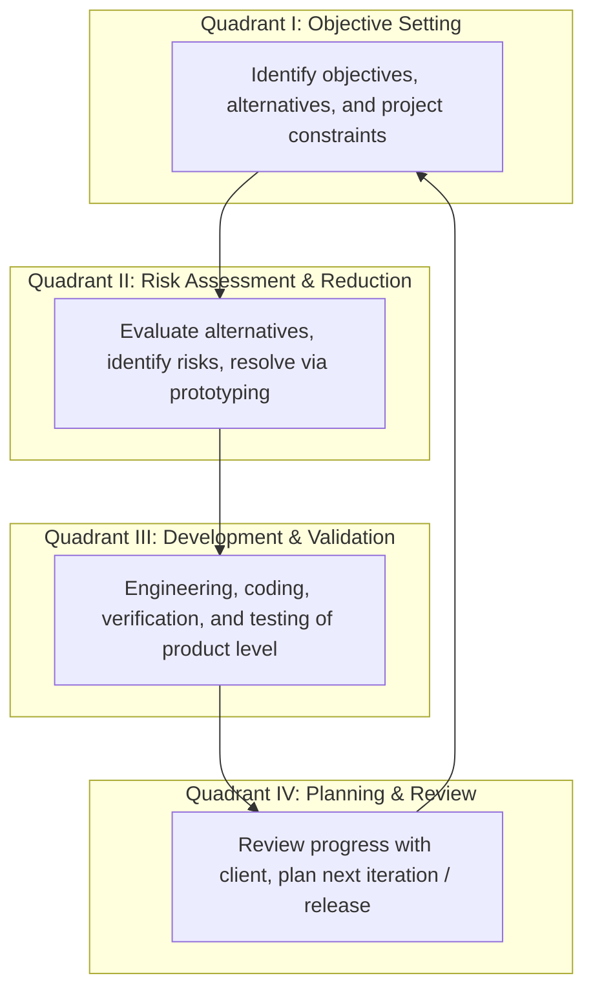

# 24ITPC302: 13-Mark & 14-Mark University Model Exam Solutions
### Course: 24ITPC302 – Software Engineering (Regulations 2024)

This document provides complete, publication-grade model solutions for the classic 13-Mark university examination combos across all 6 modules.

---

## 🎯 UNIVERSITY COMBO 1: Boehm's Spiral Model vs Classic Waterfall Model (13 Marks)

### Problem Statement:
(a) Explain Boehm's Spiral Model of software development with a neat diagram. Describe its four quadrants and explain why it is referred to as a "risk-driven" evolutionary model. [8 Marks]  
(b) Compare and contrast the Waterfall Model with the Spiral Model across 5 software project parameters. [5 Marks]

### Solution:

#### Part (a): Boehm's Spiral Model [8 Marks]
The Spiral Model, formulated by Dr. Barry Boehm in 1988, is an **evolutionary, risk-driven process model** that couples the iterative nature of prototyping with the controlled, systematic aspects of the linear sequential model.



**The Four Quadrants:**
1. **Quadrant I: Determine Objectives, Alternatives, and Constraints:**
   - Specific objectives for the iteration are identified (e.g., core database architecture).
   - Alternative technical approaches (e.g., relational vs NoSQL) and design constraints (budget, latency) are documented.
2. **Quadrant II: Risk Analysis and Resolution:**
   - Detailed risk analysis is conducted for every technical and project vulnerability.
   - Prototyping, simulation, and benchmarking are used to mitigate and resolve critical risks before committing development funds.
3. **Quadrant III: Engineering and Development:**
   - The software artifact for this spiral turn is designed, coded, and tested.
   - For early turns, this might be an architectural prototype; for later turns, it is production-grade software.
4. **Quadrant IV: Planning the Next Phase:**
   - Client reviews the deliverables and milestone progress.
   - Decisions are made whether to proceed, pivot, or terminate the project, and resources are allocated for the next spiral cycle.

#### Part (b): Waterfall Model vs Spiral Model Comparison [5 Marks]
| Parameter | Waterfall Model | Spiral Model |
| :--- | :--- | :--- |
| **Lifecycle Paradigm** | Linear sequential, rigid forward progression. | Evolutionary, iterative spiral progression. |
| **Risk Management** | Implicit; no dedicated risk assessment phase. | Explicit, mandatory risk analysis in Quadrant II. |
| **Requirement Volatility** | Inflexible; demands frozen, stable requirements upfront. | Highly adaptive; accommodates evolving user requirements. |
| **Working Software Delivery** | Appears very late in the lifecycle (Construction phase). | Early operational prototypes delivered in early spirals. |
| **Best Suited For** | Well-understood, small-to-medium systems (e.g. payroll). | High-risk, complex, mission-critical enterprise systems. |

---

## 🎯 UNIVERSITY COMBO 2: IEEE 830 SRS Document & Requirements Engineering (13 Marks)

### Problem Statement:
(a) Outline the standard IEEE 830-1998 format for a Software Requirements Specification (SRS). Detail the essential components of Section 3 (Specific Requirements). [7 Marks]  
(b) Explain the 4 steps of the Requirements Engineering Process: Feasibility Study, Elicitation, Validation, and Management. [6 Marks]

### Solution:

#### Part (a): IEEE 830 Standard SRS Outline [7 Marks]
An SRS acts as the definitive contract between stakeholders and developers.
```
1. INTRODUCTION
   1.1 Purpose (Defines intended audience and scope)
   1.2 Scope (Identifies software product, benefits, and objectives)
   1.3 Definitions, Acronyms, and Abbreviations
   1.4 References (List of related standards, books, contracts)
   1.5 Overview of SRS document structure
2. OVERALL DESCRIPTION
   2.1 Product Perspective (Context diagram, system interfaces, memory constraints)
   2.2 Product Functions (Summary of major system capabilities)
   2.3 User Characteristics (Technical proficiency, educational level)
   2.4 General Constraints (Regulatory policies, hardware limitations, security)
   2.5 Assumptions and Dependencies
3. SPECIFIC REQUIREMENTS
   3.1 External Interface Requirements
       - User Interfaces (GUI layouts, navigation flow)
       - Hardware Interfaces (Sensors, memory registers, ports)
       - Software Interfaces (Operating system, external database APIs)
       - Communications Interfaces (TCP/IP protocols, encryption standards)
   3.2 Functional Requirements (Detailed use cases, preconditions, postconditions)
   3.3 Performance Requirements (Response time, throughput, concurrency)
   3.4 Design Constraints (Programming language, architectural frameworks)
   3.5 Software System Attributes (Reliability, Availability, Security, Portability)
```

#### Part (b): The 4 Requirements Engineering Steps [6 Marks]
1. **Feasibility Study:** Assesses whether the proposed system is practically viable across:
   - *Technical Feasibility:* Availability of technology, tools, and technical skills.
   - *Economic Feasibility:* Cost-Benefit Analysis ($CBA$), Return on Investment ($ROI$).
   - *Operational Feasibility:* Organizational acceptability and user adaptation.
2. **Requirements Elicitation & Analysis:** Discovering requirements from stakeholders using interviews, surveys, on-site observation, Joint Application Development (JAD) workshops, and Use Case modeling.
3. **Requirements Validation:** Formal review by multidisciplinary teams to ensure the specification is complete, consistent, unambiguous, realistic, and verifiable.
4. **Requirements Management:** Managing requirement changes during project execution via Change Control Boards (CCB) and maintaining bidirectional traceability using a **Requirement Traceability Matrix (RTM)**.

---

## 🎯 UNIVERSITY COMBO 3: Functional Independence — Cohesion & Coupling (13 Marks)

### Problem Statement:
(a) Define Functional Independence. Explain all 7 levels of Cohesion from worst to best with programming examples. [7 Marks]  
(b) Explain all 6 levels of Coupling from worst to best. State why low coupling is essential for system maintenance. [6 Marks]

### Solution:

#### Part (a): Cohesion Hierarchy (7 Levels) [7 Marks]
**Cohesion** measures the degree of functional relatedness and focus of processing elements within a single software module.

1. **Coincidental Cohesion (Worst):** Elements are bundled together with no meaningful relationship (e.g. a utility file with `calc_tax()`, `print_logo()`, and `sort_array()`).
2. **Logical Cohesion:** Elements perform logically related tasks, but the specific task is selected by a passed control flag (e.g., `print_document(int flag)` where flag selects PDF, Word, or Text).
3. **Temporal Cohesion:** Elements are executed at the same point in time (e.g., `system_startup()` initializing database connection, loading config file, starting UI).
4. **Procedural Cohesion:** Elements must execute in a specific sequential order, but manipulate different data items (e.g., `check_file_permissions(); read_input();`).
5. **Communicational Cohesion:** Elements operate on the exact same input data structure or produce the same output data (e.g., `process_customer_data()` updates customer address and computes customer credit limit).
6. **Sequential Cohesion:** The output of one processing element serves as the direct input to the next element within the module (pipeline: `raw_data = read(); parsed = parse(raw_data); normalized = normalize(parsed);`).
7. **Functional Cohesion (Best / Ideal):** Every element in the module is dedicated exclusively to performing a single, well-defined mathematical or computational function (e.g., `compute_cosine(angle)`, `calculate_gross_salary(employee_id)`).

#### Part (b): Coupling Hierarchy (6 Levels) [6 Marks]
**Coupling** measures the degree of interdependence and interconnectedness between distinct software modules.

1. **Content Coupling (Worst / Pathological):** Module $A$ directly modifies internal code or internal memory data of Module $B$, bypassing public interfaces.
2. **Common Coupling:** Modules share read and write access to a shared global memory area or global variables.
3. **Control Coupling:** Module $A$ controls the internal operational logic of Module $B$ by passing control parameters or flags (`bool is_admin`, `int mode`).
4. **Stamp Coupling (Data-Structure Coupling):** Module $A$ passes a large composite data structure to Module $B$, which uses only a small subset of the data fields (e.g. passing complete 50-field `EmployeeRecord` when only `hourly_rate` is needed).
5. **Data Coupling (Best practical):** Modules communicate strictly through simple primitive scalar parameters (e.g., `int`, `float`, `string`).
6. **Uncoupled (Ideal):** Zero interaction; completely independent components.

*Why Low Coupling is Essential:* Low coupling ensures that changes or bug fixes made inside one module do not produce unintended "ripple effects" across other system modules, dramatically lowering maintenance costs.
