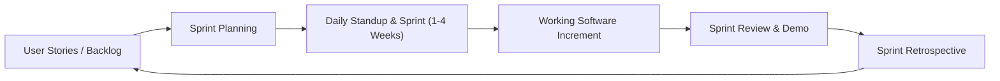
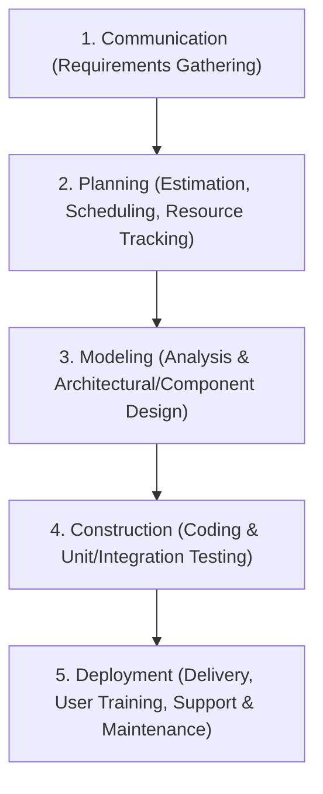
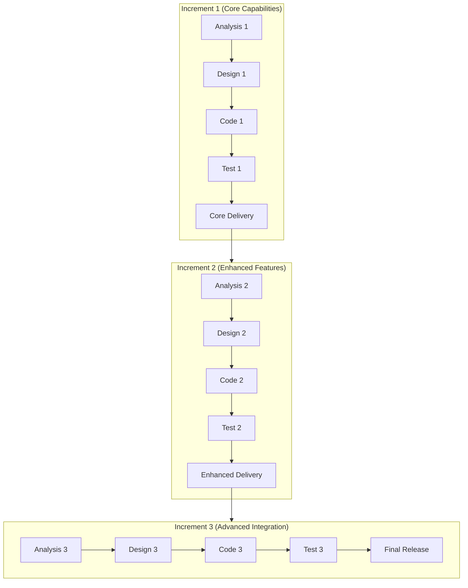
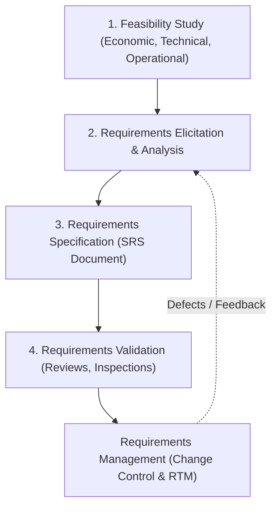

# 24ITPC302: Software Engineering — Master Exam Topic Solutions
### Course: 24ITPC302 (Anna University / Autonomous Regulations 2024)
### Core High-Yield Exam Question & Solution Bank (Prescribed Priority List)

This document provides complete, publication-grade model answers for the exact university examination questions specified by course faculty. Every answer includes full 13-mark distribution breakdowns, architectural diagrams, comparison matrices, and worked numericals.

---

# 📌 UNIT 1: SOFTWARE PROCESS & AGILE DEVELOPMENT

```
Topics Covered:
1. Agile Model (Manifesto, Values, 12 Principles, Lifecycle)
2. Waterfall Model (Phases, Strengths, Weaknesses, Applicability)
3. Extreme Programming (XP) (4 Values, 12 Core Practices, Lifecycle)
4. Spiral Model (Boehm's 4 Quadrants, Risk-Driven Lifecycle)
5. V-Model (Verification vs Validation Wings, Defect Prevention)
6. Incremental Model (Staged Delivery, Core vs Enhanced Builds)
```

---

## 🎯 UNIT 1 - QUESTION 1: Agile Model & Agile Manifesto (Full 13 Marks)

### Question:
**(a)** Discuss the Agile software development philosophy. Explain the four core values and twelve principles of the Agile Manifesto. [7 Marks]  
**(b)** Illustrate the generic Agile development lifecycle. Contrast Agile methodologies with traditional plan-driven models across key project parameters. [6 Marks]

### Model Answer:

#### (a) Agile Philosophy, 4 Core Values, and 12 Principles [7 Marks]
Agile is an iterative and incremental software engineering approach that prioritizes adaptability, continuous stakeholder collaboration, and rapid delivery of working software over rigid upfront planning.

```
+-------------------------------------------------------------------------+
|                  THE 4 CORE VALUES OF THE AGILE MANIFESTO               |
+-------------------------------------------------------------------------+
|  1. Individuals and Interactions   OVER  Processes and Tools            |
|  2. Working Software               OVER  Comprehensive Documentation    |
|  3. Customer Collaboration         OVER  Contract Negotiation           |
|  4. Responding to Change           OVER  Following a Plan               |
+-------------------------------------------------------------------------+
  (While there is value in the items on the right, Agile values the items  
   on the left more.)
```

**The 12 Agile Principles:**
1. **Customer Satisfaction:** Highest priority through early and continuous delivery of valuable software.
2. **Welcome Changing Requirements:** Harness change for customer competitive advantage, even late in development.
3. **Frequent Delivery:** Deliver working software frequently (from a couple of weeks to a couple of months).
4. **Daily Collaboration:** Business stakeholders and developers must work together daily throughout the project.
5. **Motivated Individuals:** Build projects around motivated individuals; provide environment, support, and trust.
6. **Face-to-Face Conversation:** The most efficient and effective method of conveying information is face-to-face.
7. **Working Software as Primary Measure:** Working software is the principal measure of project progress.
8. **Sustainable Development:** Sponsors, developers, and users should maintain a constant, sustainable pace indefinitely.
9. **Technical Excellence:** Continuous attention to technical excellence and good design enhances agility.
10. **Simplicity:** The art of maximizing the amount of work *not done* is essential.
11. **Self-Organizing Teams:** The best architectures, requirements, and designs emerge from self-organizing teams.
12. **Regular Reflection:** At regular intervals, the team reflects on how to become more effective, then tunes behavior.

#### (b) Generic Agile Lifecycle & Agile vs Traditional Comparison [6 Marks]



| Parameter | Agile Methodologies (Scrum, XP) | Traditional Plan-Driven (Waterfall, V-Model) |
| :--- | :--- | :--- |
| **Development Philosophy** | Iterative, adaptive, evolutionary. | Linear, predictive, sequential. |
| **Requirement Handling** | Dynamic; changes accommodated in any sprint. | Frozen early in Requirements Analysis; high change cost. |
| **Delivery Model** | Frequent small working increments (every 2-4 wks). | Single monolithic delivery at project completion. |
| **Customer Involvement** | Continuous, daily/weekly on-site collaboration. | Milestone reviews only (Sign-off & Final UAT). |
| **Testing Approach** | Continuous throughout sprint (TDD, automated). | Separate terminal phase after Construction. |
| **Risk Management** | Very low; early working increments uncover flaws. | High; defects discovered late during system integration. |

---

## 🎯 UNIT 1 - QUESTION 2: Classical Waterfall Model (Full 13 Marks)

### Question:
**(a)** Explain the Classical Waterfall Model with a neat phase diagram. Detail the activities and deliverables of each phase. [8 Marks]  
**(b)** Discuss the major limitations and weaknesses of the Waterfall model. Identify scenarios where it remains the optimal choice. [5 Marks]

### Model Answer:

#### (a) Waterfall Model Phases & Deliverables [8 Marks]
The Waterfall Model (Winston Royce, 1970) is a linear sequential software process model where each phase must be completed and signed off before the next phase begins.



1. **Communication (Feasibility & Requirements):** Elicits functional and non-functional requirements from stakeholders.  
   *Deliverable:* Software Requirements Specification (**SRS**) Document.
2. **Planning:** Defines project scope, task breakdowns (WBS), cost estimation (COCOMO), and schedule (Gantt chart).  
   *Deliverable:* Software Project Management Plan (**SPMP**).
3. **Modeling (Analysis & Design):** Converts requirements into architectural structures, database schemas, and interface models.  
   *Deliverables:* High-Level Design (**HLD**) and Low-Level Design (**LLD**).
4. **Construction (Coding & Testing):** Programmers implement the design in source code; verified via unit and integration tests.  
   *Deliverables:* Compiled Source Code, Unit Test Reports.
5. **Deployment & Maintenance:** System installed at client site; ongoing bug fixes, adaptive patches, and perfective enhancements.  
   *Deliverable:* Operational System, User Manuals, Maintenance Log.

#### (b) Limitations & Ideal Scenarios [5 Marks]
- **Limitations:**
  1. *Blocking States:* Team members sit idle waiting for predecessor phases to complete.
  2. *Late Working Software:* A working program is not available until late in the lifecycle (Construction). A critical design flaw found here can lead to project cancellation.
  3. *Inability to Handle Requirement Volatility:* Real-world customers rarely know all requirements upfront.
- **When to Use:**
  - Embedded systems with fixed, immutable hardware specifications.
  - Large-scale compiler or operating system utility development with stable, well-understood domain standards.
  - Legacy migrations where an existing system is being re-implemented in a modern language without functional changes.

---

## 🎯 UNIT 1 - QUESTION 3: Extreme Programming (XP) (Full 13 Marks)

### Question:
**(a)** What is Extreme Programming (XP)? Describe the 4 core values of XP and illustrate the XP development lifecycle. [7 Marks]  
**(b)** Explain in detail any six core practices of Extreme Programming, highlighting the mechanism and benefits of Pair Programming and Test-Driven Development (TDD). [6 Marks]

### Model Answer:

#### (a) XP Philosophy, 4 Values, and Lifecycle [7 Marks]
Extreme Programming (Kent Beck) is an agile software development methodology designed to produce higher quality software and higher quality of life for the development team in the face of rapidly changing requirements.

```
                    THE 4 CORE VALUES OF EXTREME PROGRAMMING
 +-----------------------------------------------------------------------------+
 | 1. COMMUNICATION: Open, continuous verbal communication over written memos. |
 | 2. SIMPLICITY:    Design for what is needed today, never for what might be. |
 | 3. FEEDBACK:      Immediate feedback from tests, code, and customer demo.   |
 | 4. COURAGE:       Fearless refactoring, discarding failed spike prototypes. |
 +-----------------------------------------------------------------------------+
```



```mermaid
flowchart LR
    US["User Stories on Index Cards"] --> RP["Release Planning (Commitment)"]
    RP --> SP["Spike Solutions (for High-Risk Stories)"]
    SP --> ITER["Iteration Planning"]
    ITER --> TDD["Write Automated Unit Test FIRST"]
    TDD --> PP["Pair Programming (Driver & Navigator)"]
    PP --> CI["Continuous Integration & Refactoring"]
    CI --> AT["Customer Acceptance Testing"]
    AT --> REL["Software Increment Release"]
```

#### (b) Core Practices of Extreme Programming [6 Marks]

1. **Pair Programming:**
   - *Mechanism:* Two programmers sit side-by-side at one computer. The **Driver** controls the keyboard and mouse, focusing on tactical implementation. The **Navigator** continuously reviews the code for logic errors, design issues, and edge cases. Roles switch frequently.
   - *Benefits:* Real-time continuous code review, reduced defect rates (15-20% fewer bugs), collective knowledge sharing, eliminates single-point-of-failure developers.
2. **Test-Driven Development (TDD):**
   - *Mechanism:* Developers write automated unit tests *before* writing any production code (**Red-Green-Refactor** cycle). Code is written only to make the failing test pass.
   - *Benefits:* 100% test coverage, cleaner decoupled design, absolute confidence during refactoring.
3. **Continuous Integration (CI):**
   - Code is integrated and built into the main trunk multiple times a day. Automated test suites run on every commit. Prevents "integration hell".
4. **Small Releases:**
   - System released in tiny, valuable increments (every 2-3 weeks), yielding rapid customer feedback.
5. **Simple Design:**
   - The design satisfies current tests and nothing more (YAGNI — *You Aren't Gonna Need It*).
6. **On-Site Customer:**
   - A full-time customer representative is embedded inside the development bullpen to clarify ambiguities and prioritize stories in real time.

---

## 🎯 UNIT 1 - QUESTION 4: Boehm's Spiral Model (Full 13 Marks)

### Question:
**(a)** Draw and explain Barry Boehm's Spiral Model. Detail the activities performed in each of its four quadrants. [8 Marks]  
**(b)** Why is the Spiral Model characterized as a "risk-driven" process model? State its advantages and disadvantages. [5 Marks]

### Model Answer:

#### (a) Spiral Model Quadrants [8 Marks]
The Spiral Model (Barry Boehm, 1988) combines the iterative nature of prototyping with the controlled, systematic aspects of the Waterfall model.

```
                    QUADRANT II                      QUADRANT I
           Risk Analysis & Prototyping        Determine Objectives & Constraints
                        \                           /
                         \       Spiral Turn 2     /
                          \    /---------------\  /
                           \  /  Spiral Turn 1  \/
           -----------------\+-------------------+-----------------
                            /\  Concept of Ops  /\
                           /  \----------------/  \
                          /                        \
                         /                          \
                    QUADRANT III                     QUADRANT IV
              Engineering & Development         Planning & Customer Review
```

1. **Quadrant I: Determine Objectives, Alternatives, and Constraints:**
   - Project goals for the current iteration are established.
   - Technical alternatives (e.g., in-house development vs COTS package) and constraints (cost, schedule, interface standards) are identified.
2. **Quadrant II: Identify and Resolve Risks (Risk Analysis):**
   - Thorough risk analysis is performed on every technical and organizational uncertainty.
   - Prototyping, simulation, benchmarking, and analytical modeling are executed to eliminate critical risks before committing capital.
3. **Quadrant III: Engineering, Development, and Testing:**
   - A software artifact corresponding to the current spiral level is constructed.
   - In early spirals, this produces an architectural simulation; in middle spirals, a functional prototype; in final spirals, the operational software system verified via rigorous testing.
4. **Quadrant IV: Plan Next Phase & Customer Evaluation:**
   - The customer reviews all deliverables. Management reviews progress, budget, and schedule, and decides whether to approve the next spiral turn.

#### (b) Risk-Driven Nature, Advantages & Disadvantages [5 Marks]
- **Why Risk-Driven:** At each turn of the spiral, the amount of effort spent is governed by the risk associated with that step. If a major technical risk cannot be resolved in Quadrant II, the project is terminated early, preventing catastrophic financial loss.
- **Advantages:**
  - Explicit, systematic risk mitigation at every stage.
  - Accommodates evolving requirements through incremental spiral expansion.
  - Early working prototypes provide constant customer visibility.
- **Disadvantages:**
  - Highly dependent on expert risk assessment skills (poor risk analysis leads to project disaster).
  - High process overhead; unsuitable for low-risk, small projects.

---

## 🎯 UNIT 1 - QUESTION 5: The V-Model (Full 13 Marks)

### Question:
**(a)** Illustrate the V-Model of software development. Differentiate between Verification and Validation activities. [7 Marks]  
**(b)** Explain how testing phases correspond to specification and design phases in the V-Model. What is the Defect Prevention Principle? [6 Marks]

### Model Answer:

#### (a) V-Model Structure & Verification vs Validation [7 Marks]

```
 VERIFICATION (Left Wing)                                    VALIDATION (Right Wing)
 [Requirements Analysis] <====================================> [Acceptance Testing]
         \                                                              /
      [System Design] <====================================> [System Testing]
             \                                                      /
       [Architecture Design] <========================> [Integration Testing]
                 \                                              /
             [Module Design] <====================> [Unit Testing]
                     \                                      /
                      +------> [CODING / IMPLEMENTATION] --+
```

| Dimension | Verification (Are we building the product right?) | Validation (Are we building the right product?) |
| :--- | :--- | :--- |
| **Focus** | Process compliance, static analysis, design consistency. | Functional correctness, runtime behavior, customer satisfaction. |
| **Techniques** | Inspections, reviews, walkthroughs, desk checking. | Dynamic testing execution (Unit, Integration, System, Acceptance). |
| **Execution** | Done statically *without* running compiled code. | Done dynamically *with* running compiled code. |
| **Timing** | Left wing of the V-Model (Analysis and Design). | Right wing of the V-Model (Post-coding execution). |

#### (b) Phase Correspondence & Defect Prevention Principle [6 Marks]
- **Direct Correspondence Mapping:**
  1. *Requirements Analysis $\Longleftrightarrow$ Acceptance Testing:* Acceptance test cases are written *during* Requirements Analysis to ensure every business requirement is testable and verifiable.
  2. *System Design $\Longleftrightarrow$ System Testing:* System test plans are formulated *during* System Design to validate overall performance, security, and hardware compatibility.
  3. *Architecture Design $\Longleftrightarrow$ Integration Testing:* Integration tests verify interfaces between subsystems designed during Architectural Design.
  4. *Module / Detail Design $\Longleftrightarrow$ Unit Testing:* Unit test suites verify the internal algorithms and data structures of individual components.
- **Defect Prevention Principle:**
  In traditional models, testing is an afterthought at the end. In the V-Model, test cases are designed concurrently with specifications. Writing test cases early exposes ambiguities, contradictions, and omissions in requirements *before* a single line of code is written, saving up to 80% in rework costs.

---

## 🎯 UNIT 1 - QUESTION 6: The Incremental Model (Full 13 Marks)

### Question:
**(a)** Explain the Incremental Model with a neat block diagram. How does it deliver operational capabilities in stages? [7 Marks]  
**(b)** Contrast the Incremental Model with Prototyping and Waterfall across development risk, customer feedback, and delivery timeline. [6 Marks]

### Model Answer:

#### (a) Incremental Model Mechanism [7 Marks]
The Incremental Model applies the linear sequential Waterfall phases in a staggered, iterative fashion. Each sequence of activities produces a deliverable "increment" of the software.



- **Increment 1 (Core Product):** Implements the fundamental, non-negotiable requirements (e.g., basic word processor text editing and file save). The customer puts this into production use immediately.
- **Increment 2 & Successive Increments:** Based on user evaluation of Increment 1, subsequent increments add functionality (e.g., spell check, advanced table formatting, cloud backup).
- **Staggered Resource Allocation:** If staffing is temporarily limited, Increment 1 can be built by a small core team. Additional technical specialists (e.g., UI designers, security auditors) can be brought in for later increments.

#### (b) Incremental vs Prototyping vs Waterfall [6 Marks]

| Attribute | Incremental Model | Evolutionary Prototyping | Classical Waterfall |
| :--- | :--- | :--- | :--- |
| **Delivery Strategy** | Usable operational subsets delivered in planned stages. | Working prototype evolves continuously through feedback. | Single monolithic delivery at project end. |
| **Requirement Baseline** | Core requirements must be well-understood upfront. | Requirements can be completely unclear and fluid. | All requirements must be frozen upfront. |
| **Customer Feedback** | Provided after each production release increment. | Provided continuously after each prototype demonstration. | Provided only at the very end of the lifecycle. |
| **Technical Risk** | Low to medium; early core deployment proves feasibility. | Very low; risky concepts explored through throwaway code. | High; risks remain unverified until system testing. |

---

# 📌 UNIT 2: REQUIREMENTS ANALYSIS & SPECIFICATION

```
Topics Covered:
1. IEEE 830-1998 Software Requirements Specification (SRS)
2. Requirements Engineering Process (Feasibility, Elicitation, Validation, Management)
3. Petri Nets (Places, Transitions, Tokens, Firing Rules, Concurrency)
4. Functional vs Non-Functional Requirements (FURPS+, Metrics)
```

---

## 🎯 UNIT 2 - QUESTION 1: IEEE 830 SRS Document (Full 13 Marks)

### Question:
**(a)** Outline the standard IEEE 830-1998 structure for a Software Requirements Specification (SRS). Detail the components of Section 3 (Specific Requirements). [7 Marks]  
**(b)** State and explain the six essential characteristics of a high-quality SRS document. [6 Marks]

### Model Answer:

#### (a) IEEE 830-1998 Standard SRS Architecture [7 Marks]

```
                    IEEE 830-1998 MASTER SRS TEMPLATE
================================================================================
1. INTRODUCTION
   1.1 Purpose (Defines intended audience and document objectives)
   1.2 Scope (Identifies software product, benefits, and business goals)
   1.3 Definitions, Acronyms, and Abbreviations
   1.4 References (Related IEEE standards, contract documents, books)
   1.5 Overview (Describes structure of the remainder of the SRS)

2. OVERALL DESCRIPTION
   2.1 Product Perspective (Context diagram, system interfaces, constraints)
   2.2 Product Functions (High-level summary of major services)
   2.3 User Characteristics (Technical literacy, accessibility needs)
   2.4 General Constraints (Regulatory policies, hardware platforms, audit logs)
   2.5 Assumptions and Dependencies (Third-party APIs, network bandwidth)

3. SPECIFIC REQUIREMENTS (Core Technical Section)
   3.1 External Interface Requirements
       3.1.1 User Interfaces (Screen layouts, navigational hierarchy)
       3.1.2 Hardware Interfaces (Device drivers, bus protocols, sensors)
       3.1.3 Software Interfaces (RDBMS APIs, OS system calls)
       3.1.4 Communications Interfaces (HTTPS, WebSockets, TLS 1.3)
   3.2 Functional Requirements (Detailed inputs, transformations, outputs)
   3.3 Performance Requirements (Latency < 200ms, throughput 5000 TPS)
   3.4 Design Constraints (Mandatory tech stack: Java 21, PostgreSQL)
   3.5 Software System Quality Attributes (Reliability, Availability, Security)
   3.6 Other Requirements (Data dictionary, database schema models)
================================================================================
```

#### (b) Six Characteristics of a Good SRS [6 Marks]
1. **Unambiguous:** Every requirement has exactly one interpretation. Natural language ambiguities must be resolved using formal modeling or structured notation.
2. **Complete:** Contains all significant requirements (functional, performance, interface, security), responses to both valid and invalid inputs, and full labeled diagrams.
3. **Consistent:** No requirement conflicts with any other (e.g., Requirement A specifying 256-bit AES encryption cannot be contradicted by Requirement B mandating cleartext legacy transmission).
4. **Verifiable (Testable):** There exists a finite, cost-effective process by which a person or machine can verify that the final software meets the requirement.
5. **Modifiable:** The structure and style allow changes to be made easily, completely, and consistently (table of contents, cross-referencing, numbered paragraphs).
6. **Traceable:** The origin of each requirement is clear (backward traceability), and each requirement facilitates reference in future development or testing documents (forward traceability via Requirements Traceability Matrix — **RTM**).

---

## 🎯 UNIT 2 - QUESTION 2: Requirements Engineering Process (Full 13 Marks)

### Question:
**(a)** Diagram and describe the four key phases of the Requirements Engineering Process. [7 Marks]  
**(b)** Explain Requirements Elicitation techniques and describe how the Requirements Traceability Matrix (RTM) enables effective Requirements Management. [6 Marks]

### Model Answer:

#### (a) The 4 Requirements Engineering Phases [7 Marks]



1. **Feasibility Study:** Evaluates whether the user's needs can be satisfied within budget, schedule, and technical constraints:
   - *Technical Feasibility:* Available technology, team competence, and hardware.
   - *Economic Feasibility:* Cost-benefit analysis ($CBA$), estimated $ROI$.
   - *Operational Feasibility:* Will the system be accepted and utilized by the operational staff?
2. **Requirements Elicitation & Analysis:** Discovering requirements through active engagement with stakeholders, filtering noise, and resolving conflicts.
3. **Requirements Specification:** Translating informal stakeholder desires into a structured, technical, and unambiguous document (IEEE 830 SRS).
4. **Requirements Validation:** Demonstrating that the requirements define the system that the customer actually wants via formal inspection, prototype demonstration, and test-case generation.

#### (b) Elicitation Techniques & Requirements Traceability Matrix [6 Marks]
- **Elicitation Techniques:**
  - *Interviews:* Structured (formal question set) or unstructured (open discussion with domain experts).
  - *Joint Application Development (JAD):* Intensive group workshops with developers, users, and managers to achieve rapid consensus.
  - *Surveys & Questionnaires:* Scalable data gathering across thousands of distributed end-users.
  - *Use Case Modeling & Scenarios:* Documenting step-by-step user-system interactions for core business flows.
- **Requirements Traceability Matrix (RTM):**
  A grid tracking each requirement from its origin through design, code, and test cases:

| Req ID | Business Requirement Description | Design Module | Source Code File | Test Case ID | Status |
| :---: | :--- | :--- | :--- | :--- | :--- |
| **REQ-01** | User Multi-Factor Authentication | `AuthService` | `mfa_auth.py` | `TC_MFA_001` | Passed |
| **REQ-02** | Export Financial Ledger to CSV | `ReportGenerator` | `csv_exporter.py`| `TC_CSV_014` | Passed |

*Benefits:* Ensures 100% test coverage (no requirement is forgotten), prevents scope creep (gold plating), and enables instant impact analysis when a change is requested.

---

## 🎯 UNIT 2 - QUESTION 3: Petri Nets (Full 13 Marks)

### Question:
**(a)** Define a Petri Net formally as a mathematical 5-tuple. Describe the four graphical primitives and the fundamental transition firing rules. [7 Marks]  
**(b)** Construct a Petri Net model representing a classical synchronization problem (Producer-Consumer with a bounded buffer). Trace its state transitions through two firings. [6 Marks]

### Model Answer:

#### (a) Formal Definition & Graphical Primitives [7 Marks]
A Petri Net is a formal graphical and mathematical modeling tool used for describing concurrent, asynchronous, distributed, parallel, and nondeterministic systems.

- **Formal 5-Tuple Definition:**
  $$\mathbf{PN = (P, T, F, W, M_0)}$$
  1. $P = \{p_1, p_2, \dots, p_m\}$: Finite set of **Places** (represented by circles).
  2. $T = \{t_1, t_2, \dots, t_n\}$: Finite set of **Transitions** (represented by bars or rectangles), where $P \cap T = \emptyset$.
  3. $F \subseteq (P \times T) \cup (T \times P)$: Set of directed **Arcs** (flow relation).
  4. $W: F \to \{1, 2, 3, \dots\}$: **Weight function** on arcs (default weight = 1).
  5. $M_0: P \to \{0, 1, 2, \dots\}$: **Initial Marking** vector indicating the initial distribution of tokens in places.

- **Transition Firing Rules:**
  1. *Enabling Condition:* A transition $t$ is **enabled** if and only if each of its input places $p \in I(t)$ contains at least $W(p, t)$ tokens:
     $$\forall p \in I(t), \quad M(p) \ge W(p, t)$$
  2. *Firing Rule:* When an enabled transition fires:
     - It consumes $W(p, t)$ tokens from each input place $p \in I(t)$.
     - It deposits $W(t, p')$ tokens into each output place $p' \in O(t)$.
     $$M_{\text{new}}(p) = M_{\text{old}}(p) - W(p, t) + W(t, p)$$

#### (b) Producer-Consumer Model with Bounded Buffer ($N=1$) [6 Marks]

```
 Places:
   P1 = Producer Ready
   P2 = Buffer Empty (Token present initially)
   P3 = Buffer Full
   P4 = Consumer Ready

 Transitions:
   T1 = Produce & Deposit Item
   T2 = Fetch Item & Consume
```

```
          [P1: Producer Ready (•)]       [P2: Buffer Empty (•)]
                    \                        /
                     \                      /
                      v                    v
                   ============================
                   |  T1: Produce & Deposit   |
                   ============================
                     /                      \
                    /                        \
                   v                          v
       [P1: Producer Ready]             [P3: Buffer Full]
                                              |
                                              |
       [P4: Consumer Ready (•)]               |
               \                             /
                \                           /
                 v                         v
              =================================
              |    T2: Fetch & Consume        |
              =================================
                /                           \
               /                             \
              v                               v
    [P4: Consumer Ready]             [P2: Buffer Empty]
```

- **Initial Marking:** $M_0 = [P_1: 1, \ P_2: 1, \ P_3: 0, \ P_4: 1]$.
- **Firing 1 ($T_1$ fires):**
  - Inputs to $T_1$ ($P_1$ and $P_2$) each have 1 token $\implies T_1$ is enabled.
  - $T_1$ fires: Consumes token from $P_1$ and $P_2$; deposits token into $P_1$ and $P_3$.
  - State becomes $M_1 = [P_1: 1, \ P_2: 0, \ P_3: 1, \ P_4: 1]$.
- **Firing 2 ($T_2$ fires):**
  - Inputs to $T_2$ ($P_3$ and $P_4$) each have 1 token $\implies T_2$ is enabled.
  - $T_2$ fires: Consumes token from $P_3$ and $P_4$; deposits token into $P_4$ and $P_2$.
  - State returns to $M_2 = [P_1: 1, \ P_2: 1, \ P_3: 0, \ P_4: 1] = M_0$.
- *Conclusion:* Mutual exclusion and bounded synchronization are guaranteed.

---

## 🎯 UNIT 2 - QUESTION 4: Functional vs Non-Functional Requirements (Full 13 Marks)

### Question:
**(a)** Distinguish between Functional and Non-Functional Requirements with suitable examples. Explain the FURPS+ classification framework. [7 Marks]  
**(b)** Why are Non-Functional Requirements often harder to specify and verify? Provide quantifiable test metrics for Performance, Reliability, and Usability. [6 Marks]

### Model Answer:

#### (a) Functional vs Non-Functional & FURPS+ [7 Marks]

| Parameter | Functional Requirements (FR) | Non-Functional Requirements (NFR) |
| :--- | :--- | :--- |
| **Definition** | What the system *must do* (services, operations, computations). | How well the system *behaves* (quality constraints, attributes). |
| **Origin** | Directly derived from user business processes. | Derived from technical constraints, regulations, and user experience. |
| **Example** | "The system shall calculate monthly interest using $I = P \cdot r \cdot t$." | "The system shall process monthly interest for 100,000 users in $< 60$ seconds." |
| **Verification** | Simple Pass/Fail testing against expected outputs. | Complex performance, stress, and security profiling. |

- **The FURPS+ Framework (Robert Grady, HP):**
  1. **F — Functionality:** Feature sets, capabilities, security mechanisms.
  2. **U — Usability:** Human factors, UI aesthetics, ease of learning, documentation.
  3. **R — Reliability:** Frequency of failure, recoverability, predictability, Mean Time Between Failures ($MTBF$).
  4. **P — Performance:** Response latency, transaction throughput, resource utilization.
  5. **S — Supportability:** Maintainability, testability, extensibility, configurability.
  6. **"+" Constraints:** Design constraints, implementation constraints, interface constraints, physical constraints.

#### (b) Quantifiable Metrics for NFR Verification [6 Marks]
NFRs written in vague terms (e.g., "The software must be fast and user-friendly") are untestable. They must be translated into quantifiable engineering metrics:

1. **Performance Metrics:**
   - *Response Time:* $95\%$ of transaction queries shall return within $\le 1.5$ seconds under a load of 2,000 concurrent users.
   - *Throughput:* The payment engine shall process a minimum of $\ge 3,500$ transactions per second (TPS).
2. **Reliability Metrics:**
   - *Availability:* System uptime shall exceed $\ge 99.99\%$ during scheduled business hours.
   - *Mean Time to Recover ($MTTR$):* In the event of a primary database node failure, failover to the replica shall complete in $\le 30$ seconds.
3. **Usability Metrics:**
   - *Learnability:* A newly hired clerk shall complete a standard order entry in $\le 5$ minutes with zero errors after 1 hour of training.
   - *Task Completion Rate:* At least $90\%$ of first-time users shall complete the account registration in $< 3$ minutes.

---

# 📌 UNIT 3: SOFTWARE DESIGN & ARCHITECTURE

```
Topics Covered:
1. The Software Design Process & Design Pyramid (4 Levels)
2. Architectural Styles (Data-Centered, Data-Flow, Call-Return, Event-Driven)
3. The 12 Fundamental Software Design Concepts (Pressman)
```

---

## 🎯 UNIT 3 - QUESTION 1: The Design Process & The Design Pyramid (Full 13 Marks)

### Question:
**(a)** Explain the Software Design Process. Illustrate Pressman's 4-Level Software Design Pyramid and explain how each level transforms analysis models into design artifacts. [7 Marks]  
**(b)** Differentiate between High-Level Design (HLD) and Low-Level Design (LLD). Explain the role of Design Heuristics (Fan-In vs Fan-Out). [6 Marks]

### Model Answer:

#### (a) The 4-Level Design Pyramid [7 Marks]

```
                     / \
                    /   \
                   /     \
                  /  [4]  \    COMPONENT-LEVEL DESIGN
                 /---------\   (Procedural Algorithms, PDL, Statecharts)
                /   [3]     \  INTERFACE DESIGN
               /-------------\ (User Interface, External/Internal APIs)
              /     [2]       \ARCHITECTURAL DESIGN
             /-----------------\(Subsystems, Connectors, Arch Styles)
            /       [1]         \DATA / CLASS DESIGN
           /---------------------\(Data Structures, ER Schemas, Classes)
```

1. **Data / Class Design (Base Level):**
   - *Input:* Analysis class diagrams, Data Dictionaries, CRC cards.
   - *Transformation:* Maps business entities into normalized relational database schemas, object-oriented class hierarchies, and core data structures.
2. **Architectural Design (Second Level):**
   - *Input:* Data Flow Diagrams (DFDs), context models.
   - *Transformation:* Establishes the structural skeleton of the system; identifies major software subsystems, architectural patterns, and inter-component messaging protocols.
3. **Interface Design (Third Level):**
   - *Input:* Use cases, sequence diagrams.
   - *Transformation:* Defines how components communicate with one another, with external systems, and with human operators (GUI wireframes, REST API contracts).
4. **Component-Level Design (Apex Level):**
   - *Input:* Class descriptions, activity diagrams.
   - *Transformation:* Converts architectural structural elements into detailed procedural algorithms, decision tables, and Program Design Language (**PDL** / Pseudocode).

#### (b) HLD vs LLD & Design Heuristics [6 Marks]

| Feature | High-Level Design (HLD) | Low-Level Design (LLD) |
| :--- | :--- | :--- |
| **Scope** | Macroscopic: Entire system structure and subsystems. | Microscopic: Internal logic of a single component. |
| **Audience** | Software Architects, Project Managers, Client Leads. | Programmers, Unit Testers. |
| **Deliverables** | Architecture diagram, DB schemas, Subsystem APIs. | Flowcharts, algorithms, pseudocode, method signatures. |

- **Design Heuristics: Fan-In vs Fan-Out:**
  - **Fan-Out (Span of Control):** The number of submodules directly called by a module.  
    *Heuristic:* $3 \le \text{Fan-Out} \le 7$. If $\text{Fan-Out} > 7$, the module is overloaded with coordination logic and should be refactored.
  - **Fan-In (Multi-Use):** The number of parent modules that directly call a given module.  
    *Heuristic:* **Maximize Fan-In!** High Fan-In indicates high software reusability of a utility service.

---

## 🎯 UNIT 3 - QUESTION 2: Architectural Styles & Patterns (Full 13 Marks)

### Question:
**(a)** What is an Architectural Style? Explain with neat structural diagrams: (i) Data-Centered Architecture, and (ii) Data-Flow Architecture (Pipe-and-Filter). [7 Marks]  
**(b)** Explain: (i) Call-and-Return (Layered) Architecture, and (ii) Event-Driven Architecture. State their respective trade-offs. [6 Marks]

### Model Answer:

#### (a) Data-Centered & Data-Flow Architectures [7 Marks]

1. **Data-Centered Architecture (Repository / Blackboard):**
   - *Structure:* A central data repository (database, file, blackboard) sits at the core. Independent client software components access the central store to add, modify, or delete data.

```
       [Client Software 1]       [Client Software 2]
                \                     /
                 v                   v
              +-------------------------+
              |   CENTRAL REPOSITORY    |
              | (Shared Database/Store) |
              +-------------------------+
                 ^                   ^
                /                     \
       [Client Software 3]       [Client Software 4]
```
   - *Advantage:* Highly modular; new clients can be added without altering existing clients.
   - *Disadvantage:* Central repository is a single point of failure and performance bottleneck.

2. **Data-Flow Architecture (Pipe-and-Filter):**
   - *Structure:* Data enters the system and flows through a series of **Filters** (transformation processing nodes) connected by **Pipes** (unidirectional data streams).

```
   [Input Data] ---> | Pipe | ---> [ Filter 1 ] ---> | Pipe | ---> [ Filter 2 ] ---> [Output Data]
```
   - *Advantage:* Easy to understand, maintain, and parallelize across multiple CPU cores.
   - *Disadvantage:* Inefficient for interactive applications; overhead in serializing/deserializing data.

#### (b) Layered & Event-Driven Architectures [6 Marks]

1. **Call-and-Return: Layered Architecture:**
   - *Structure:* Organized into horizontal tiers. Each layer provides services to the layer immediately above it and consumes services from the layer immediately below it.

```
   +------------------------------------+
   |   1. PRESENTATION LAYER (UI / CLI) |
   +------------------------------------+
                     |
   +------------------------------------+
   |   2. APPLICATION / BUSINESS LOGIC  |
   +------------------------------------+
                     |
   +------------------------------------+
   |   3. DATA ACCESS LAYER (ORM / DAO) |
   +------------------------------------+
                     |
   +------------------------------------+
   |   4. DATABASE / PERSISTENCE LAYER  |
   +------------------------------------+
```
   - *Advantage:* High maintainability and loose coupling; a layer can be replaced without modifying others.
   - *Disadvantage:* Cascading performance overhead across multiple layers.

2. **Event-Driven Architecture (Publish-Subscribe):**
   - *Structure:* Decoupled components interact asynchronously via events. Publishers emit events to an Event Broker without knowing who will consume them; subscribers register interest in specific topics.
   - *Advantage:* Extreme loose coupling, highly scalable, ideal for real-time reactive applications.
   - *Disadvantage:* Difficult to test and debug end-to-end event flow.

---

## 🎯 UNIT 3 - QUESTION 3: The 12 Fundamental Software Design Concepts (Full 13 Marks)

### Question:
Detail the twelve fundamental software design concepts formulated by Roger S. Pressman. Focus extensively on Functional Independence (Cohesion vs Coupling). [13 Marks]

### Model Answer:

### The 12 Fundamental Software Design Concepts (Pressman):

1. **Abstraction:** Permitting consideration of a mechanism at a high conceptual level without being encumbered by low-level implementation details:
   - *Data Abstraction:* Representing data without revealing storage format.
   - *Procedural Abstraction:* Naming a sequence of instructions (e.g., `sort()`).
2. **Architecture:** The hierarchical structure of program components, their interactions, and the structure of data used by the system.
3. **Patterns:** A named, proven solution to a recurring design problem within a specified context (e.g., Singleton, Observer).
4. **Separation of Concerns:** Any complex problem can be more easily resolved if subdivided into pieces that can each be solved independently.
5. **Modularity:** Software is divided into separately named and addressable components (modules) integrated to satisfy problem requirements.
6. **Information Hiding (David Parnas Principle):** Modules should be designed so that information (algorithms and data structures) contained within a module is inaccessible to other modules that have no need for such information.
7. **Functional Independence (The Golden Law):** Modules should perform a single, focused task and interact minimally with other modules. Measured by:
   - **Cohesion (Maximize):** The degree to which elements within a module belong together.
   - **Coupling (Minimize):** The degree of interdependence between software modules.
8. **Refinement (Stepwise Refinement — Niklaus Wirth):** Top-down process of successively decomposing high-level abstract statements into lower-level detailed operations.
9. **Aspects:** A representation of cross-cutting concerns that touch multiple system functions (e.g., logging, authentication, audit).
10. **Refactoring:** The process of restructuring an existing software design or source code without altering its external functional behavior to improve internal maintainability.
11. **Object-Oriented Design Concepts:** Core OOP principles: Classes, Objects, Inheritance, Polymorphism, and Encapsulation.
12. **Design Classes:** Refining analysis classes into technical implementation types: Entity Classes, Boundary Classes, and Controller Classes.

```
================================================================================
                    COHESION HIERARCHY (WORST TO BEST)
  [Coincidental] -> [Logical] -> [Temporal] -> [Procedural] 
                 -> [Communicational] -> [Sequential] -> [FUNCTIONAL (BEST)]
================================================================================
                    COUPLING HIERARCHY (WORST TO BEST)
  [Content (Worst)] -> [Common] -> [Control] -> [Stamp] 
                    -> [DATA (BEST)] -> [Uncoupled]
================================================================================
```

---

# 📌 UNIT 5: PROJECT MANAGEMENT & ESTIMATION

```
Topics Covered:
1. Barry Boehm's COCOMO Models (Basic, Intermediate, Modes, Calculations)
2. Earned Value Analysis (EVA) (PV, EV, AC, CV, SV, CPI, SPI, EAC)
3. Software Risk Management Fundamentals (Risk Types, Exposure, Leverage)
```

---

## 🎯 UNIT 5 - QUESTION 1: Boehm's COCOMO Estimation Models (Full 13 Marks)

### Question:
**(a)** Explain Barry Boehm's Basic COCOMO I model. Detail the characteristics of the three development modes (Organic, Semidetached, Embedded) and their governing formulas. [7 Marks]  
**(b)** **Numerical Problem:** A software project is estimated to be $35 \text{ KLOC}$. Calculate the Effort (Person-Months), Development Time (Months), Average Staff Size, and Productivity if developed in (i) Organic Mode, and (ii) Embedded Mode. [6 Marks]

### Model Answer:

#### (a) Basic COCOMO I Modes & Equations [7 Marks]
The Constructive Cost Model (COCOMO), formulated by Barry Boehm (1981), estimates effort and duration as a function of size in thousands of lines of source code ($KLOC$).

$$\mathbf{E = a \cdot (KLOC)^b \quad \text{[Person-Months]}}, \qquad \mathbf{D = c \cdot (E)^d \quad \text{[Months]}}, \qquad \mathbf{P = \frac{E}{D} \quad \text{[Staff]}}$$

1. **Organic Mode ($a=2.4, \ b=1.05, \ c=2.5, \ d=0.38$):**
   - *Characteristics:* Small teams, thoroughly understood domain, relaxed deadlines, stable operating environment (e.g., payroll system).
2. **Semidetached Mode ($a=3.0, \ b=1.12, \ c=2.5, \ d=0.35$):**
   - *Characteristics:* Medium teams with mixed experience, moderately tight deadlines, mixture of rigid and flexible requirements (e.g., database management system).
3. **Embedded Mode ($a=3.6, \ b=1.20, \ c=2.5, \ d=0.32$):**
   - *Characteristics:* Tight hardware/software coupling, strict regulatory and security constraints, inflexible interfaces (e.g., flight control system).

#### (b) Worked Numerical Solution ($KLOC = 35$) [6 Marks]

**Case (i): Organic Mode**
1. **Effort ($E$):**
   $$E = 2.4 \times (35)^{1.05} = 2.4 \times 41.761 = \mathbf{100.23 \text{ Person-Months}}$$
2. **Development Time ($D$):**
   $$D = 2.5 \times (100.23)^{0.38} = 2.5 \times 5.764 = \mathbf{14.41 \text{ Months}}$$
3. **Average Staff Size ($P$):**
   $$P = \frac{E}{D} = \frac{100.23}{14.41} = \mathbf{6.96 \approx 7 \text{ Persons}}$$
4. **Productivity:**
   $$\text{Productivity} = \frac{35,000 \text{ LOC}}{100.23 \text{ PM}} = \mathbf{349.2 \text{ LOC/PM}}$$

**Case (ii): Embedded Mode**
1. **Effort ($E$):**
   $$E = 3.6 \times (35)^{1.20} = 3.6 \times 71.026 = \mathbf{255.69 \text{ Person-Months}}$$
2. **Development Time ($D$):**
   $$D = 2.5 \times (255.69)^{0.32} = 2.5 \times 5.922 = \mathbf{14.81 \text{ Months}}$$
3. **Average Staff Size ($P$):**
   $$P = \frac{E}{D} = \frac{255.69}{14.81} = \mathbf{17.26 \approx 18 \text{ Persons}}$$
4. **Productivity:**
   $$\text{Productivity} = \frac{35,000 \text{ LOC}}{255.69 \text{ PM}} = \mathbf{136.9 \text{ LOC/PM}}$$

---

## 🎯 UNIT 5 - QUESTION 2: Earned Value Analysis (EVA) (Full 13 Marks)

### Question:
**(a)** What is Earned Value Analysis (EVA)? Define the core metrics: Planned Value ($PV$), Earned Value ($EV$), and Actual Cost ($AC$). Write the formulas for Cost Variance ($CV$), Schedule Variance ($SV$), Cost Performance Index ($CPI$), and Schedule Performance Index ($SPI$). [7 Marks]  
**(b)** **Numerical Problem:** A software project has a Budget at Completion ($BAC$) of $\$150,000$ and a planned duration of 10 months. At Month 5, project records reveal:
- Planned Value ($PV$) = $\$75,000$
- Earned Value ($EV$) = $\$60,000$
- Actual Cost ($AC$) = $\$70,000$  
Compute $CV, SV, CPI, SPI$, Estimate at Completion ($EAC$), and Estimate to Complete ($ETC$). Interpret project health. [6 Marks]

### Model Answer:

#### (a) EVA Theoretical Framework & Formulas [7 Marks]
Earned Value Analysis (EVA) is a quantitative project management technique that integrates scope, schedule, and cost metrics to assess project performance and forecast final outcomes.

- **The 3 Core Quantities:**
  1. **Planned Value ($PV$ or $BCWS$):** Budgeted cost of work scheduled to be completed by the milestone date.
  2. **Earned Value ($EV$ or $BCWP$):** Budgeted cost of the *actual work completed* by the milestone date.
  3. **Actual Cost ($AC$ or $ACWP$):** Total cost incurred in accomplishing the work completed by the milestone date.

- **Performance Formulas & Rules of Interpretation:**
  - **Cost Variance ($CV = EV - AC$):**
    - $CV > 0 \implies$ Under Budget (Favorable).
    - $CV < 0 \implies$ **Over Budget (Unfavorable / Critical).**
  - **Schedule Variance ($SV = EV - PV$):**
    - $SV > 0 \implies$ Ahead of Schedule (Favorable).
    - $SV < 0 \implies$ **Behind Schedule (Unfavorable / Critical).**
  - **Cost Performance Index ($CPI = EV / AC$):** Efficiency of capital expenditure ($CPI < 1.0 \implies$ Cost overrun).
  - **Schedule Performance Index ($SPI = EV / PV$):** Efficiency of schedule progress ($SPI < 1.0 \implies$ Behind schedule).
  - **Estimate at Completion ($EAC = BAC / CPI$):** Forecasted total project cost.
  - **Estimate to Complete ($ETC = EAC - AC$):** Funds required to complete the remainder of the project.

#### (b) Worked Numerical Problem & Project Health Audit [6 Marks]

Given: $BAC = \$150,000, \ PV = \$75,000, \ EV = \$60,000, \ AC = \$70,000$.

1. **Cost Variance ($CV$):**
   $$CV = EV - AC = 60,000 - 70,000 = \mathbf{-\$10,000} \quad \text{[Project is \$10,000 OVER budget]}$$
2. **Schedule Variance ($SV$):**
   $$SV = EV - PV = 60,000 - 75,000 = \mathbf{-\$15,000} \quad \text{[Project is \$15,000 BEHIND schedule]}$$
3. **Cost Performance Index ($CPI$):**
   $$CPI = \frac{EV}{AC} = \frac{60,000}{70,000} = \mathbf{0.857}$$
   *(Interpretation: For every \$1.00 spent, the project only produces \$0.86 worth of work).*
4. **Schedule Performance Index ($SPI$):**
   $$SPI = \frac{EV}{PV} = \frac{60,000}{75,000} = \mathbf{0.800}$$
   *(Interpretation: The project is progressing at only $80\%$ of its planned velocity).*
5. **Estimate at Completion ($EAC$):**
   $$EAC = \frac{BAC}{CPI} = \frac{150,000}{0.8571} = \mathbf{\$175,000}$$
   *(Interpretation: Projected cost overrun of $\$25,000$).*
6. **Estimate to Complete ($ETC$):**
   $$ETC = EAC - AC = 175,000 - 70,000 = \mathbf{\$105,000}$$

---

## 🎯 UNIT 5 - QUESTION 3: Software Risk Management Fundamentals (Full 13 Marks)

### Question:
**(a)** Distinguish between Reactive and Proactive risk strategies. Explain the major categories of software risks (Project, Technical, Business, Known, Predictable, Unpredictable). [7 Marks]  
**(b)** Explain how Risk Exposure ($RE$) and Risk Reduction Leverage ($RRL$) are computed. Solve: A software defect risk has $P=0.25$ and potential impact cost $C=\$80,000$. An automated testing suite costs $\$6,000$ and reduces risk probability to $P=0.05$. Should the team purchase it? [6 Marks]

### Model Answer:

#### (a) Reactive vs Proactive & Risk Taxonomies [7 Marks]
- **Reactive vs Proactive Strategies:**
  - *Reactive Strategy ("Firefighting"):* The project team ignores potential risks until they occur. When disaster strikes, resources are hastily gathered to patch the problem.
  - *Proactive Strategy:* Begins well before development starts. Potential risks are systematically identified, their probability and impact assessed, and an explicit prevention/mitigation plan established.

- **Categories of Software Risks:**
  1. **Project Risks:** Threaten project schedule or resources (e.g., staffing loss, budget cuts).
  2. **Technical Risks:** Threaten the quality and timeliness of the software to be produced (e.g., unproven framework, ambiguous algorithmic constraints).
  3. **Business Risks:** Threaten the commercial viability of the software (e.g., market risk, sales risk, management risk).
  4. **Known Risks:** Uncovered after careful evaluation of the project plan, business environment, and technical specifications (e.g., unrealistic delivery date).
  5. **Predictable Risks:** Extrapolated from past project experience (e.g., staff turnover, communication dilution).
  6. **Unpredictable Risks:** "Joker" events that cannot be anticipated in advance (e.g., global hardware supply chain collapse).

#### (b) Risk Exposure ($RE$), Leverage ($RRL$), & Decision Problem [6 Marks]

$$\mathbf{RE = P \times C}, \qquad \mathbf{RRL = \frac{RE_{\text{before}} - RE_{\text{after}}}{\text{Cost of Action}}}$$

- **Step 1: Baseline Risk Exposure ($RE_{\text{before}}$):**
  $$RE_{\text{before}} = P_1 \times C_1 = 0.25 \times \$80,000 = \mathbf{\$20,000}$$
- **Step 2: Risk Exposure after Test Automation ($RE_{\text{after}}$):**
  $$RE_{\text{after}} = P_2 \times C_2 = 0.05 \times \$80,000 = \mathbf{\$4,000}$$
- **Step 3: Risk Reduction Leverage ($RRL$):**
  $$RRL = \frac{\$20,000 - \$4,000}{\$6,000} = \frac{\$16,000}{\$6,000} = \mathbf{2.67}$$
- **Managerial Decision:**
  Because $\mathbf{RRL = 2.67 > 1.0}$, every dollar invested in the testing suite yields $\$2.67$ in avoided risk losses. **The management should definitely purchase the automated testing suite.**

---

# 📌 UNIT 6: RISK MANAGEMENT & CASE TOOLS

```
Topics Covered:
1. RMMM Plan (Risk Mitigation, Monitoring, and Management)
2. Computer-Aided Software Engineering (CASE) Tools Environment & Architecture
```

---

## 🎯 UNIT 6 - QUESTION 1: The RMMM Plan (Full 13 Marks)

### Question:
**(a)** What is an RMMM Plan? Explain the three core phases: Risk Mitigation, Risk Monitoring, and Risk Management with concrete engineering actions. [7 Marks]  
**(b)** Design an RMMM table for a critical project scenario: **"High Staff Turnover of Senior Core Developers during Active Construction"**. [6 Marks]

### Model Answer:

#### (a) The Three Pillars of RMMM [7 Marks]
An RMMM Plan (Risk Mitigation, Monitoring, and Management) is an operational document that translates abstract risk assessment into concrete, actionable steps.

```
+-----------------------------------------------------------------------------+
|                             THE RMMM TRIAD                                  |
+-----------------------------------------------------------------------------+
| 1. RISK MITIGATION (Proactive Avoidance):                                   |
|    Steps taken BEFORE the risk occurs to reduce probability or impact.      |
|                                                                             |
| 2. RISK MONITORING (Early Warning Detection):                               |
|    Tracking project indicators and warning triggers during execution.       |
|                                                                             |
| 3. RISK MANAGEMENT (Emergency Contingency Response):                         |
|    Action plan executed AFTER the risk occurs to contain the disaster.      |
+-----------------------------------------------------------------------------+
```

1. **Risk Mitigation (Avoidance):** Proactive measures instituted during planning:
   - Institute pair programming to eliminate single-point-of-failure dependencies.
   - Enforce rigorous documentation standards so work is not tied to one person's memory.
2. **Risk Monitoring (Tracking):** Continual observation of risk symptoms:
   - Track team morale, overtime hours, and attendance.
   - Monitor code defect discovery rates and code review backlogs.
3. **Risk Management (Contingency):** Crisis handling when the risk manifests:
   - Temporarily freeze non-critical features.
   - Reassign standby senior engineers from maintenance to the critical path.

#### (b) Concrete RMMM Table: High Staff Turnover [6 Marks]

| RMMM Component | Operational Procedures & Action Items |
| :--- | :--- |
| **Risk Description** | Key senior software engineers quit during critical construction phase ($P=0.35, \ C=\$50,000$). |
| **Mitigation (Avoidance)** | 1. Implement competitive retention incentives and bonuses.<br>2. Mandate **Pair Programming** so at least two developers understand every module.<br>3. Establish strict architectural documentation; all API contracts must be fully commented. |
| **Monitoring (Triggers)** | 1. Conduct monthly 1-on-1 feedback sessions with team leads.<br>2. Monitor developer overtime (> 50 hrs/week signals burnout).<br>3. Track sudden drops in git commit frequency or uncharacteristic absenteeism. |
| **Management (Contingency)** | 1. Immediately promote the trained junior pair-programming partner to lead.<br>2. Activate contract staffing agreement with an on-demand consulting agency.<br>3. De-scope non-essential secondary requirements to accommodate the onboarding lag. |

---

## 🎯 UNIT 6 - QUESTION 2: CASE Tools Environment & Architecture (Full 13 Marks)

### Question:
**(a)** Define Computer-Aided Software Engineering (CASE) tools. Illustrate the architecture of an integrated CASE environment, explaining the central role of the Object Management System (OMS) repository. [7 Marks]  
**(b)** Classify CASE tools across Upper CASE, Lower CASE, and Integrated CASE (I-CASE). Explain the tangible benefits of CASE tools across the SDLC. [6 Marks]

### Model Answer:

#### (a) Definition & CASE Environment Architecture [7 Marks]
CASE (Computer-Aided Software Engineering) encompasses software tools that provide automated support for software process activities throughout the SDLC.

```
+-------------------------------------------------------------------------+
|                  USER INTERFACE LAYER (GUI / Web IDE)                   |
+-------------------------------------------------------------------------+
                                    |
+-------------------------------------------------------------------------+
|                        TOOL INTEGRATION SERVICES                        |
|  - Data Integration    - Control Integration   - Presentation Services  |
+-------------------------------------------------------------------------+
         |                          |                         |
         v                          v                         v
   [ Upper CASE ]            [ Lower CASE ]            [ Management ]
   Analysis / DFD             Code / Compilers           Gantt / Jira
         \                          |                         /
          \                         |                        /
           v                        v                       v
+-------------------------------------------------------------------------+
|                OBJECT MANAGEMENT SYSTEM (OMS) REPOSITORY                 |
|   - Centralized Meta-Data Store      - Version Control & History        |
|   - Relationship Graphs & Schema     - Requirement Traceability Matrix  |
|   - Multi-User Access Locking        - Audit Logs & Security            |
+-------------------------------------------------------------------------+
```

- **The Object Management System (OMS / Central Repository):**
  The OMS is the foundation of the CASE environment. Instead of individual tools storing private files, all design diagrams, source code, test cases, and project schedules are stored as interrelated entities in the OMS:
  1. *Data Integrity:* Prevents conflicting specifications between tools.
  2. *Automated Traceability:* Directly links a requirement entity in Upper CASE to a test-case entity in Lower CASE.
  3. *Configuration Control:* Tracks revisions and provides rollback capabilities across the entire artifact baseline.

#### (b) CASE Taxonomy & Benefits [6 Marks]

1. **Upper CASE Tools (Front-End):**
   - *Scope:* Supports early lifecycle phases (Requirements Analysis, Modeling, and System Design).
   - *Examples:* DFD modelers (Draw.io, Lucidchart), UML tools (Enterprise Architect, StarUML), Requirements management tools (IBM DOORS).
2. **Lower CASE Tools (Back-End):**
   - *Scope:* Supports construction, verification, and maintenance phases.
   - *Examples:* Compilers, IDEs (VS Code, IntelliJ), Static code analyzers (SonarQube), Automated test harnesses (JUnit, Selenium).
3. **Integrated CASE (I-CASE) Environments:**
   - *Scope:* Seamlessly connects Upper and Lower CASE tools across a unified OMS repository, providing complete end-to-end SDLC automation.

- **Tangible Benefits Across the SDLC:**
  - *Significant Productivity Boost:* Automated code generation from UML diagrams reduces manual coding time by 30-40%.
  - *Drastic Defect Reduction:* Static analysis and consistency checkers eliminate syntax and design violations before compilation.
  - *Automated Documentation:* Up-to-date documentation is extracted directly from the repository, eliminating documentation drift.
