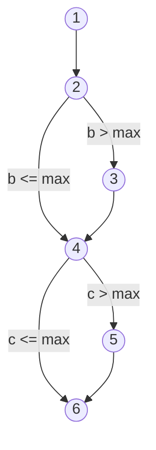

# 24ITPC302: Numerical Problems & Worked Step-by-Step Solutions
### Course: 24ITPC302 – Software Engineering (Regulations 2024)

This compendium contains complete, verified step-by-step solutions to every major quantitative and numerical problem model tested in university examinations.

---

## 🎯 NUMERICAL PROBLEM 1: White-Box Basis Path Testing & Cyclomatic Complexity

### Problem Statement:
Consider the following C function to find the maximum of three numbers:
```c
int findMax(int a, int b, int c) {
    int max = a;       // Node 1
    if (b > max) {     // Node 2 (Predicate)
        max = b;       // Node 3
    }
    if (c > max) {     // Node 4 (Predicate)
        max = c;       // Node 5
    }
    return max;        // Node 6
}
```
(i) Construct the Control Flow Graph (CFG) identifying all nodes and edges.  
(ii) Compute the Cyclomatic Complexity $V(G)$ using all three independent methods.  
(iii) Enumerate all linearly independent basis paths.  
(iv) Formulate specific test case inputs $(a, b, c)$ and expected outputs to achieve 100% path coverage.

---

### Step-by-Step Solution:

#### Step 1: Control Flow Graph (CFG) Nodes and Edges
- **Nodes ($N = 6$):**
  - Node 1: Entry, initialization (`int max = a;`)
  - Node 2: Decision 1 (`b > max`)
  - Node 3: True branch of Decision 1 (`max = b;`)
  - Node 4: Decision 2 (`c > max`)
  - Node 5: True branch of Decision 2 (`max = c;`)
  - Node 6: Return node (`return max;`)
- **Edges ($E = 7$):**
  - Edge 1: $(1 \to 2)$
  - Edge 2: $(2 \to 3)$ [Condition true: $b > max$]
  - Edge 3: $(2 \to 4)$ [Condition false: $b \le max$]
  - Edge 4: $(3 \to 4)$
  - Edge 5: $(4 \to 5)$ [Condition true: $c > max$]
  - Edge 6: $(4 \to 6)$ [Condition false: $c \le max$]
  - Edge 7: $(5 \to 6)$



#### Step 2: Cyclomatic Complexity Calculation ($V(G)$ via 3 Methods)
- **Method 1 (Edges and Nodes Formula):**
  $$V(G) = E - N + 2P$$
  Here $E = 7$, $N = 6$, and connected components $P = 1$:
  $$V(G) = 7 - 6 + 2(1) = 1 + 2 = \mathbf{3}$$

- **Method 2 (Predicate Nodes Formula):**
  $$V(G) = P' + 1$$
  Predicate nodes are nodes with out-degree $= 2$. Here, nodes 2 and 4 are predicate nodes ($P' = 2$):
  $$V(G) = 2 + 1 = \mathbf{3}$$

- **Method 3 (Enclosed Planar Regions Formula):**
  $$V(G) = R$$
  - Region 1: Enclosed by edges $(2 \to 3), (3 \to 4), (2 \to 4)$
  - Region 2: Enclosed by edges $(4 \to 5), (5 \to 6), (4 \to 6)$
  - Region 3: Unbounded external region outside the graph
  $$V(G) = 2 \text{ (inner regions)} + 1 \text{ (outer region)} = \mathbf{3}$$

*Conclusion:* All three methods independently yield $V(G) = 3$. Exactly 3 independent basis paths exist.

#### Step 3: Deriving Linearly Independent Basis Paths
- **Path 1:** $1 \to 2 \to 4 \to 6$ (Neither condition true: $a$ is max)
- **Path 2:** $1 \to 2 \to 3 \to 4 \to 6$ (First condition true, second false: $b$ is max)
- **Path 3:** $1 \to 2 \to 4 \to 5 \to 6$ (First condition false, second true: $c$ is max)

#### Step 4: Test Case Design Suite
| Test Case ID | Target Basis Path | Input $(a, b, c)$ | Expected Output | Path Executed |
| :---: | :---: | :---: | :---: | :---: |
| **TC-01** | Path 1 | $(10, 5, 2)$ | $10$ | $1 \to 2 \to 4 \to 6$ |
| **TC-02** | Path 2 | $(5, 10, 2)$ | $10$ | $1 \to 2 \to 3 \to 4 \to 6$ |
| **TC-03** | Path 3 | $(5, 2, 10)$ | $10$ | $1 \to 2 \to 4 \to 5 \to 6$ |

---

## 🎯 NUMERICAL PROBLEM 2: Function Point (FP) & Lines of Code (LOC) Sizing

### Problem Statement:
A software system for an e-commerce platform has the following functional requirements:
- External Inputs ($EI$): 20 (Simple), 10 (Average)
- External Outputs ($EO$): 15 (Average), 5 (Complex)
- External Inquiries ($EQ$): 12 (Simple), 8 (Average)
- Internal Logical Files ($ILF$): 4 (Average), 2 (Complex)
- External Interface Files ($EIF$): 3 (Average)
The 14 General System Characteristics ($F_1$ to $F_{14}$) were assessed with an average rating of 3 each.  
(i) Compute the Unadjusted Function Count ($UFC$).  
(ii) Calculate the Value Adjustment Factor ($VAF$).  
(iii) Compute the final Function Points ($FP$).  
(iv) If the application is coded in Python (average 25 LOC/FP) versus Java (53 LOC/FP), compute total estimated Lines of Code (LOC).

---

### Step-by-Step Solution:

#### Step 1: Unadjusted Function Count ($UFC$) Table
| Functional Element | Complexity | Count | Weight ($w$) | Subtotal ($\text{Count} \times w$) |
| :--- | :--- | :---: | :---: | :---: |
| **External Inputs ($EI$)** | Simple | 20 | 3 | $20 \times 3 = 60$ |
| **External Inputs ($EI$)** | Average | 10 | 4 | $10 \times 4 = 40$ |
| **External Outputs ($EO$)** | Average | 15 | 5 | $15 \times 5 = 75$ |
| **External Outputs ($EO$)** | Complex | 5 | 7 | $5 \times 7 = 35$ |
| **External Inquiries ($EQ$)** | Simple | 12 | 3 | $12 \times 3 = 36$ |
| **External Inquiries ($EQ$)** | Average | 8 | 4 | $8 \times 4 = 32$ |
| **Internal Logical Files ($ILF$)** | Average | 4 | 10 | $4 \times 10 = 40$ |
| **Internal Logical Files ($ILF$)** | Complex | 2 | 15 | $2 \times 15 = 30$ |
| **External Interface Files ($EIF$)** | Average | 3 | 7 | $3 \times 7 = 21$ |
| **Total UFC** | - | - | - | $\mathbf{UFC = 369}$ |

#### Step 2: Value Adjustment Factor ($VAF$)
Given that all 14 factors are rated 3:
$$\sum_{i=1}^{14} F_i = 14 \times 3 = 42$$
$$VAF = 0.65 + 0.01 \sum F_i = 0.65 + 0.01(42) = 0.65 + 0.42 = \mathbf{1.07}$$

#### Step 3: Final Function Points ($FP$)
$$FP = UFC \times VAF = 369 \times 1.07 = \mathbf{394.83 \approx 395 \text{ FP}}$$

#### Step 4: Sizing in Lines of Code (LOC)
- **For Python (25 LOC / FP):**
  $$\text{LOC}_{\text{Python}} = 394.83 \times 25 = 9,870.75 \approx \mathbf{9,871 \text{ LOC} \ (9.87 \text{ KLOC})}$$
- **For Java (53 LOC / FP):**
  $$\text{LOC}_{\text{Java}} = 394.83 \times 53 = 20,925.99 \approx \mathbf{20,926 \text{ LOC} \ (20.93 \text{ KLOC})}$$

---

## 🎯 NUMERICAL PROBLEM 3: Basic & Intermediate COCOMO Cost Estimation

### Problem Statement:
A software system is sized at $KLOC = 40$. Compute the development Effort ($E$ in Person-Months), Development Duration ($D$ in Months), Staff Size ($P$ in Persons), and Productivity across:
(i) Organic Mode, (ii) Semidetached Mode, and (iii) Embedded Mode.

---

### Step-by-Step Solution:

#### 1. Organic Mode
Constants: $a = 2.4, b = 1.05, c = 2.5, d = 0.38$.
- **Effort ($E$):**
  $$E = 2.4 \times (40)^{1.05} = 2.4 \times 48.089 = \mathbf{115.41 \text{ Person-Months}}$$
- **Development Time ($D$):**
  $$D = 2.5 \times (115.41)^{0.38} = 2.5 \times 6.095 = \mathbf{15.24 \text{ Months}}$$
- **Average Staff Size ($P$):**
  $$P = \frac{E}{D} = \frac{115.41}{15.24} = \mathbf{7.57 \approx 8 \text{ Persons}}$$
- **Productivity:**
  $$\text{Productivity} = \frac{40,000 \text{ LOC}}{115.41 \text{ PM}} = \mathbf{346.6 \text{ LOC / PM}}$$

#### 2. Semidetached Mode
Constants: $a = 3.0, b = 1.12, c = 2.5, d = 0.35$.
- **Effort ($E$):**
  $$E = 3.0 \times (40)^{1.12} = 3.0 \times 61.64 = \mathbf{184.92 \text{ Person-Months}}$$
- **Development Time ($D$):**
  $$D = 2.5 \times (184.92)^{0.35} = 2.5 \times 6.242 = \mathbf{15.61 \text{ Months}}$$
- **Average Staff Size ($P$):**
  $$P = \frac{184.92}{15.61} = \mathbf{11.85 \approx 12 \text{ Persons}}$$

#### 3. Embedded Mode
Constants: $a = 3.6, b = 1.20, c = 2.5, d = 0.32$.
- **Effort ($E$):**
  $$E = 3.6 \times (40)^{1.20} = 3.6 \times 82.52 = \mathbf{297.07 \text{ Person-Months}}$$
- **Development Time ($D$):**
  $$D = 2.5 \times (297.07)^{0.32} = 2.5 \times 6.183 = \mathbf{15.46 \text{ Months}}$$
- **Average Staff Size ($P$):**
  $$P = \frac{297.07}{15.46} = \mathbf{19.22 \approx 20 \text{ Persons}}$$

#### Comparative Summary Table:
| Mode | Effort ($E$) [PM] | Duration ($D$) [Months] | Staff Size ($P$) [Persons] | Productivity [LOC/PM] |
| :--- | :---: | :---: | :---: | :---: |
| **Organic** | 115.41 | 15.24 | 7.6 | 346.6 |
| **Semidetached** | 184.92 | 15.61 | 11.9 | 216.3 |
| **Embedded** | 297.07 | 15.46 | 19.2 | 134.6 |

*Engineering Insight:* Notice that while effort nearly triples from Organic (115 PM) to Embedded (297 PM) due to complexity and strict hardware interfaces, the project duration remains roughly 15 months by expanding the staff size from 8 to 20 engineers.

---

## 🎯 NUMERICAL PROBLEM 4: Earned Value Analysis (EVA) Project Health Audit

### Problem Statement:
A software development contract has a planned Budget at Completion $BAC = \$200,000$ and a planned duration of 12 months. At the end of Month 6:
- Planned Value ($PV$) = $\$100,000$
- Earned Value ($EV$) = $\$80,000$
- Actual Cost ($AC$) = $\$95,000$
(i) Compute Cost Variance ($CV$) and Schedule Variance ($SV$).  
(ii) Calculate Cost Performance Index ($CPI$) and Schedule Performance Index ($SPI$).  
(iii) Compute Estimate at Completion ($EAC$) and Estimate to Complete ($ETC$).  
(iv) Interpret the results and formulate project management recommendations.

---

### Step-by-Step Solution:

#### Step 1: Variance Calculations
- **Cost Variance ($CV$):**
  $$CV = EV - AC = 80,000 - 95,000 = \mathbf{-\$15,000}$$
  *Interpretation:* $CV < 0 \implies$ The project is **Over Budget** by $\$15,000$.
- **Schedule Variance ($SV$):**
  $$SV = EV - PV = 80,000 - 100,000 = \mathbf{-\$20,000}$$
  *Interpretation:* $SV < 0 \implies$ The project is **Behind Schedule** by $\$20,000$ worth of work.

#### Step 2: Performance Indices
- **Cost Performance Index ($CPI$):**
  $$CPI = \frac{EV}{AC} = \frac{80,000}{95,000} \approx \mathbf{0.842}$$
  *Interpretation:* For every $\$1.00$ spent, the project only delivers $\$0.842$ in earned value.
- **Schedule Performance Index ($SPI$):**
  $$SPI = \frac{EV}{PV} = \frac{80,000}{100,000} = \mathbf{0.800}$$
  *Interpretation:* The project is progressing at only $80\%$ of its scheduled pace.

#### Step 3: Projections & Forecasting ($EAC, ETC$)
- **Estimate at Completion ($EAC$):**
  $$EAC = \frac{BAC}{CPI} = \frac{200,000}{0.8421} \approx \mathbf{\$237,500}$$
  The project will cost $\$237,500$ instead of the planned $\$200,000$ (a projected cost overrun of $\$37,500$ or $18.75\%$).
- **Estimate to Complete ($ETC$):**
  $$ETC = EAC - AC = 237,500 - 95,000 = \mathbf{\$142,500}$$
  An additional $\$142,500$ is required to complete the remaining project work.

#### Step 4: Management Recommendations
1. *Scope Scrubbing:* Audit pending user stories and eliminate non-critical "gold-plating" features.
2. *Critical Path Fast-Tracking:* Reassign senior developers to bottleneck tasks on the critical path.
3. *Process Optimization:* Adopt pair programming and automate integration testing to decrease rework cycles.
